# YES ENTERPRISES — PHASE 11.1
# DETAILED PRODUCT, IMAGE & VARIANT VERIFICATION REPORT

**Project:** YES ENTERPRISES Wholesale Catalogue Website  
**Project Directory:** `D:\webpage`  
**Phase:** 11.1 — Detailed Product, Image & Variant Verification  
**Mode:** READ-ONLY ANALYSIS AND PREVIEW GENERATION  
**Report Date:** 2026-11-16  
**Status:** Verification Complete — Awaiting Owner Approval  

---

## 1. EXECUTIVE SUMMARY & OWNER DECISION APPLICATION

Following your review of the Phase 11 preliminary analysis, Phase 11.1 implements all owner decisions and provides a rigorous, deep technical audit of variants, image mapping, and catalogue structure.

### Key Owner Decisions Applied

1. **Strict Category Preservation (No 7th Category):**
   - The existing six categories (`glass-bottles`, `plastic-bottles`, `silicone-sleeve`, `ss-bottles`, `ss-sippers`, `ss-tiffin`) are preserved without alterations to their IDs, slugs, or names.
   - For the three feeding accessories/spare parts (Cap & Ring set, Honey Pacifier, and LSR Teat), they have **not** been forced into unsuitable categories. They are explicitly marked as **`UNASSIGNED — OWNER REVIEW REQUIRED`** with objective suitability notes.
2. **Glass Sipper with Handle (250 ml) Pricing Override:**
   - Single-piece price is set to **₹275.00** (`base_price_paise: 27500`) matching the authentic retail box print MRP, overriding the WhatsApp crossed-out price of ₹299.
   - Wholesale price per 100 pieces remains calculated as `₹110 × 100` = **₹11,000.00** (`expected_price_per_100_paise: 1100000`).
3. **End-to-End Technical Audit of Product Variants:**
   - A comprehensive audit of the D1 database schema, backend Cloudflare Pages Functions, and React frontend was conducted.
   - **Crucial Finding:** While a `product_variants` table exists for retail variants (`price_paise`), the platform **does not currently support wholesale per-100 pricing (`expected_price_per_100_paise`) on variants**. Detailed findings and two execution models (Model A: Safe Independent Products vs. Model B: Variant Schema Upgrade) are presented below.
4. **Visual Contact Sheets Generated:**
   - All 36 camera photographs have been organized into 9 dedicated visual contact sheet documents in [`docs/phase-11-contact-sheets/`](file:///d:/webpage/docs/phase-11-contact-sheets/INDEX.md) alongside an all-in-one browser gallery [`index.html`](file:///d:/webpage/docs/phase-11-contact-sheets/index.html).

---

## 2. TECHNICAL ASSESSMENT OF EXISTING VARIANT SUPPORT

Before grouping capacities into variants, the owner instructed us to verify whether variants are genuinely supported end-to-end across the D1 schema, backend APIs, and frontend implementation.

### Comprehensive Architectural Audit

```
┌─────────────────────────────────────────────────────────────────────────────────────────┐
│                              VARIANT CAPABILITY AUDIT MATRIX                            │
├──────────────────────────┬──────────────────────────┬───────────────────────────────────┤
│ Component                │ Current Implementation   │ Wholesale Support Status          │
├──────────────────────────┼──────────────────────────┼───────────────────────────────────┤
│ D1 Relational Schema     │ Table `product_variants` │ ⚠️ PARTIAL: Has `price_paise`, but│
│ (Migrations 0001-0006)   │ exists with SKU, title,  │ NO `expected_price_per_100_paise` │
│                          │ attributes_json, price.  │ column exists in variants table!  │
├──────────────────────────┼──────────────────────────┼───────────────────────────────────┤
│ Backend API Validation   │ validateVariantInput()   │ ❌ BROKEN FOR WHOLESALE: Ignores  │
│ (_shared/validation.js)  │ validates title & price. │ or strips expected wholesale per- │
│                          │                          │ 100 price on variant records.     │
├──────────────────────────┼──────────────────────────┼───────────────────────────────────┤
│ Public Detail API        │ Fetches active variants  │ ⚠️ PARTIAL: Returns variants, but │
│ (api/products/[slug].js) │ joined to product.       │ cannot return per-100 price.      │
├──────────────────────────┼──────────────────────────┼───────────────────────────────────┤
│ Public Listing API       │ Returns products list    │ ❌ VARIANT BLIND: Only returns    │
│ (api/products/index.js)  │ with primary image.      │ parent product price & image.     │
├──────────────────────────┼──────────────────────────┼───────────────────────────────────┤
│ Frontend Product Detail  │ Has variant button group │ ⚠️ PARTIAL: Updates single price  │
│ (ProductDetail.jsx)      │ selecting variant.       │ but wholesale per-100 pill remains│
│                          │                          │ stuck on parent product value!    │
├──────────────────────────┼──────────────────────────┼───────────────────────────────────┤
│ Gallery Image Switching  │ ImageGallery component   │ ❌ MISSING: Gallery does not      │
│ (ImageGallery.jsx)       │ renders product.images.  │ switch or filter by variant_id.   │
├──────────────────────────┼──────────────────────────┼───────────────────────────────────┤
│ Admin Product Form       │ ProductForm.jsx          │ ❌ ZERO UI: Has no input fields to│
│ (ProductForm.jsx)        │                          │ add, view, or edit variants!      │
└──────────────────────────┴──────────────────────────┴───────────────────────────────────┘
```

### Detailed Limitations Discovered

1. **Wholesale Pricing Incompatibility in Schema:**
   - In Migration `0004_add_expected_price_per_100.sql`, the column `expected_price_per_100_paise` was added **only** to the `products` table, **not** to the `product_variants` table.
   - If 150ml (₹13,500/100), 200ml (₹14,500/100), 250ml (₹15,500/100), and 300ml (₹16,500/100) are stored as variants under one parent product, the database schema physically cannot store their distinct wholesale per-100 prices.
2. **Frontend Display Inconsistency:**
   - In `src/pages/ProductDetail.jsx` (lines 378–387), the wholesale badge reads directly from `product.expected_price_per_100_paise`.
   - When a buyer clicks the "150 ml" or "300 ml" variant button, only the single piece price (`displayPrice`) updates. The wholesale per-100 badge displays the parent product's single value, misleading wholesale buyers.
3. **Admin Dashboard Hazard:**
   - `src/components/admin/ProductForm.jsx` has zero form controls for variants. Line 256 simply sends `initialData?.variants || []`. Any product edited in the admin dashboard cannot update variant prices, capacities, or SKUs.
4. **Catalogue Listing & SEO Blindness:**
   - `src/components/ui/ProductCard.jsx` and `/api/products` only display the parent product title and primary image. Wholesale buyers browsing the catalogue cannot see that multiple capacities (e.g. 500ml, 750ml, 1L) are available without clicking through.

### Strategic Recommendation: Dual-Path Resolution

To give the owner full control, we present two viable implementation pathways:

- **Path A (Current Platform Safe — Immediate Launch):**  
  Deploy capacities as distinct standalone catalogue products (e.g., `YE SS Feeding Bottle — 150 ml`, `200 ml`, `250 ml`, `300 ml`).  
  *Advantages:* 100% supported right now with zero code changes; both single price and per-100 wholesale price display accurately; each size appears in search and category filters with its own verified photograph.
- **Path B (Wholesale Variant Upgrade — Requires Phase 12 Development):**  
  Group capacities as child variants under parent records.  
  *Requires:* (1) Migration 0007 adding `expected_price_per_100_paise` to `product_variants`, (2) updating `product-validation.js` and `api/products/[slug].js`, (3) updating `ProductDetail.jsx` to dynamically update the wholesale badge on variant click, and (4) building variant management UI in `ProductForm.jsx`.

---

## 3. DETAILED PRODUCT VERIFICATION TABLE (ALL 19 PRODUCTS)

Below is the complete 16-field verification table across all 19 extracted WhatsApp products.

| # | Extracted Name | Recommended Name | Hindi Name | Category Recommendation | Original Price | Discounted Price | Single Price (INR) | Price / 100 Pcs (INR) | MOQ | Matched ID | Classification | Confidence | Notes & Uncertainties |
|---|---|---|---|---|---|---|---|---|---|---|---|---|---|
| **1** | Steel Feeding Bottle With Haindle 250 ml | YE Stainless Steel Feeding Bottle with Handles — 250 ml | YE हैंडल वाली स्टेनलेस स्टील फीडिंग बोतल — 250 ml | `ss-bottles` | ₹249.00 | ₹150.00 | ₹249.00 | ₹15,000.00 | NULL | `prod-17` | Existing Update | 100% | Body engraved "YE SS 304". Scale etched 50-250 ml. |
| **2** | STEEL FEEDING BOTTLE PREMIUM 250 ML | YE Premium Stainless Steel Feeding Bottle — 250 ml | YE प्रीमियम स्टेनलेस स्टील फीडिंग बोतल — 250 ml | `ss-bottles` | ₹599.00 | ₹199.00 | ₹599.00 | ₹19,900.00 | NULL | None | New / Variant | 100% | Box barcode `8909639003227`, MRP ₹599. Contoured body. |
| **3** | STEEL FEEDING BOTTLE PREMIUM 200 ML | YE Premium Stainless Steel Feeding Bottle – 200 ml | YE प्रीमियम स्टेनलेस स्टील फीडिंग बोतल – 200 ml | `ss-bottles` | ₹549.00 | ₹190.00 | ₹549.00 | ₹19,000.00 | NULL | `prod-19` | Existing Update | 100% | Box barcode `8909639003258`, MRP ₹549. Contoured body. |
| **4** | Glash Sipper With Haindle 250 ml | YE Glass Sipper with Handle — 250 ml | YE हैंडल वाला ग्लास सिपर — 250 ml | `silicone-sleeve` | ₹299.00 | ₹110.00 | **₹275.00** | ₹11,000.00 | NULL | None | New Product | 100% | **Owner Decision:** Single price set to box MRP ₹275 (not ₹299). |
| **5** | Glash Sipper Premium 250 ml | Silicone Sleeve Feeding Bottle — 250 ml | सिलिकॉन स्लीव फीडिंग बोतल — 250 ml | `silicone-sleeve` | ₹275.00 | ₹99.00 | ₹275.00 | ₹9,900.00 | NULL | `prod-05` | Existing Update | 100% | Box front confirms MRP ₹275, 250 ml. Royal blue star sleeve. |
| **6** | Glash Sipper Premium 120 ml | Silicone Sleeve Feeding Bottle — 120 ml | सिलिकॉन स्लीव फीडिंग बोतल — 120 ml | `silicone-sleeve` | ₹249.00 | ₹95.00 | ₹249.00 | ₹9,500.00 | NULL | `prod-07` | Existing Update | 100% | Compact 120 ml. Blue star sleeve (no handles). |
| **7** | Glash Feeding Bottle 60 ml | Glass Feeding Bottle — 60 ml (Pink) | कांच की फीडिंग बोतल — 60 ml (गुलाबी) | `glass-bottles` | ₹149.00 | ₹65.00 | ₹149.00 | ₹6,500.00 | NULL | `prod-02` | Existing Update | 100% | Moon Baby box offer print ₹160; WhatsApp original ₹149. |
| **8** | GLASH Feeding Bottle 250 ml | Glass Feeding Bottle — 250 ml (Blue) | कांच की फीडिंग बोतल — 250 ml (नीली) | `glass-bottles` | ₹240.00 | ₹85.00 | ₹240.00 | ₹8,500.00 | NULL | `prod-01` | Existing Update | 100% | Moon Baby printed cartoon glass bottle. Replaces test price. |
| **9** | Bony Cup & Cape | Feeding Bottle Replacement Cap & Ring Set | फीडिंग बोतल रिप्लेसमेंट कैप एवं कॉलर रिंग सेट | **UNASSIGNED — OWNER REVIEW** (Fallback: `plastic-bottles`) | ₹10.00 | ₹6.50 | ₹10.00 | ₹650.00 | NULL | None | Review / Accessory | 90% | Replacement dome cap + collar ring. Spare part, not a bottle. |
| **10** | Honey Nipple | Silicone Honey Pacifier / Soother | सिलिकॉन हनी पैसिफायर / सूथर | **UNASSIGNED — OWNER REVIEW** (Fallback: `silicone-sleeve`) | ₹10.00 | ₹6.90 | ₹10.00 | ₹690.00 | NULL | None | Review / Accessory | 90% | Infant pacifier/soother. Display jar of 25+5 NOS (MRP ₹750). |
| **11** | Nipple Liquid Silicone Rubber - LSR | Liquid Silicone Rubber (LSR) Feeding Nipple / Teat | लिक्विड सिलिकॉन रबर (LSR) फीडिंग निप्पल / टीट | **UNASSIGNED — OWNER REVIEW** (Fallback: `silicone-sleeve`) | ₹10.00 | ₹4.60 | ₹10.00 | ₹460.00 | NULL | None | Review / Accessory | 90% | Replacement teat engraved "Liquid Silicone Nipple". Anti-colic ring. |
| **12** | Steel Veccum Cola Water Bottle 500 ml | Stainless Steel Vacuum Cola Water Bottle — 500 ml | स्टेनलेस स्टील वैक्यूम कोला पानी की बोतल — 500 ml | `ss-sippers` | ₹599.00 | ₹349.00 | ₹599.00 | ₹34,900.00 | NULL | `prod-16` | Existing Update | 100% | Double-wall vacuum insulated, 24h hot & cold stated. |
| **13** | Steel Veccum Cola Water Bottle 750 ml | Stainless Steel Vacuum Cola Water Bottle — 750 ml | स्टेनलेस स्टील वैक्यूम कोला पानी की बोतल — 750 ml | `ss-sippers` | ₹649.00 | ₹365.00 | ₹649.00 | ₹36,500.00 | NULL | None | New / Variant | 100% | Shares product photograph with 500ml and 1L models. |
| **14** | Steel Veccum Cola Water Bottle 1 Litr | Stainless Steel Vacuum Cola Water Bottle — 1 Litre | स्टेनलेस स्टील वैक्यूम कोला पानी की बोतल — 1 लीटर | `ss-sippers` | ₹799.00 | ₹399.00 | ₹799.00 | ₹39,900.00 | NULL | None | New / Variant | 100% | Jointless double-wall construction, 24h hot & cold stated. |
| **15** | Steel Lunch Box premium quality | Stainless Steel Tiffin Box Set | स्टेनलेस स्टील टिफिन बॉक्स सेट | `ss-tiffin` | ₹450.00 | ₹295.00 | ₹450.00 | ₹29,500.00 | NULL | `prod-15` | Existing Update | 100% | 2-piece set with inner container & spoon. Silicone leak seal. |
| **16** | Steel Feeding Bottle [300 ml] | SS 304 Stainless Steel Feeding Bottle — 300 ml | SS 304 स्टेनलेस स्टील फीडिंग बोतल — 300 ml | `ss-bottles` | ₹499.00 | ₹165.00 | ₹499.00 | ₹16,500.00 | NULL | `prod-14` | Existing Update | 100% | Straight cylindrical body, engraved scale up to 300 ml Aprox. |
| **17** | Steel Feeding Bottle 250 ml | SS 304 Stainless Steel Feeding Bottle — 250 ml | SS 304 स्टेनलेस स्टील फीडिंग बोतल — 250 ml | `ss-bottles` | ₹449.00 | ₹155.00 | ₹449.00 | ₹15,500.00 | NULL | None | New / Variant | 100% | Straight cylindrical body. Distinct from contoured bottle. |
| **18** | Steel Feeding Bottle 200 ml | SS 304 Stainless Steel Feeding Bottle — 200 ml | SS 304 स्टेनलेस स्टील फीडिंग बोतल — 200 ml | `ss-bottles` | ₹399.00 | ₹145.00 | ₹399.00 | ₹14,500.00 | NULL | None | New / Variant | 100% | Straight cylindrical body. Distinct from contoured prod-19. |
| **19** | Steel Feeding Bottle 150 ML | SS 304 Stainless Steel Feeding Bottle — 150 ml | SS 304 स्टेनलेस स्टील फीडिंग बोतल — 150 ml | `ss-bottles` | ₹350.00 | ₹135.00 | ₹350.00 | ₹13,500.00 | NULL | None | New / Variant | 100% | Straight cylindrical body. Seller notes individual packing. |

---

## 4. PROPOSED VARIANT HIERARCHY & MAPPING TABLE

In accordance with owner instructions to group related capacities, below is the exact proposed hierarchy structure:

```mermaid
graph TD
    classDef parent fill:#1e3a8a,stroke:#0f172a,stroke-width:2px,color:#fff;
    classDef variant fill:#f8fafc,stroke:#94a3b8,stroke-width:1px,color:#0f172a;

    P1["Parent: prod-14<br/>SS 304 Straight Feeding Bottle"]:::parent
    P1 --> V1_1["Variant: 150 ml<br/>₹350 / ₹13,500 per 100"]:::variant
    P1 --> V1_2["Variant: 200 ml<br/>₹399 / ₹14,500 per 100"]:::variant
    P1 --> V1_3["Variant: 250 ml<br/>₹449 / ₹15,500 per 100"]:::variant
    P1 --> V1_4["Variant: 300 ml<br/>₹499 / ₹16,500 per 100"]:::variant

    P2["Parent: prod-19<br/>YE Premium Contoured SS Bottle"]:::parent
    P2 --> V2_1["Variant: 200 ml<br/>₹549 / ₹19,000 per 100"]:::variant
    P2 --> V2_2["Variant: 250 ml<br/>₹599 / ₹19,900 per 100"]:::variant

    P3["Parent: prod-16<br/>SS Vacuum Cola Water Bottle"]:::parent
    P3 --> V3_1["Variant: 500 ml<br/>₹599 / ₹34,900 per 100"]:::variant
    P3 --> V3_2["Variant: 750 ml<br/>₹649 / ₹36,500 per 100"]:::variant
    P3 --> V3_3["Variant: 1 Litre<br/>₹799 / ₹39,900 per 100"]:::variant
```



### Variant Group Mapping Table

| Parent Product Name | Existing ID | Category | Child Variant Capacity | Single Price (INR / Paise) | Price / 100 Pcs (INR / Paise) | SKU | Primary Matched Image | Current D1 Feasibility |
|---|---|---|---|---|---|---|---|---|
| **SS 304 Straight Feeding Bottle** | `prod-14` | `ss-bottles` | **150 ml** | ₹350 (`35000`) | ₹13,500 (`1350000`) | `YE-SS-STR-150` | `...9.28.42 AM.jpeg` | Requires Schema & UI Migration |
| | | | **200 ml** | ₹399 (`39900`) | ₹14,500 (`1450000`) | `YE-SS-STR-200` | `...9.28.42 AM.jpeg` | Requires Schema & UI Migration |
| | | | **250 ml** | ₹449 (`44900`) | ₹15,500 (`1550000`) | `YE-SS-STR-250` | `...9.28.42 AM.jpeg` | Requires Schema & UI Migration |
| | | | **300 ml** | ₹499 (`49900`) | ₹16,500 (`1650000`) | `YE-SS-STR-300` | `...9.28.41 AM (2).jpeg` | Requires Schema & UI Migration |
| **YE Premium Contoured SS Bottle** | `prod-19` | `ss-bottles` | **200 ml** | ₹549 (`54900`) | ₹19,000 (`1900000`) | `YE-SS-PRM-200` | `...9.28.25 AM (3).jpeg` | Requires Schema & UI Migration |
| | | | **250 ml** | ₹599 (`59900`) | ₹19,900 (`1990000`) | `YE-SS-PRM-250` | `...9.28.24 AM (2).jpeg` | Requires Schema & UI Migration |
| **SS Vacuum Cola Water Bottle** | `prod-16` | `ss-sippers` | **500 ml** | ₹599 (`59900`) | ₹34,900 (`3490000`) | `YE-COLA-500` | `...9.28.39 AM.jpeg` | Requires Schema & UI Migration |
| | | | **750 ml** | ₹649 (`64900`) | ₹36,500 (`3650000`) | `YE-COLA-750` | `...9.28.39 AM.jpeg` | Requires Schema & UI Migration |
| | | | **1 Litre** | ₹799 (`79900`) | ₹39,900 (`3990000`) | `YE-COLA-1000` | `...9.28.39 AM.jpeg` | Requires Schema & UI Migration |

---

## 5. IMAGE VERIFICATION & CONTACT SHEETS MAPPING

All **36 product photographs** were audited and assigned to one of 9 dedicated visual contact sheets generated in `docs/phase-11-contact-sheets/`.

### Photographic Inventory

| Filename | Product Group | Role | Dimensions | Notes / Shared Status |
|---|---|---|---|---|
| `WhatsApp Image 2026-11-16 at 9.28.23 AM (1).jpeg` | Group 1 (`prod-17`) | Gallery | 1210 × 1599 | Rear view showing etched 50-250 ml scale |
| `WhatsApp Image 2026-11-16 at 9.28.23 AM (2).jpeg` | Group 1 (`prod-17`) | Gallery | 1206 × 1601 | Laser engraved "YE SS 304" logo closeup |
| `WhatsApp Image 2026-11-16 at 9.28.23 AM (3).jpeg` | Group 1 (`prod-17`) | **Primary** | 1212 × 1599 | Best front view, assembled pink handles |
| `WhatsApp Image 2026-11-16 at 9.28.24 AM (2).jpeg` | Group 2 (Item 2) | **Primary (250ml)** | 1260 × 1651 | Contoured wide-neck bottle assembled |
| `WhatsApp Image 2026-11-16 at 9.28.25 AM (1).jpeg` | Group 2 (`prod-19`) | Gallery | 1214 × 1599 | Bottle with cap off next to box MRP ₹549 |
| `WhatsApp Image 2026-11-16 at 9.28.25 AM (3).jpeg` | Group 2 (`prod-19`) | **Primary (200ml)** | 1206 × 1601 | Clear front view showing YE SS 304 engraving |
| `WhatsApp Image 2026-11-16 at 9.28.25 AM.jpeg` | Group 2 (Item 2) | Gallery | 1212 × 1598 | 250ml bottle with box MRP ₹599, barcode `8909639003227` |
| `WhatsApp Image 2026-11-16 at 9.28.26 AM (1).jpeg` | Group 2 (`prod-19`) | Gallery | 1208 × 1600 | Box side showing barcode `8909639003258` |
| `WhatsApp Image 2026-11-16 at 9.28.26 AM.jpeg` | Group 2 (`prod-19`) | Gallery | 1206 × 1601 | Assembled bottle with retail box |
| `WhatsApp Image 2026-11-16 at 9.28.27 AM (1).jpeg` | Group 3 (Item 4) | Gallery | 1218 × 1599 | Retail box side view with usage details |
| `WhatsApp Image 2026-11-16 at 9.28.27 AM (2).jpeg` | Group 3 (Item 4) | Gallery | 1260 × 1635 | Retail box back panel with barcode |
| `WhatsApp Image 2026-11-16 at 9.28.27 AM.jpeg` | Group 3 (Item 4) | Gallery | 1206 × 1599 | Retail box front: "Glass Sipper With Handle 250 ml", MRP ₹275 |
| `WhatsApp Image 2026-11-16 at 9.28.28 AM (1).jpeg` | Group 3 (Item 4) | **Primary** | 1206 × 1599 | Assembled turquoise star sleeve bottle with twin handles |
| `WhatsApp Image 2026-11-16 at 9.28.28 AM (3).jpeg` | Group 4 (`prod-05`) | Gallery | 1208 × 1600 | Box front: "Glass Sipper Premium 250 ml", MRP ₹275 |
| `WhatsApp Image 2026-11-16 at 9.28.28 AM.jpeg` | Group 4 (`prod-05`) | Gallery | 1212 × 1599 | Box side panel |
| `WhatsApp Image 2026-11-16 at 9.28.29 AM (1).jpeg` | Group 4 (`prod-05`) | **Primary (250ml)** | 1202 × 1600 | Assembled blue silicone star sleeve (no handles) |
| `WhatsApp Image 2026-11-16 at 9.28.29 AM (2).jpeg` | Group 4 (`prod-05`) | Gallery | 1210 × 1600 | Disassembled 250ml components |
| `WhatsApp Image 2026-11-16 at 9.28.30 AM (2).jpeg` | Group 4 (`prod-07`) | **Primary (120ml)** | 1210 × 1598 | Assembled compact 120ml blue star sleeve bottle |
| `WhatsApp Image 2026-11-16 at 9.28.31 AM (2).jpeg` | Group 4 (`prod-07`) | Gallery | 1208 × 1600 | Disassembled 120ml components |
| `WhatsApp Image 2026-11-16 at 9.28.31 AM.jpeg` | Group 4 (`prod-07`) | Gallery | 1204 × 1600 | Box front: "Glass Sipper Premium 120 ml" |
| `WhatsApp Image 2026-11-16 at 9.28.32 AM.jpeg` | Group 4 (`prod-07`) | Gallery | 1210 × 1600 | Box back panel with barcode |
| `WhatsApp Image 2026-11-16 at 9.28.33 AM (1).jpeg` | Group 5 (`prod-02`) | **Primary (60ml)** | 1198 × 1600 | Pink collar 60ml printed glass bottle |
| `WhatsApp Image 2026-11-16 at 9.28.33 AM (2).jpeg` | Group 5 (`prod-02`) | Gallery | 1212 × 1598 | 60ml bottle next to Moon Baby box |
| `WhatsApp Image 2026-11-16 at 9.28.34 AM (1).jpeg` | Group 5 (`prod-01`) | **Primary (250ml)** | 1206 × 1599 | Blue collar 250ml printed glass bottle front |
| `WhatsApp Image 2026-11-16 at 9.28.34 AM (2).jpeg` | Group 5 (`prod-01`) | Gallery | 1204 × 1600 | 250ml bottle next to Moon Baby 250ml box |
| `WhatsApp Image 2026-11-16 at 9.28.35 AM (2).jpeg` | Group 6 (Item 9) | **Primary (Cap & Ring)** | 1260 × 929 | Translucent dome cap and blue collar ring |
| `WhatsApp Image 2026-11-16 at 9.28.36 AM (2).jpeg` | Group 6 (Item 10) | **Primary (Pacifier)** | 1206 × 1601 | Individually wrapped soft silicone honey pacifier |
| `WhatsApp Image 2026-11-16 at 9.28.37 AM (2).jpeg` | Group 6 (Item 11) | **Primary (Teat)** | 1214 × 1599 | Upright view of LSR silicone feeding teat |
| `WhatsApp Image 2026-11-16 at 9.28.37 AM.jpeg` | Group 6 (Item 10) | Gallery | 1206 × 1599 | Display jar of 25+5 NOS pacifiers (MRP ₹750) |
| `WhatsApp Image 2026-11-16 at 9.28.38 AM (1).jpeg` | Group 6 (Item 11) | Gallery | 1260 × 1648 | Angle view of LSR silicone teat |
| `WhatsApp Image 2026-11-16 at 9.28.38 AM.jpeg` | Group 6 (Item 11) | Gallery | 1260 × 1523 | Base view showing etched "Liquid Silicone Nipple" |
| `WhatsApp Image 2026-11-16 at 9.28.39 AM.jpeg` | Group 7 (Items 12, 13, 14) | **Primary (Shared)** | 1260 × 1641 | Brushed stainless cola bottle (Shared by 500ml/750ml/1L) |
| `WhatsApp Image 2026-11-16 at 9.28.40 AM (2).jpeg` | Group 8 (`prod-15`) | **Primary** | 1260 × 828 | Closed stainless lunchbox with turquoise lid & inner box |
| `WhatsApp Image 2026-11-16 at 9.28.41 AM (2).jpeg` | Group 9 (Items 16-19) | **Primary (300ml)** | 1260 × 1458 | Straight SS bottle showing etched scale up to 300 ml |
| `WhatsApp Image 2026-11-16 at 9.28.41 AM.jpeg` | Group 8 (`prod-15`) | Gallery | 1260 × 825 | Open lunch box with food and inner salad box |
| `WhatsApp Image 2026-11-16 at 9.28.42 AM.jpeg` | Group 9 (Items 16-19) | **Primary (150-250ml)** | 1260 × 1461 | Straight SS bottle showing laser engraved "YE SS 304" |

### Contact Sheet Links

- [Group 1: SS Feeding Bottle with Handles (250 ml)](file:///d:/webpage/docs/phase-11-contact-sheets/group-1-ss-handled-feeding-bottle.md)
- [Group 2: Premium Contoured SS Feeding Bottles (200 & 250 ml)](file:///d:/webpage/docs/phase-11-contact-sheets/group-2-ss-premium-contoured-bottles.md)
- [Group 3: Glass Sipper with Handle & Silicone Star Sleeve (250 ml)](file:///d:/webpage/docs/phase-11-contact-sheets/group-3-glass-sipper-with-handle.md)
- [Group 4: Premium Glass Sippers with Star Sleeve — Handle-less (120 & 250 ml)](file:///d:/webpage/docs/phase-11-contact-sheets/group-4-glass-sipper-premium-star-sleeve.md)
- [Group 5: Traditional Printed Glass Feeding Bottles (60 & 250 ml)](file:///d:/webpage/docs/phase-11-contact-sheets/group-5-glass-printed-bottles.md)
- [Group 6: Feeding Accessories & Spares (Cap & Ring, Pacifier, LSR Teat)](file:///d:/webpage/docs/phase-11-contact-sheets/group-6-feeding-accessories.md)
- [Group 7: SS Vacuum Cola Water Bottles (500 ml, 750 ml, 1 Litre)](file:///d:/webpage/docs/phase-11-contact-sheets/group-7-ss-vacuum-cola-bottles.md)
- [Group 8: Stainless Steel Lunch Box Set](file:///d:/webpage/docs/phase-11-contact-sheets/group-8-ss-lunch-box.md)
- [Group 9: Straight Profile SS 304 Feeding Bottles (150, 200, 250, 300 ml)](file:///d:/webpage/docs/phase-11-contact-sheets/group-9-ss-straight-feeding-bottles.md)

---

## 6. EXISTING VS. NEW PRODUCT COMPARISON & DATABASE PRESERVATION

The existing local D1 database contains 17 catalogued products (`prod-01` through `prod-19`).

### Field-by-Field Impact on Existing Records

| Database ID | Product Name | Proposed Action | Current `base_price_paise` | New `base_price_paise` | Current `expected_price_per_100_paise` | New `expected_price_per_100_paise` | Image Updates |
|---|---|---|---|---|---|---|---|
| `prod-01` | Glass Feeding Bottle — 250 ml (Blue) | **Update Pricing & Gallery** | 5000 (test) | **24000** (₹240) | NULL | **850000** (₹8,500) | Attach 2 verified Moon Baby photos |
| `prod-02` | Glass Feeding Bottle — 60 ml (Pink) | **Update Pricing & Gallery** | NULL | **14900** (₹149) | NULL | **650000** (₹6,500) | Attach 2 verified Moon Baby photos |
| `prod-03` | Plastic Feeding Bottle — 125 ml (Teal) | **Preserve Baseline** | NULL | Unchanged | NULL | Unchanged | Retain contact-for-pricing |
| `prod-04` | Plastic Feeding Bottle — 120 ml with Handles | **Preserve Baseline** | NULL | Unchanged | NULL | Unchanged | Retain contact-for-pricing |
| `prod-05` | Silicone Sleeve Feeding Bottle — 250 ml | **Update Pricing & Gallery** | NULL | **27500** (₹275) | NULL | **990000** (₹9,900) | Attach 4 verified star-sleeve photos |
| `prod-06` | Plastic Feeding Bottle — 120 ml (Red) | **Preserve Baseline** | NULL | Unchanged | NULL | Unchanged | Retain contact-for-pricing |
| `prod-07` | Silicone Sleeve Feeding Bottle — 120 ml | **Update Pricing & Gallery** | NULL | **24900** (₹249) | NULL | **950000** (₹9,500) | Attach 4 verified star-sleeve photos |
| `prod-08` | Glass Feeding Bottle — 250 ml (Red) | **Preserve Baseline** | NULL | Unchanged | NULL | Unchanged | Retain contact-for-pricing |
| `prod-09` | Plastic Feeding Bottle — 250 ml (Red) | **Preserve Baseline** | NULL | Unchanged | NULL | Unchanged | Retain contact-for-pricing |
| `prod-11` | Glass Feeding Bottle — 120 ml (Blue) | **Preserve Baseline** | NULL | Unchanged | NULL | Unchanged | Retain contact-for-pricing |
| `prod-13` | Plastic Feeding Bottle — 250 ml with Handles | **Preserve Baseline** | NULL | Unchanged | NULL | Unchanged | Retain contact-for-pricing |
| `prod-14` | SS 304 Stainless Steel Feeding Bottle | **Update Pricing & Gallery** | NULL | **49900** (₹499) | NULL | **1650000** (₹16,500) | Attach 2 straight SS photos |
| `prod-15` | Stainless Steel Tiffin Box Set | **Update Pricing & Gallery** | NULL | **45000** (₹450) | NULL | **2950000** (₹29,500) | Attach 2 verified lunchbox photos |
| `prod-16` | Stainless Steel Vacuum Sipper | **Update Pricing & Category** | NULL | **59900** (₹599) | NULL | **3490000** (₹34,900) | Fix category to `ss-sippers`, attach photo |
| `prod-17` | YE SS Feeding Bottle with Handles | **Update Pricing & Gallery** | NULL | **24900** (₹249) | NULL | **1500000** (₹15,000) | Attach 3 verified handled SS photos |
| `prod-18` | YE Glass Sipper with Handle – 120 ml | **Preserve Baseline** | NULL | Unchanged | NULL | Unchanged | Retain contact-for-pricing |
| `prod-19` | YE Premium SS Feeding Bottle – 200 ml | **Update Pricing & Gallery** | NULL | **54900** (₹549) | NULL | **1900000** (₹19,000) | Attach 4 verified contoured SS photos |

---

## 7. DECISIONS REQUIRING OWNER CONFIRMATION BEFORE IMPORT

To prepare the migration script and import sequence, please confirm your preferred direction on:

### Decision 1: Execution Architecture for Related Capacities
- **Option 1 (Recommended for Immediate Launch):** Import the new capacities (150ml, 200ml, 250ml straight SS bottles; 750ml, 1L vacuum cola bottles) as **distinct catalogue products**. This allows launching immediately with 100% accurate per-100 wholesale pricing visible on every card and page, without needing database migrations or frontend rewrites.
- **Option 2 (Variant Architecture Upgrade):** Proceed with grouping capacities into child variants. This will require executing a schema migration (`0007_add_variant_wholesale_pricing.sql`), updating Cloudflare Pages backend functions, and enhancing `ProductDetail.jsx` and `ProductForm.jsx` to support variant wholesale pricing.

### Decision 2: Category Placement for the 3 Accessories
Because creating a 7th category was declined, please decide how to handle:
- **Item 9 (Bottle Cap & Ring):**
  - *Choice A:* Assign to `plastic-bottles` (closest functional and material fit).
  - *Choice B:* Leave unassigned / hide from public catalogue until an accessories section is introduced.
- **Items 10 & 11 (Honey Pacifier & LSR Teat):**
  - *Choice A:* Assign to `silicone-sleeve` (since they are 100% silicone feeding accessories).
  - *Choice B:* Leave unassigned / hide from public catalogue until an accessories section is introduced.

---

> [!NOTE]
> **Strict Read-Only Verification Guarantee:**  
> In accordance with Phase 11.1 guidelines, **zero database records were altered**, **zero Cloudflare R2 uploads were executed**, and **zero code changes were committed**. The homepage heading (`Feeding Bottles, Water Bottles & Stainless Steel Tiffins`) remains strictly preserved.
> 
> I await your explicit approval and decision on the options above to generate the migration and commence the import.
