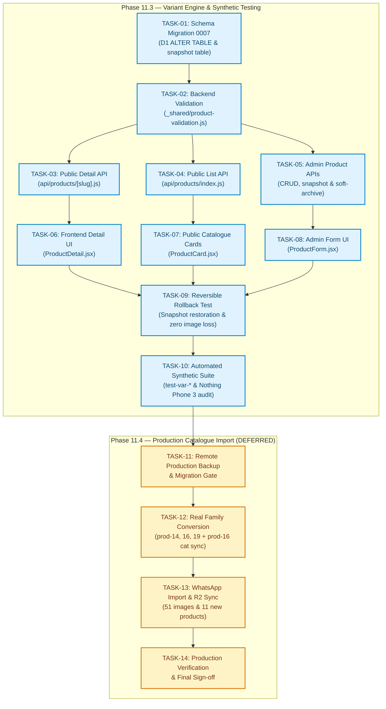

# YES ENTERPRISES — PHASE 11.2
# PRODUCT VARIANT SYSTEM: IMPLEMENTATION CHECKLIST

**Project:** YES ENTERPRISES Wholesale Catalogue Website  
**Project Directory:** `D:\webpage`  
**Phase:** 11.2 — Variant System Technical Design  
**Document:** Ordered Implementation Checklist & Acceptance Criteria  
**Status:** Updated with Actual Variant Status Schema (`status IN ('active', 'archived')`), Reversible Image Rollback, Verified Snapshot Storage & Rollback Boundaries  

---

## 1. PHASE SCOPE & ROLLBACK BOUNDARIES

To ensure zero risk to existing catalogue data, the rollout and rollback operations are partitioned into strict boundaries:

```
┌──────────────────────────────────────────────────────────────────────────────────┐
│ BOUNDARY 1: IN-FLIGHT / FAILED CONVERSION (ATOMIC DATABASE BATCH)                │
│ • Execution Scope: During conversion execution in db.batch([stmt1, stmt2...]).   │
│ • Behavior: If any single statement fails, D1 automatically aborts and rolls     │
│   back the entire transaction. Zero partial data commits.                        │
│ • Recovery: Automatic native engine rollback. Zero manual intervention needed.  │
└──────────────────────────────────────────────────────────────────────────────────┘
                                         │
                                         ▼
┌──────────────────────────────────────────────────────────────────────────────────┐
│ BOUNDARY 2: COMMITTED PRODUCT CONVERSION REVERSAL (PRODUCT-LEVEL SCOPE)          │
│ • Execution Scope: A previously committed variable product is reverted to simple.│
│ • Snapshot Source: product_conversion_snapshots table in D1.                     │
│ • Execution: Atomic db.batch() restoring parent fields from snapshot, setting   │
│   status = 'archived' on child variants, and leaving product_images untouched.   │
│ • Reversibility: Full. Re-activating variants immediately restores complete state│
└──────────────────────────────────────────────────────────────────────────────────┘
                                         │
                                         ▼
┌──────────────────────────────────────────────────────────────────────────────────┐
│ BOUNDARY 3: SCHEMA MIGRATION ROLLBACK (DATABASE-LEVEL SCOPE)                     │
│ • Execution Scope: Reverting schema migration 0007 on Cloudflare D1.             │
│ • Tool: External verified SQL backup dump (wrangler d1 export).                  │
│ • Reality: D1 does not support automatic down-migrations. Rollback requires      │
│   restoring from the pre-migration dump file taken prior to migration.           │
└──────────────────────────────────────────────────────────────────────────────────┘
```

---

## 2. TASK DEPENDENCY GRAPH



---

## 3. PHASE 11.3 — ORDERED IMPLEMENTATION CHECKLIST

### Stage 1: Database & Backend Foundations

- [ ] **TASK-01: Create & Verify Schema Migration `0007_add_variant_wholesale_pricing.sql`**
  - **Prerequisites:** Verified that migration `0006_add_phase12_new_products.sql` is committed and recorded in local `d1_migrations`. Next migration number is strictly `0007`.
  - **File:** `migrations/0007_add_variant_wholesale_pricing.sql`
  - **Target Changes:**
    ```sql
    -- 1. Add wholesale pricing and min order quantity to product_variants
    ALTER TABLE product_variants ADD COLUMN expected_price_per_100_paise INTEGER DEFAULT NULL;
    ALTER TABLE product_variants ADD COLUMN min_order_quantity INTEGER DEFAULT NULL;

    -- 2. Create index for fast active variant price range aggregation
    CREATE INDEX IF NOT EXISTS idx_product_variants_pricing
      ON product_variants(product_id, status, price_paise, expected_price_per_100_paise);

    -- 3. Dedicated pre-conversion snapshot table for safe rollback
    CREATE TABLE IF NOT EXISTS product_conversion_snapshots (
        id TEXT PRIMARY KEY,
        product_id TEXT NOT NULL REFERENCES products(id) ON DELETE CASCADE,
        snapshot_timestamp DATETIME NOT NULL DEFAULT CURRENT_TIMESTAMP,
        converted_by TEXT NOT NULL,
        baseline_base_price_paise INTEGER,
        baseline_compare_at_price_paise INTEGER,
        baseline_expected_price_per_100_paise INTEGER,
        baseline_min_order_quantity INTEGER,
        baseline_sku TEXT,
        baseline_has_variants BOOLEAN NOT NULL DEFAULT 0,
        baseline_images_json TEXT NOT NULL DEFAULT '[]',
        status TEXT NOT NULL DEFAULT 'active' CHECK(status IN ('active', 'restored', 'superseded'))
    );
    CREATE INDEX IF NOT EXISTS idx_snapshots_product ON product_conversion_snapshots(product_id);
    ```
  - **Acceptance Criteria:**
    - Migration executes cleanly on local D1 emulator without errors.
    - `PRAGMA table_info(product_variants)` confirms both new columns exist with `INTEGER` type and `NULL` defaults.
    - `PRAGMA table_info(product_conversion_snapshots)` confirms dedicated snapshot table exists.
    - Existing simple product records and foreign keys remain 100% unaffected.
    - Migration is NOT applied to remote production D1 during Phase 11.3.

- [ ] **TASK-02: Update Backend Validation in `functions/_shared/product-validation.js`**
  - **Prerequisites:** TASK-01
  - **File:** `functions/_shared/product-validation.js`
  - **Target Changes:**
    - Update `validateVariantInput(variant)`:
      - `title`: required string, 1–100 characters.
      - `title_hi`: optional string, max 100 characters.
      - `price_paise`: required integer, `>= 0`, `<= 100000000` (max ₹10 Lakh).
      - `expected_price_per_100_paise`: optional nullable integer, `>= 0`, `<= 500000000` (max ₹50 Lakh).
      - `min_order_quantity`: optional nullable integer, `>= 1` or `null`. (Explicit: per-100 wholesale pricing does NOT enforce `min_order_quantity = 100`).
      - `status`: optional string, must be `'active'` or `'archived'` (default `'active'`). **Note: `is_active` does NOT exist in the schema and must not be used.**
      - `sort_order`: optional non-negative integer (default `0`).
    - Update `validateProductInput(data)`:
      - When `has_variants === true || has_variants === 1`, require `variants` array with at least one variant.
      - Enforce integer validation across all variant price fields.
  - **Acceptance Criteria:**
    - Rejects negative prices, non-integer numbers (e.g. `299.50`), and out-of-range values with HTTP 400.
    - Rejects invalid `status` values (e.g. `draft`, `inactive`, or boolean). Accepts strictly `'active'` or `'archived'`.
    - Rejects invalid `min_order_quantity` (`< 1` or decimal). Accepts `null` or `undefined`.
    - Returns sanitized, type-coerced variant objects ready for SQL binding.

- [ ] **TASK-03: Update Public Detail API in `functions/api/products/[slug].js`**
  - **Prerequisites:** TASK-01, TASK-02
  - **File:** `functions/api/products/[slug].js`
  - **Target Changes:**
    - Modify SQL variant query to fetch active variants using the actual schema status column:
      ```sql
      SELECT id, product_id, sku, title, title_hi, price_paise, 
             compare_at_price_paise, expected_price_per_100_paise, 
             min_order_quantity, status, sort_order
      FROM product_variants 
      WHERE product_id = ? AND status = 'active'
      ORDER BY sort_order ASC, price_paise ASC, id ASC;
      ```
    - Ensure inactive/archived variants (`status = 'archived'`) are excluded from public responses.
    - Fetch and associate variant images (`product_images.variant_id`).
  - **Acceptance Criteria:**
    - Public response contains `variants` array with complete wholesale pricing data.
    - Simple products continue returning `variants: []` and standard parent pricing fields without regression.
    - Archived variants are omitted from public payload.

- [ ] **TASK-04: Update Public List API in `functions/api/products/index.js`**
  - **Prerequisites:** TASK-01, TASK-02
  - **File:** `functions/api/products/index.js`
  - **Target Changes:**
    - Add subqueries for active variant aggregates using `status = 'active'`:
      - `min_variant_price_paise`: lowest `price_paise` among variants where `status = 'active'`.
      - `max_variant_price_paise`: highest `price_paise` among variants where `status = 'active'`.
      - `min_variant_expected_price_100_paise`: lowest per-100 wholesale price among variants where `status = 'active'`.
      - `variants_count`: count of variants where `status = 'active'`.
      - `variant_capacities_summary`: formatted string of variant titles (`150 ml, 200 ml, 250 ml, 300 ml`).
  - **Acceptance Criteria:**
    - GET `/api/products` provides starting prices (`min_variant_price_paise`) and available capacities for variable products.
    - Response time remains < 50ms; pagination, category filters, and sorting continue functioning identically.
    - Simple products have `min_variant_price_paise = NULL` and use parent `base_price_paise`.

- [ ] **TASK-05: Update Admin Product APIs (`functions/api/admin/products/`)**
  - **Prerequisites:** TASK-01, TASK-02
  - **Files:**
    - `functions/api/admin/products/[id].js`
    - `functions/api/admin/products/index.js`
    - `functions/api/admin/products/duplicate.js`
  - **Target Changes:**
    - Atomic transaction: Insert/update product parent fields, upsert variants with `expected_price_per_100_paise` and `min_order_quantity`.
    - Snapshot creation: When converting a product from simple to variable, insert baseline snapshot row into `product_conversion_snapshots` in the same `db.batch()` transaction.
    - Soft-archive handling: Deleting a variant in the admin form sets `status = 'archived'` (never hard DELETE).
    - Duplication logic: Clone all child variants with their capacities, prices, and wholesale pricing.
  - **Acceptance Criteria:**
    - Admin PUT successfully updates parent and variant pricing atomically.
    - Duplicating a variable product creates a new draft product with an identical set of child variants.
    - Zero SQL injection or unhandled promise rejections on invalid payloads.

---

### Stage 2: Frontend Implementation (Owner-Approved Display Rules)

- [ ] **TASK-06: Implement Product Detail Page Variant Switching (`src/pages/ProductDetail.jsx`)**
  - **Prerequisites:** TASK-03
  - **File:** `src/pages/ProductDetail.jsx`
  - **Owner Display Rules to Enforce:**
    1. **Automatic Pre-selection:** Pre-select lowest-capacity active variant by default (`variants.filter(v => v.status === 'active').sort((a,b) => a.sort_order - b.sort_order)[0]`). Never select an archived variant.
    2. **Synchronized Dual Pricing:** Display selected variant's `price_paise` AND `expected_price_per_100_paise` simultaneously. Switching capacity updates BOTH prices immediately.
    3. **Gallery Synchronization:** If the selected variant has dedicated photos (`image.variant_id === selectedVariant.id`), prioritize and switch to that image; otherwise display parent product gallery.
    4. **WhatsApp Enquiry Link:** Update pre-filled message with selected variant's capacity and pricing:
       ```
       "Hi YES ENTERPRISES, I am interested in wholesale catalogue product: [Name] ([Capacity]) at ₹[Price]/pc (Wholesale approx ₹[Wholesale100]/100 pcs). Please share wholesale bulk pricing..."
       ```
    5. **Simple Product Fallback:** If `has_variants` is false or variants array is empty, render unchanged simple product UI.
  - **Acceptance Criteria:**
    - Capacity buttons render as accessible interactive chips/pills (minimum 44×44px touch targets).
    - Clicking a different capacity synchronously switches single price, per-100 wholesale price, and gallery focus.
    - Zero layout shift or flickering on variant change.

- [ ] **TASK-07: Implement Product Card Display Rules (`src/components/ui/ProductCard.jsx`)**
  - **Prerequisites:** TASK-04
  - **File:** `src/components/ui/ProductCard.jsx`
  - **Owner Display Rules to Enforce:**
    1. **Primary Price:** Display `From ₹X`, where X is `formatCurrency(min_variant_price_paise)`. Do NOT display full price range (e.g. "₹350 – ₹450") as primary price.
    2. **Capacity Labels:** Render available capacities as compact pills/badges (e.g. `[150 ml] [200 ml] [250 ml] [300 ml]`) below the title or above the price.
    3. **Single Family Card:** Exactly one card is displayed per product family.
    4. **Simple Products:** Simple products continue displaying single price `₹X` with no "From" prefix.
  - **Acceptance Criteria:**
    - Cards maintain uniform height and visual balance across desktop grid (4 columns), tablet (2 columns), and mobile (1 column).
    - Capacity pills wrap cleanly without clipping or breaking card boundaries.
    - Screen readers announce "Starting from ₹X" for variable products.

- [ ] **TASK-08: Build Responsive Admin Variant Editor (`src/components/admin/ProductForm.jsx`)**
  - **Prerequisites:** TASK-05
  - **File:** `src/components/admin/ProductForm.jsx`
  - **Target Changes:**
    - Add "Product Type" toggle: `Simple Product` vs `Variable Product (Multiple Capacities)`.
    - When `Variable Product` is selected:
      - Display responsive variant manager table/cards.
      - Add Variant button (`+ Add Capacity`).
      - Each row/card contains: Capacity Title (EN), Capacity Title (HI), Single Price (₹), Wholesale Price / 100 pcs (₹), Min Order Qty, Status (`active` / `archived`), and Remove button.
      - Touch targets ≥ 44px on mobile viewports.
      - Conversion between INR input values and integer paise payload.
  - **Acceptance Criteria:**
    - Admin can seamlessly add 2–6 variants with distinct wholesale pricing.
    - Validates that at least one active variant is present before submission when variable product is toggled.
    - Clean error feedback highlighting any negative, empty, or non-numeric input.

---

### Stage 3: Verification, Reversible Rollback Audit & Mobile Quality Gate

- [ ] **TASK-09: Verify Reversible Snapshot Rollback Strategy**
  - **Prerequisites:** TASK-01 through TASK-08
  - **Test Target:** Synthetic fixture `test-var-rollback-01`
  - **Verification Procedure:**
    1. Seed synthetic simple product `test-var-rollback-01` with baseline price ₹250 (25,000 paise) and wholesale ₹20,000 (2,000,000 paise).
    2. Execute snapshot procedure: save baseline fields to `product_conversion_snapshots` table via atomic `db.batch()`.
    3. Convert to variable product with 3 variants (150ml @ ₹200, 200ml @ ₹250, 250ml @ ₹300) and assign a variant image.
    4. **Execute Reversible Rollback Procedure:**
       - Soft-archive variants: `UPDATE product_variants SET status = 'archived', updated_at = CURRENT_TIMESTAMP WHERE product_id = ?;` (NEVER `is_active = 0`, NEVER `DELETE`).
       - **DO NOT TOUCH `product_images`!** `variant_id` links, `is_primary`, `sort_order`, and metadata remain 100% intact.
       - Restore parent product from `product_conversion_snapshots`:
         ```sql
         UPDATE products SET
           base_price_paise = snapshot.baseline_base_price_paise,
           compare_at_price_paise = snapshot.baseline_compare_at_price_paise,
           expected_price_per_100_paise = snapshot.baseline_expected_price_per_100_paise,
           min_order_quantity = snapshot.baseline_min_order_quantity,
           sku = snapshot.baseline_sku,
           has_variants = 0,
           updated_at = CURRENT_TIMESTAMP
         WHERE id = ?;
         ```
       - Mark snapshot as `status = 'restored'`.
    5. **Verify Simple State:**
       - Public List API displays simple product with original baseline price ₹250 (`base_price_paise = 25000`).
       - Public Detail API displays original simple product with no variants selector.
       - Image gallery displays parent shared images (`variant_id IS NULL`).
    6. **Verify Reversibility:**
       - Re-activate variants: `UPDATE product_variants SET status = 'active' WHERE product_id = ?;` and `UPDATE products SET has_variants = 1 WHERE id = ?;`.
       - Confirm all 3 variants and variant-specific photos are immediately restored without any manual re-linking.
  - **Acceptance Criteria:**
    - Complete restoration to simple product state without losing original parent data.
    - Zero modification to `product_images` records.
    - 100% reversible restoration when re-activating variable state.

- [ ] **TASK-10: Automated Synthetic Test Suite & Mobile Responsive Audit**
  - **Prerequisites:** TASK-01 through TASK-09
  - **Test Suite:**
    - Unit tests: `functions/_shared/product-validation.test.js` (integer paise, limits, nullable MOQ, status check).
    - API tests: Local D1 tests querying synthetic fixtures `test-var-*`.
    - Component tests: `ProductCard.test.jsx`, `ProductDetail.test.jsx`, `ProductForm.test.jsx`.
  - **Real-Device / Mobile Viewport Audit (Nothing Phone 3 — 412×915px):**
    - Viewport width: 412px (CSS logical).
    - Verify catalogue grid displays single-column or 2-column layout cleanly with `From ₹X` and capacity badges.
    - Verify detail page variant selector buttons have `min-height: 44px`, `min-width: 44px`.
    - Verify zero horizontal scrolling (`document.documentElement.scrollWidth <= window.innerWidth`).
    - Verify synchronized dual price updates on touch event.
  - **Acceptance Criteria:**
    - 100% test pass rate across all new and existing tests.
    - Zero modifications to production D1, zero modifications to existing 17 catalogue products.

---

## 4. PHASE 11.4 — PRODUCTION CATALOGUE EXPANSION (DEFERRED)

*Note: The tasks in this section will NOT be executed during Phase 11.3. They are scheduled for execution only after complete approval of Phase 11.3 verification results.*

- [ ] **TASK-11: Remote Production Database Backup & Migration Gate**
  - Execute full remote D1 backup dump: `npx wrangler d1 export yes_enterprises_db --remote --output D:\YES-ENTERPRISES-production-backups\<date>\...`.
  - Verify backup dump file size and row count integrity before proceeding.
  - Apply `0006_add_phase12_new_products.sql` followed by `0007_add_variant_wholesale_pricing.sql` to remote production D1.

- [ ] **TASK-12: Convert Benchmark Families (`prod-14`, `prod-16`, `prod-19`)**
  - **prod-14 (Straight SS Feeding Bottle):**
    - Create pre-conversion snapshot in `product_conversion_snapshots`.
    - Convert to variable product.
    - Seed 4 active variants: 150 ml (₹350 / ₹13,500 per 100), 200 ml (₹399 / ₹14,500 per 100), 250 ml (₹449 / ₹15,500 per 100), 300 ml (₹499 / ₹16,500 per 100) with `status = 'active'`.
  - **prod-19 (Premium Contoured SS Bottle):**
    - Create pre-conversion snapshot in `product_conversion_snapshots`.
    - Convert to variable product.
    - Seed 2 active variants: 200 ml (₹549 / ₹19,000 per 100), 250 ml (₹599 / ₹19,900 per 100) with `status = 'active'`.
  - **prod-16 (SS Vacuum Cola Water Bottle):**
    - Align local category from `glass-bottles` to `ss-sippers` (matching production backup and migration 0003).
    - Create pre-conversion snapshot in `product_conversion_snapshots`.
    - Convert to variable product.
    - Seed 3 active variants: 500 ml (₹599 / ₹34,900 per 100), 750 ml (₹649 / ₹36,500 per 100), 1000 ml (₹799 / ₹39,900 per 100) with `status = 'active'`.

- [ ] **TASK-13: WhatsApp Catalogue Bulk Import & R2 Asset Synchronization**
  - Process verified 63 source photographs (51 new unique images).
  - WebP conversion, thumbnail generation, and R2 bucket upload.
  - Seed 11 new products/variants extracted in Phase 11 / Phase 11.1 (including Glass Sipper 250 ml with verified ₹275 MRP and ₹11,000/100 wholesale price).

- [ ] **TASK-14: Final Production Verification & Launch Readiness Sign-Off**
  - Run live smoke test against `yesenterprises.net.in`.
  - Validate Cloudflare Zero Trust admin authentication and access controls.
  - Verify zero console errors, full schema integrity, and correct WhatsApp enquiry links.

---

## 5. CHECKLIST COMPLETION SIGNOFF CRITERIA

| Milestone | Stage Gate | Condition for Advancement |
|---|---|---|
| **Phase 11.2 Complete** | Planning & Design Signoff | All 3 planning documents updated, reviewed, and approved by owner. |
| **Phase 11.3 Entry** | Development Clearance | Owner provides explicit instruction to begin Phase 11.3 coding. |
| **Phase 11.3 Exit** | Synthetic Verification Gate | 100% tests pass on `test-var-*`, reversible rollback verified, mobile audit passed, 0 production writes. |
| **Phase 11.4 Entry** | Production Import Clearance | Owner approves Phase 11.3 test report and authorizes production migration & catalogue expansion. |
