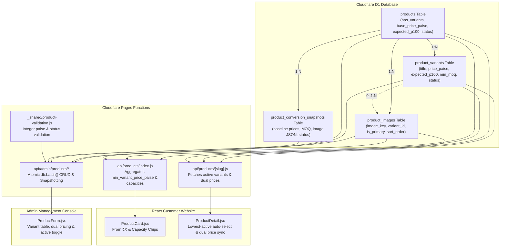

# YES ENTERPRISES — PHASE 11.2
# PRODUCT VARIANT SYSTEM: TECHNICAL IMPLEMENTATION PLAN

**Project:** YES ENTERPRISES Wholesale Catalogue Website  
**Project Directory:** `D:\webpage`  
**Phase:** 11.2 — Variant System Technical Design  
**Document:** End-to-End Implementation Architecture, Data Flow & Verification Plan  
**Status:** Updated with Actual Variant Status Schema (`status IN ('active', 'archived')`), Reversible Image Rollback, Verified Snapshot Storage & Rollback Boundaries  

---

## 1. EXECUTIVE SUMMARY & OWNER DECISIONS

The owner of YES ENTERPRISES has decided on a unified **product variant model** for items with multiple capacities (such as stainless steel feeding bottles, vacuum cola water bottles, and sippers). 

Instead of cluttering the catalogue with duplicate cards for each bottle size, customers will see **one card per product family** and select available capacities on the product detail page.

### Final Owner-Approved Display Decisions
1. **Public Catalogue Cards (`ProductCard.jsx`):**
   - Renders **`From ₹X`**, where X is the lowest single-piece price among active variants (`min_variant_price_paise`).
   - Displays available capacity labels (e.g. `150 ml`, `200 ml`, `250 ml`, `300 ml`).
   - Does **NOT** display the complete price range (e.g. `₹350 – ₹450`) as the primary card price.
2. **Product Detail Page (`ProductDetail.jsx`):**
   - Automatically pre-selects the lowest-capacity active variant (`status = 'active'`, lowest `sort_order`).
   - Inactive / archived variants (`status = 'archived'`) are never selected by default and are excluded from public view.
   - Simultaneously displays the single-piece price (`price_paise`) AND the expected wholesale price per 100 pieces (`expected_price_per_100_paise`).
   - When the customer taps a capacity pill, both prices and the relevant gallery photo update synchronously.
3. **Strict Phase Separation:**
   - **Phase 11.3 (Engine Implementation & Synthetic Testing):** Builds and validates the variant engine, APIs, migration 0007, admin UI, and customer-facing components exclusively against **synthetic test fixtures** (`test-var-*`). Zero changes to production D1, zero catalogue changes, zero R2 uploads.
   - **Phase 11.4 (Catalogue Import & Conversion):** Converts the three benchmark families (`prod-14`, `prod-16`, `prod-19`), corrects local `prod-16` category to `ss-sippers`, processes WhatsApp images (51 photos), and executes the real catalogue import after owner approval.

---

## 2. SYSTEM ARCHITECTURE & DATA FLOW



---

## 3. MIGRATION SEQUENCE & PRODUCTION READINESS

### Audit Findings
- Migrations `0001` through `0005` are applied in both local emulator and production D1.
- Migration `0006_add_phase12_new_products.sql` is committed and recorded in local emulator `d1_migrations`, but is **pending execution in remote production D1**.
- Consequently, the variant wholesale pricing schema migration is strictly numbered **`0007_add_variant_wholesale_pricing.sql`**.

### Migration `0007` Specification (`migrations/0007_add_variant_wholesale_pricing.sql`)
```sql
-- 1. Add expected wholesale price per 100 pieces in paise
ALTER TABLE product_variants ADD COLUMN expected_price_per_100_paise INTEGER DEFAULT NULL;

-- 2. Add optional minimum order quantity
ALTER TABLE product_variants ADD COLUMN min_order_quantity INTEGER DEFAULT NULL;

-- 3. Composite index for active variant price range aggregation
CREATE INDEX IF NOT EXISTS idx_product_variants_pricing
  ON product_variants(product_id, status, price_paise, expected_price_per_100_paise);

-- 4. Dedicated pre-conversion snapshot table for safe rollback
CREATE TABLE IF NOT EXISTS product_conversion_snapshots (
    id TEXT PRIMARY KEY,
    product_id TEXT NOT NULL REFERENCES products(id) ON DELETE CASCADE,
    snapshot_timestamp DATETIME NOT NULL DEFAULT CURRENT_TIMESTAMP,
    converted_by TEXT NOT NULL,
    baseline_base_price_paise INTEGER,
    baseline_compare_at_price_paise INTEGER,
    baseline_expected_price_per_100_paise INTEGER,
    baseline_min_order_quantity INTEGER,
    baseline_sku TEXT,
    baseline_has_variants BOOLEAN NOT NULL DEFAULT 0,
    baseline_images_json TEXT NOT NULL DEFAULT '[]',
    status TEXT NOT NULL DEFAULT 'active' CHECK(status IN ('active', 'restored', 'superseded'))
);

CREATE INDEX IF NOT EXISTS idx_snapshots_product 
  ON product_conversion_snapshots(product_id);
```

---

## 4. PRICING & MOQ VALIDATION RULES

Implemented in `functions/_shared/product-validation.js`:

1. **Integer Paise Standard:**
   - All monetary fields must be non-negative integers (`paise >= 0`).
   - Floats, decimals, negative amounts, or non-numeric strings trigger immediate 400 Bad Request.
2. **Single-Piece Price (`price_paise`):**
   - Nullable (allows "Contact for Pricing").
   - If provided: integer `0 <= price_paise <= 100,000,000` (max ₹10 Lakh ceiling).
3. **Wholesale Price per 100 Pieces (`expected_price_per_100_paise`):**
   - Nullable.
   - If provided: integer `0 <= expected_price_per_100_paise <= 500,000,000` (max ₹50 Lakh ceiling).
   - Stored as total quotation for 100 pieces (e.g. ₹13,500 = `1350000` paise).
4. **Minimum Order Quantity (`min_order_quantity`):**
   - Strictly Nullable (`NULL` default).
   - If provided: integer `1 <= min_order_quantity <= 1,000,000`.
   - **Crucial Rule:** Having an `expected_price_per_100_paise` does **NOT** require or imply `min_order_quantity = 100`.

---

## 5. IMAGE ARCHITECTURE & REVERSIBLE ROLLBACK

```
                               ┌───────────────┐
                               │   products    │
                               │ (id: 'prod-14')
                               └───────┬───────┘
                                       │ 1:N
                     ┌─────────────────┴─────────────────┐
                     ▼                                   ▼
          ┌──────────────────────┐            ┌───────────────────────────────────┐
          │   product_variants   │            │          product_images           │
          │ id: 'var-14-150'     │            │ id: 'img-14-shared'               │
          │ title: '150 ml'      │            │ product_id: 'prod-14'             │
          │ status: 'active'     │            │ variant_id: NULL ◄── (Shared)     │
          └──────────┬───────────┘            │ is_primary: 1                     │
                     │ 1:N                    │                                   │
                     └───────────────────────►│ id: 'img-14-150'                  │
                                              │ product_id: 'prod-14'             │
                                              │ variant_id: 'var-14-150' ◄──────┐ │
                                              │ is_primary: 1                   │ │
                                              └─────────────────────────────────┼─┘
                                                                                │
                                                   Specific variant photograph ─┘
```

### Relational Image Behavior

1. **Shared Family Images (`variant_id IS NULL`):**
   - General lifestyle, branding, or packaging photos.
   - Variable products must have at least one shared primary image (`variant_id IS NULL AND is_primary = 1`).
   - Retrieved by `/api/products` for public catalogue cards.
2. **Variant-Specific Images (`variant_id = <variantId>`):**
   - Photographs representing a specific capacity (e.g. 300ml bottle with etched graduation scale).
   - Has its own isolated primary flag (`is_primary = 1 WHERE variant_id = <variantId>`).
3. **Sort Order:**
   - Ordered by: `is_primary DESC, sort_order ASC, created_at ASC`.
4. **Default Selection & Fallback Behavior:**
   - On page load, the lowest-capacity active variant is pre-selected.
   - If that variant has dedicated images, they appear first in the gallery, and the variant's primary photo renders in the hero frame.
   - **Fallback Guarantee:** If the selected variant has no dedicated images (e.g. vacuum bottles sharing one photo), the gallery smoothly falls back to the parent product's shared family images (`variant_id IS NULL`). The customer never sees a placeholder or missing image.
5. **Reversible Image Rollback Invariant (ZERO Image Modification):**
   - Setting `product_images.variant_id = NULL` during rollback is **prohibited** because it permanently destroys the variant-to-image association and risks violating `idx_single_primary_image_product`.
   - Instead, during rollback, **`product_images` records are NOT modified at all**:
     - Image `id`, `variant_id`, `is_primary`, `sort_order`, and metadata remain 100% intact.
     - When `has_variants = 0`, public catalogue queries only display images where `variant_id IS NULL`.
     - If the variable product is re-enabled in the future (`has_variants = 1` and variant status restored to `'active'`), all variant-to-image associations are immediately and automatically restored without re-linking or manual work.

---

## 6. BACKEND AND API PLAN

### A. Public Detail Endpoint (`functions/api/products/[slug].js`)
- Selects active variants:
  ```sql
  SELECT id, product_id, sku, title, title_hi, price_paise,
         compare_at_price_paise, expected_price_per_100_paise,
         min_order_quantity, status, sort_order
  FROM product_variants
  WHERE product_id = ? AND status = 'active'
  ORDER BY sort_order ASC, title ASC;
  ```
- Simple products continue returning `variants: []` and normal product-level fields.

### B. Public Listing Endpoint (`functions/api/products/index.js`)
- Augments variable products with SQL subqueries:
  ```sql
  (SELECT MIN(pv.price_paise) FROM product_variants pv WHERE pv.product_id = p.id AND pv.status = 'active') as min_variant_price_paise,
  (SELECT MAX(pv.price_paise) FROM product_variants pv WHERE pv.product_id = p.id AND pv.status = 'active') as max_variant_price_paise,
  (SELECT MIN(pv.expected_price_per_100_paise) FROM product_variants pv WHERE pv.product_id = p.id AND pv.status = 'active') as min_variant_expected_price_100,
  (SELECT COUNT(*) FROM product_variants pv WHERE pv.product_id = p.id AND pv.status = 'active') as variants_count,
  (SELECT GROUP_CONCAT(pv.title, ', ') FROM (SELECT title FROM product_variants WHERE product_id = p.id AND status = 'active' ORDER BY sort_order ASC)) as variant_capacities_summary
  ```

### C. Admin Endpoints (`functions/api/admin/products/`)
- `[id].js`: Updates and inserts variant records with `expected_price_per_100_paise`. Identifies omitted variants and soft-archives them (`status = 'archived'`).
- `index.js`: Saves variant wholesale prices on variable product creation.
- `[id]/duplicate.js`: Copies variant wholesale prices when cloning products.

---

## 7. FRONTEND AND ADMIN UI PLAN

### A. Public Product Detail (`src/pages/ProductDetail.jsx`)
1. **Pre-Selection Invariant:** Automatically selects the lowest-capacity active variant (`variants.filter(v => v.status === 'active').sort((a,b) => a.sort_order - b.sort_order)[0]`). Never selects an inactive variant.
2. **Synchronized Pricing:**
   - Single-piece price updates to `selectedVariant.price_paise`.
   - Expected wholesale price badge updates to `selectedVariant.expected_price_per_100_paise`.
3. **WhatsApp Enquiry:** Embeds selected capacity title and dual pricing into pre-filled message.
4. **Hero Image Switching:** Displays variant primary image if present, falling back to shared family primary image.

### B. Public Product Card (`src/components/ui/ProductCard.jsx`)
- **Single Card:** Renders exactly once per product family.
- **Price Display:** Displays **`From ₹X`** (e.g. `From ₹350`), where X is `min_variant_price_paise`.
- **Capacities Snippet:** Displays capacity labels as compact badges below the title.

### C. Admin Product Form (`src/components/admin/ProductForm.jsx`)
- Adds a responsive variant editor table/cards section:
  - Toggle: Simple Product vs. Variable Product.
  - Variant cards: English Title, Hindi Title, SKU, Single Price (INR), Wholesale Price / 100 Pcs (INR), Stock Quantity, Status (`active` / `archived`).
  - Mobile layout: Fully touch-optimized for Nothing Phone 3 (412×915px) with `min-h-[48px]` touch targets.

---

## 8. REVERSIBLE ROLLBACK ARCHITECTURE & BOUNDARIES

Simply executing `UPDATE products SET has_variants = 0` is **insufficient and unsafe** because parent product pricing fields (`base_price_paise`, `expected_price_per_100_paise`, `sku`) may have been cleared during conversion.

### The Three Rollback Boundaries

```
┌──────────────────────────────────────────────────────────────────────────────────┐
│ BOUNDARY 1: IN-FLIGHT / FAILED CONVERSION (ATOMIC DATABASE BATCH)                │
│ • Execution Scope: During conversion execution in db.batch([stmt1, stmt2...]).   │
│ • Behavior: If any single statement fails, D1 automatically aborts and rolls     │
│   back the entire transaction. Zero partial data commits.                        │
│ • Recovery: Automatic native engine rollback. Zero manual intervention needed.  │
└──────────────────────────────────────────────────────────────────────────────────┘
                                         │
                                         ▼
┌──────────────────────────────────────────────────────────────────────────────────┐
│ BOUNDARY 2: COMMITTED PRODUCT CONVERSION REVERSAL (PRODUCT-LEVEL SCOPE)          │
│ • Execution Scope: A previously committed variable product is reverted to simple.│
│ • Snapshot Source: product_conversion_snapshots table in D1.                     │
│ • Execution: Atomic db.batch() restoring parent fields from snapshot, setting   │
│   status = 'archived' on child variants, and leaving product_images untouched.   │
│ • Reversibility: Full. Re-activating variants immediately restores complete state│
└──────────────────────────────────────────────────────────────────────────────────┘
                                         │
                                         ▼
┌──────────────────────────────────────────────────────────────────────────────────┐
│ BOUNDARY 3: SCHEMA MIGRATION ROLLBACK (DATABASE-LEVEL SCOPE)                     │
│ • Execution Scope: Reverting schema migration 0007 on Cloudflare D1.             │
│ • Tool: External verified SQL backup dump (wrangler d1 export).                  │
│ • Reality: D1 does not support automatic down-migrations. Rollback requires      │
│   restoring from the pre-migration dump file taken prior to migration.           │
└──────────────────────────────────────────────────────────────────────────────────┘
```

### Snapshot Storage & Verification Protocol
1. **Creation Timing:** The conversion snapshot is created in `product_conversion_snapshots` within the **exact same atomic `db.batch()` transaction** as the product conversion itself.
2. **Recorded State:** Captures `baseline_base_price_paise`, `baseline_compare_at_price_paise`, `baseline_expected_price_per_100_paise`, `baseline_min_order_quantity`, `baseline_sku`, and full JSON array of image mappings (`baseline_images_json`).
3. **Pre-Conversion Verification:** The conversion transaction asserts that snapshot data is valid and non-null for baseline pricing before toggling `has_variants = 1`.
4. **Product-Level Restoration Procedure:**
   ```sql
   -- 1. Restore parent product fields from verified snapshot
   UPDATE products SET
     base_price_paise = snapshot.baseline_base_price_paise,
     compare_at_price_paise = snapshot.baseline_compare_at_price_paise,
     expected_price_per_100_paise = snapshot.baseline_expected_price_per_100_paise,
     min_order_quantity = snapshot.baseline_min_order_quantity,
     sku = snapshot.baseline_sku,
     has_variants = 0,
     updated_at = CURRENT_TIMESTAMP
   WHERE id = ?;

   -- 2. Soft-archive child variants (never hard DELETE)
   UPDATE product_variants SET 
     status = 'archived', 
     updated_at = CURRENT_TIMESTAMP 
   WHERE product_id = ?;

   -- 3. Mark snapshot as restored
   UPDATE product_conversion_snapshots SET 
     status = 'restored' 
   WHERE id = ?;

   -- 4. DO NOT TOUCH product_images! 
   -- All variant_id links remain intact in the database.
   -- Public simple product views filter out variant images via WHERE variant_id IS NULL.
   ```

---

## 9. COMPREHENSIVE TEST PLAN (PHASE 11.3)

All Phase 11.3 testing is conducted against **isolated synthetic test fixtures** (`test-var-*`):

| Test Category | Target Script | Test Execution & Expected Result |
|---|---|---|
| **D1 Schema Integrity** | `scripts/test-phase1-schema.mjs` | Verifies `0007` adds nullable columns to `product_variants` and creates `product_conversion_snapshots`. Confirms `PRAGMA foreign_key_check` passes with 0 errors. |
| **Backend Validation** | `scripts/test-phase2-api.mjs` | Submits variant with negative price -> 400 Bad Request. Submits variant with valid integer paise -> 200 OK. Confirms MOQ is nullable. Validates `status IN ('active', 'archived')`. |
| **Public Detail API** | `scripts/test-phase2-api.mjs` | GET `/api/products/test-var-fixture` -> verifies `variants` array contains active variants and distinct `expected_price_per_100_paise`. |
| **Public List API** | `scripts/test-phase2-api.mjs` | GET `/api/products` -> asserts `min_variant_price_paise` and `variant_capacities_summary` are present on variable products. |
| **Admin CRUD & Snapshots** | `scripts/test-phase3-admin.mjs` | Creates, edits, reorders, and soft-archives synthetic variants (`status = 'archived'`). Verifies conversion snapshot record creation. |
| **Non-Destructive Rollback** | `scripts/test-phase3-admin.mjs` | Reverts synthetic variable product to simple: asserts parent prices restored from snapshot, variants archived, images untouched, and catalogue card displays simple price. |
| **Public Detail Switcher** | `scripts/test-phase4-ui-browser.mjs` | Puppeteer clicks capacity pill: verifies single price and wholesale badge update synchronously; verifies WhatsApp link updates. |
| **Mobile Responsiveness** | `scripts/verify-phase9-admin-mobile.mjs` | Viewport 412×915 (Nothing Phone 3): verifies no horizontal scroll, touch targets ≥ 48px, numeric keyboards active. |

---

## 10. REMAINING DECISIONS & APPROVAL GATE

All previous design ambiguities have been resolved:
- Public cards: `From ₹X` + capacity labels (Approved).
- Product detail: Pre-select lowest-capacity active variant + synchronized prices and images (Approved).
- Migration sequencing: `0007_add_variant_wholesale_pricing.sql` (Verified).
- Separation: Variant engine in 11.3; Catalogue import in 11.4 (Approved).
- Rollback safety: Non-destructive restoration using `product_conversion_snapshots`, `status = 'archived'`, zero image modification, and verified external backup dump.

**Next Step:** Awaiting your explicit approval to commence Phase 11.3.
