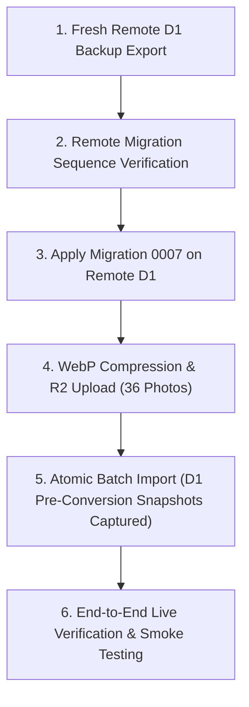

# YES ENTERPRISES — PHASE 11.4A
# CATALOGUE IMPORT APPROVAL CHECKLIST (RECONCILED)

**Project:** YES ENTERPRISES Wholesale Catalogue Website  
**Project Directory:** `D:\webpage`  
**Phase:** 11.4A $\to$ 11.4B Transition Gate (Correction Pass)  
**Date:** 2026-11-16  
**Auditor:** AntiGravity Agent System  
**Status:** AWAITING OWNER REVIEW & SIGN-OFF  

---

## 1. Executive Summary & Catalogue Reconciliation Summary

This checklist outlines the mandatory owner approval gates required before any database updates, Cloudflare D1 migrations, or Cloudflare R2 image uploads are executed in **Phase 11.4B (Production Import & Conversion Execution)**.

### Reconciled Structure Overview:
- **Total WhatsApp Items Accounted For:** **19 items**
- **Variant Families:** **3 families** (`prod-14`, `prod-19`, `prod-16`)
- **Total Capacity Variants:** **9 variants**
- **Standalone Public Products:** **7 products** (Items 1, 4, 5, 6, 7, 8, 15)
- **Active Public Catalogue Cards:** **10 cards** ($3 \text{ Families} + 7 \text{ Standalone} = \mathbf{10}$)
- **Unassigned Hidden Accessories:** **3 items** (Items 9, 10, 11)
- **Total Mapped Photographs:** **36 camera photos** (0 orphans, 0 duplicates)

Until each decision gate below is explicitly confirmed by the owner, all codebase files, local databases, and remote Cloudflare production resources remain in a strict read-only state.

---

## 2. Owner Approval Decision Gates

Please review and confirm each of the following strategic items:

### Gate 1: Variant Family Conversions (3 Families, 9 Variants)
The Phase 11.3 variant engine will convert three existing simple catalogue cards into multi-capacity product families with real-time price, wholesale, and gallery photo synchronization:
- [ ] **Approve Family A (`prod-14`):** SS 304 Straight Feeding Bottle (150 ml @ ₹350 / ₹13,500; 200 ml @ ₹399 / ₹14,500; 250 ml @ ₹449 / ₹15,500; 300 ml @ ₹499 / ₹16,500).
- [ ] **Approve Family B (`prod-19`):** YE Premium Contoured SS Bottle (200 ml @ ₹549 / ₹19,000; 250 ml @ ₹599 / ₹19,900).
- [ ] **Approve Family C (`prod-16`):** SS Vacuum Cola Water Bottle (500 ml @ ₹599 / ₹34,900; 750 ml @ ₹649 / ₹36,500; 1 Litre @ ₹799 / ₹39,900).

### Gate 2: Standalone Public Products Accounting (7 Products)
Confirm the individual accounting of all seven standalone simple public products:
- [ ] **Approve Standalone 1 (`prod-17`):** YE Stainless Steel Feeding Bottle with Handles — 250 ml (`ss-bottles`, ₹249 / ₹15,000).
- [ ] **Approve Standalone 2 (New: `prod-new-glass-sipper-handle-250`):** YE Glass Sipper with Handle — 250 ml (`silicone-sleeve`, ₹275 / ₹11,000).
- [ ] **Approve Standalone 3 (`prod-05`):** Silicone Sleeve Feeding Bottle — 250 ml (`silicone-sleeve`, ₹275 / ₹9,900).
- [ ] **Approve Standalone 4 (`prod-07`):** Silicone Sleeve Feeding Bottle — 120 ml (`silicone-sleeve`, ₹249 / ₹9,500).
- [ ] **Approve Standalone 5 (`prod-02`):** Glass Feeding Bottle — 60 ml Pink (`glass-bottles`, ₹149 / ₹6,500).
- [ ] **Approve Standalone 6 (`prod-01`):** Glass Feeding Bottle — 250 ml Blue (`glass-bottles`, ₹240 / ₹8,500).
- [ ] **Approve Standalone 7 (`prod-15`):** Stainless Steel Tiffin Box Set (`ss-tiffin`, ₹450 / ₹29,500).

$$\mathbf{3 \text{ Families}} + \mathbf{7 \text{ Standalone Products}} = \mathbf{10 \text{ Active Public Catalogue Cards}}$$

### Gate 3: Product Claims Review & Sign-Off
Confirm the handling of product claims across descriptions and specifications:
- [ ] **SS 304 Food Grade (Verified):** Direct physical laser engraving proof `YE SS 304` on bottle bodies (Items 1, 2, 3, 16, 17, 18, 19). Approved to display.
- [ ] **Anti-Colic Valve (Verified):** Visible physical groove / air-valve design on LSR silicone teats. Approved to display.
- [ ] **Leak-Proof (Verified):** 4-way snap-clamp lid with silicone perimeter gasket (Tiffin `prod-15`) and silicone O-ring threaded cap (Cola `prod-16`). Approved to display.
- [ ] **BPA-Free (Manufacturer-Stated Claim):** Confirm whether to publish the "BPA-Free" claim for silicone teats and PP parts (unverified on physical packaging photographs).
- [ ] **24-Hour Hot & Cold Thermal Performance (Manufacturer-Stated Claim):** Confirm whether to publish the seller WhatsApp claim of "hot & cold 24 hours" for SS Vacuum Cola Water Bottles (`prod-16`) without formal laboratory test certificate.
- [ ] **Thermal-Shock Resistant (Material Characteristic):** Confirm whether to display "Thermal Shock Resistant" for borosilicate glass bottles.

### Gate 4: Category Alignment for `prod-16`
- [ ] **Approve Category Alignment:** In the local D1 emulator, `prod-16` is incorrectly set to `glass-bottles`. The production backup correctly records `ss-sippers`. Approve updating `prod-16.category_id = 'ss-sippers'` during import.

### Gate 5: Accessory Placement & Visibility
The owner previously rejected creating a 7th category. Confirm the disposition for the 3 feeding accessories:
- [ ] **Option A (Recommended — Staged Review):** Keep all 3 accessories (`acc-bottle-cap-ring-set`, `acc-honey-pacifier-soother`, `acc-lsr-silicone-teat`) in `status = 'unassigned'` and hidden from public catalogue browsing until an accessories section is introduced.
- [ ] **Option B (Assign to Closest Existing):** Assign Cap & Ring set to `plastic-bottles`, and assign Honey Pacifier and LSR Teat to `silicone-sleeve`.

### Gate 6: Glass Sipper with Handle Pricing Override
- [ ] **Confirm Override:** Approve single-piece price of **₹275.00** for Item 4 (YE Glass Sipper with Handle 250 ml) based on authentic retail packaging box MRP, overriding WhatsApp crossed-out price of ₹299. Wholesale rate per 100 remains **₹11,000.00**.

### Gate 7: Pre-Execution Remote Production Backup Gate
- [ ] **Mandatory Safety Step:** Before any migration or write command is issued to Cloudflare production in Phase 11.4B, dispatch a fresh SQL export of remote D1:
  ```bash
  npx wrangler d1 export yes_enterprises_db --remote --output="D:\YES-ENTERPRISES-production-backups\pre_phase11_4b_export.sql"
  ```
  and verify file existence and SHA256 checksum outside the Git repository.

### Gate 8: Remote Migration Sequence Verification
- [ ] **Verify Remote D1 Migration Ledger:** Inspect remote D1 to verify whether migration `0006_add_phase12_new_products.sql` is applied or pending. If pending, confirm whether 0006 and 0007 should be applied in strict numerical sequence.

### Gate 9: R2 Image Compression & Upload Authorization
- [ ] **Approve Image Upload Pipeline:** Authorize compressing the 36 audited photographs to modern WebP format and uploading them to the production Cloudflare R2 bucket with unique UUID keys, matching the mapping defined in [docs/PHASE_11_4A_IMAGE_MAPPING_REPORT.md](file:///D:/webpage/docs/PHASE_11_4A_IMAGE_MAPPING_REPORT.md).

---

## 3. Post-Approval Execution Workflow (Phase 11.4B)

Once the owner signs off on the gates above, Phase 11.4B will execute in the following controlled sequence:



---

## 4. Current State Acknowledgment

- All preparations, mappings, claims reviews, and preview JSON files are complete and reconciled.
- The working tree remains read-only.
- No changes have been pushed or deployed.
