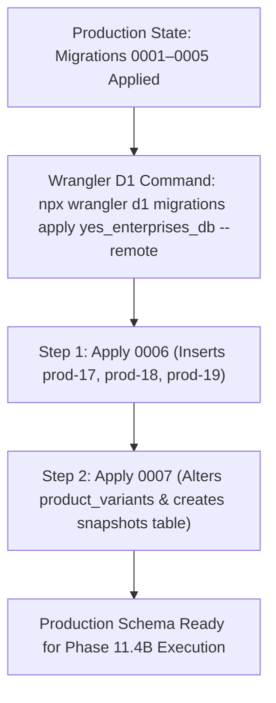

# YES ENTERPRISES — PHASE 11.4B STAGE 2
# MIGRATION IMPACT REVIEW & APPROVED CATALOGUE COMPATIBILITY AUDIT

**Project:** YES ENTERPRISES Wholesale Catalogue Website  
**Project Directory:** `D:\webpage`  
**Phase:** 11.4B Preparation — Stage 2 (Migration Impact & Catalogue Compatibility)  
**Audit Date:** 2026-11-16  
**Auditor:** AntiGravity Agent System  
**Execution Mode:** STRICT READ-ONLY (Zero database writes, zero migrations applied)  
**Final Stage 2 Verdict:** **`SAFE WITH REQUIRED DECISIONS`**  

---

## 1. Executive Summary & Audit Mandate

This report conducts a thorough, statement-by-statement SQL impact review of pending production migrations **0006** (`0006_add_phase12_new_products.sql`) and **0007** (`0007_add_variant_wholesale_pricing.sql`) against the live Cloudflare D1 production database and the approved Phase 11.4A catalogue preview ([data/phase_11_4A_catalogue_import_preview.json](file:///D:/webpage/data/phase_11_4A_catalogue_import_preview.json)).

### Core Findings Summary:
1. **Migration 0007 is 100% Safe & Architecturally Mandatory:**
   Migration 0007 contains purely additive DDL (`ALTER TABLE ... ADD COLUMN`, `CREATE TABLE IF NOT EXISTS`, `CREATE INDEX IF NOT EXISTS`). It introduces zero breaking changes, does not mutate existing data, and is strictly required by the backend variant engine (`functions/api/admin/products/[id].js`).
2. **Migration 0006 Introduces a Known Catalogue Discrepancy (`prod-18`):**
   Migration 0006 inserts three products: `prod-17`, `prod-18`, and `prod-19`. While `prod-17` and `prod-19` are foundational records required for Phase 11.4B standalone updating and variant family conversion, **`prod-18` (*YE Glass Sipper with Handle – 120 ml*) is NOT part of the approved Phase 11.4A catalogue**.
3. **Idempotency vs. Public Exposure Risk:**
   While migration 0006 uses `ON CONFLICT(id) DO NOTHING`, because `prod-17`, `prod-18`, and `prod-19` do not yet exist in production, `ON CONFLICT` will not trigger. All three records will be inserted with `status = 'active'`. If migration 0006 is applied without an immediate follow-up action, `prod-18` will appear on the public website as an unverified, unpriced 11th catalogue card.
4. **Three Owner Decisions are Provided:**
   A structured decision framework is outlined to resolve `prod-18` safely without risk to production integrity.

---

## 2. Migration 0006 Complete SQL Impact Analysis

Migration `0006_add_phase12_new_products.sql` consists of three product insertions and six product image insertions:

### 2.1 Product 1: `prod-17` (*YE Stainless Steel Feeding Bottle with Handles*)
- **SQL Statement:** `INSERT INTO products (id, name, name_hi, slug, category_id, ..., status, is_featured, sort_order, ...) VALUES ('prod-17', ...)`
- **Category:** `ss-bottles` | **Status:** `active` | **`has_variants`:** `0`
- **Pricing:** `base_price_paise = NULL`, `expected_price_per_100_paise = NULL`, `min_order_quantity = NULL`
- **Image:** `img-prod-17-1` (`/assets/seller-new-products/product-a-handled-ss-bottle.jpeg`, primary, sort order 1).
- **Catalogue Compatibility:** **100% COMPATIBLE.** In Phase 11.4A, `prod-17` is classified as `existing_product_update` (Item 1). Applying 0006 creates the base record; Phase 11.4B will immediately update it with verified WhatsApp rates (₹249 single / ₹15,000 wholesale) and attach verified Group 1 camera photos.

### 2.2 Product 2: `prod-18` (*YE Glass Sipper with Handle – 120 ml*)
- **SQL Statement:** `INSERT INTO products (id, name, name_hi, slug, category_id, ..., status, is_featured, sort_order, ...) VALUES ('prod-18', ...)`
- **Category:** `glass-bottles` | **Status:** `active` | **`has_variants`:** `0`
- **Pricing:** `base_price_paise = NULL`, `expected_price_per_100_paise = NULL`
- **Image:** `img-prod-18-1` (`/assets/seller-new-products/product-b-glass-sipper-120ml.jpeg`, primary).
- **Catalogue Compatibility:** **⚠️ CONFLICT / UNAPPROVED ITEM.** Not present in the approved Phase 11.4A catalogue. Detailed investigation below.

### 2.3 Product 3: `prod-19` (*YE Premium Stainless Steel Feeding Bottle – 200 ml*)
- **SQL Statement:** `INSERT INTO products (id, name, name_hi, slug, category_id, ..., status, is_featured, sort_order, ...) VALUES ('prod-19', ...)`
- **Category:** `ss-bottles` | **Status:** `active` | **`has_variants`:** `0`
- **Pricing:** `base_price_paise = NULL` (notes indicate printed box MRP ₹549).
- **Images:** 4 image records (`img-prod-19-1` through `img-prod-19-4`).
- **Catalogue Compatibility:** **100% COMPATIBLE.** In Phase 11.4A, `prod-19` is classified as `existing_product_variant_conversion` (Family B Baseline). Applying 0006 creates the parent product; Phase 11.4B variant engine will convert it into a 2-capacity family (200 ml @ ₹549 / ₹19,000 and 250 ml @ ₹599 / ₹19,900) with 6 verified Group 2 photos.

### 2.4 Analysis of `ON CONFLICT(id) DO NOTHING`
- **Mechanism:** If a row with the specified primary key (`id`) already exists in the table, SQLite silently skips the insertion without raising an error.
- **Data Overwrite Safety:** It will **never** overwrite or alter existing data in production.
- **Production Reality Check:** As verified in Stage 1, `prod-17`, `prod-18`, and `prod-19` **do not exist** in production. Therefore, `ON CONFLICT` will not trigger; all three records and all six images **will be newly created**.
- **Public Visibility Consequence:** Because all three products specify `status: 'active'`, they will immediately be queried by `GET /api/products` and displayed on the public website with "Contact for Price" (since price is `NULL`), unless updated or deactivated.

---

## 3. Special Investigation: `prod-18`

### 3.1 Why was `prod-18` included in Migration 0006?
On November 15 (Phase 12), prior to the delivery of the complete WhatsApp catalogue, the seller provided an initial preliminary batch of 8 photographs. One photograph (`WhatsApp Image 2026-11-15 at 7.23.58 PM (1).jpeg`) showed a retail packaging sample printed with:
> *"YE Glass Sipper With Handle, 120 ml. Capacity, Happy Baby"*

Migration 0006 was drafted to capture this sample as `prod-18`.

### 3.2 Does it represent an older or superseded decision?
**YES.** On November 16, the seller delivered the official WhatsApp Business catalogue (27 items) along with 36 high-resolution camera photographs. A comprehensive audit revealed:
1. The commercial handled glass sipper currently sold by YES ENTERPRISES is **250 ml** (Item 4, printed box MRP ₹275, wholesale ₹11,000 per 100, turquoise star sleeve with handles).
2. The 120 ml glass sipper currently sold is **handle-less** (Item 6, `prod-07`, royal blue star sleeve).
3. **There is NO 120 ml Glass Sipper with Handle in the official WhatsApp catalogue.**

### 3.3 Photo & Source Item Verification
- Neither the 27 WhatsApp screenshots nor the 36 verified camera photographs contain a 120 ml handled glass sipper.
- The approved [data/phase_11_4A_catalogue_import_preview.json](file:///D:/webpage/data/phase_11_4A_catalogue_import_preview.json) does **not** reference `prod-18` anywhere.

### 3.4 Public Impact if Migration 0006 is Applied Unchanged
If migration 0006 is applied without intervention:
- `prod-18` will become an **11th public catalogue card** (exceeding the approved 10 cards).
- It will appear under `glass-bottles` instead of `silicone-sleeve`.
- It will have `price = NULL` ("Contact for Price") and reference a legacy local image path (`/assets/seller-new-products/...`) rather than Cloudflare R2.
- It will confuse wholesale buyers browsing alongside the verified 250 ml Handled Sipper (`prod-new-glass-sipper-handle-250`) and the 120 ml Handle-less Sipper (`prod-07`).

---

## 4. The Three Owner Decision Options for `prod-18`

To resolve `prod-18`, the owner must select one of the following strategic paths:

```
┌──────────────────────────────────────────────────────────────────────────────────────────────────┐
│ OPTION A: Apply 0006 Unchanged; Phase 11.4B Immediately Deactivates or Repurposes prod-18       │
│ • How it works: Run migrations 0006 and 0007 sequentially as standard. Immediately in Phase     │
│   11.4B, the import script executes:                                                             │
│   - Choice A1: UPDATE products SET status = 'inactive' WHERE id = 'prod-18'; (Hides it)         │
│   - Choice A2: Repurposes 'prod-18' to BE Item 4 (YE Glass Sipper with Handle 250ml, ₹275),      │
│     giving Item 4 a clean ID rather than creating 'prod-new-glass-sipper-handle-250'.            │
│ • Pros: Zero changes to migration files; 100% compatible with standard Wrangler CLI workflow.    │
│ • Cons: Requires immediate Phase 11.4B execution to prevent temporary public display.           │
├──────────────────────────────────────────────────────────────────────────────────────────────────┤
│ OPTION B: Revise Migration 0006 Prior to Execution (Pre-Execution Patch)                         │
│ • How it works: Modify migrations/0006_add_phase12_new_products.sql before applying to remote D1:│
│   - Change prod-18 status from 'active' to 'inactive'.                                           │
│   - OR completely remove the prod-18 insert statement.                                           │
│ • Pros: prod-18 never touches the live public site, even for a second.                           │
│ • Cons: Modifies a migration file that was already applied locally (requires local re-seed).     │
├──────────────────────────────────────────────────────────────────────────────────────────────────┤
│ OPTION C: Defer Migration 0006 & 0007 Pending Seller Confirmation                                │
│ • How it works: Halt all migration execution until the owner checks with the warehouse/seller   │
│   whether a 120 ml Handled Glass Sipper actually exists in physical inventory.                   │
│ • Pros: Absolute real-world physical stock certainty.                                            │
│ • Cons: Pauses Phase 11.4B rollout.                                                              │
└──────────────────────────────────────────────────────────────────────────────────────────────────┘
```

---

## 5. Migration 0007 Complete Schema Impact Analysis

Migration `0007_add_variant_wholesale_pricing.sql` was audited line-by-line:

```sql
-- 1. Add expected wholesale price per 100 pieces in paise to product_variants
ALTER TABLE product_variants ADD COLUMN expected_price_per_100_paise INTEGER DEFAULT NULL;

-- 2. Add optional minimum order quantity to product_variants
ALTER TABLE product_variants ADD COLUMN min_order_quantity INTEGER DEFAULT NULL;

-- 3. Composite index for fast active variant price range aggregation
CREATE INDEX IF NOT EXISTS idx_product_variants_pricing
  ON product_variants(product_id, status, price_paise, expected_price_per_100_paise);

-- 4. Dedicated pre-conversion snapshot table for safe, non-destructive rollbacks
CREATE TABLE IF NOT EXISTS product_conversion_snapshots (
    id TEXT PRIMARY KEY,
    product_id TEXT NOT NULL REFERENCES products(id) ON DELETE CASCADE,
    snapshot_timestamp DATETIME NOT NULL DEFAULT CURRENT_TIMESTAMP,
    converted_by TEXT NOT NULL,
    baseline_base_price_paise INTEGER,
    baseline_compare_at_price_paise INTEGER,
    baseline_expected_price_per_100_paise INTEGER,
    baseline_min_order_quantity INTEGER,
    baseline_sku TEXT,
    baseline_has_variants BOOLEAN NOT NULL DEFAULT 0,
    baseline_images_json TEXT NOT NULL DEFAULT '[]',
    status TEXT NOT NULL DEFAULT 'active' CHECK(status IN ('active', 'restored', 'superseded'))
);

CREATE INDEX IF NOT EXISTS idx_snapshots_product 
  ON product_conversion_snapshots(product_id);
```

### Schema Impact Verification Points:
1. **Column Additions (`expected_price_per_100_paise`, `min_order_quantity`):**
   - Both columns are nullable (`DEFAULT NULL`) with no strict `NOT NULL` constraints.
   - Compatible with SQLite table alteration rules.
   - Zero impact on existing records (production currently has 0 variants anyway).
2. **Composite Index (`idx_product_variants_pricing`):**
   - Uses `IF NOT EXISTS`.
   - Dramatically accelerates the `SELECT MIN(price_paise), MIN(expected_price_per_100_paise) FROM product_variants WHERE product_id = ? AND status = 'active'` queries powering the public "From ₹X" card badges.
3. **Rollback Snapshot Table (`product_conversion_snapshots`):**
   - Uses `IF NOT EXISTS`.
   - Foreign key references `products(id)` with `ON DELETE CASCADE`.
   - Check constraint enforces `status IN ('active', 'restored', 'superseded')`.
   - Provides safe, non-destructive rollback storage if an owner converts a product and later reverts it.
4. **Backend Implementation Compatibility:**
   - [functions/api/admin/products/[id].js](file:///D:/webpage/functions/api/admin/products/[id].js#L141-L153) explicitly queries and inserts into `product_conversion_snapshots`.
   - [functions/api/admin/products/[id]/rollback.js](file:///D:/webpage/functions/api/admin/products/[id]/rollback.js#L39-L43) queries `product_conversion_snapshots`.
   - [functions/_shared/product-validation.js](file:///D:/webpage/functions/_shared/product-validation.js#L78) validates `expected_price_per_100_paise`.
   - **Conclusion:** The application code **demands** migration 0007. Running Phase 11.4B without 0007 will cause 500 runtime errors on all variant conversions.

---

## 6. Migration Order & Dependency Analysis



### Dependency Findings:
- **Does 0007 depend on 0006?** No. 0007 alters `product_variants` and creates a snapshots table; it does not reference any product rows from 0006.
- **Can Wrangler apply 0007 alone?** No. Cloudflare Wrangler applies pending migrations strictly in ascending numerical order. Running `wrangler d1 migrations apply` will automatically execute 0006 first, then 0007.
- **Is sequential application safe?** Yes, provided the owner selects an approval path for `prod-18` (Option A or Option B).

---

## 7. Product-by-Product Catalogue Compatibility Matrix

| Product ID | Product Name | Production D1 Status | Migration 0006 Action | Approved Phase 11.4A Placement | Approved 11.4A Action | Category | Final Compatibility Verdict |
|---|---|:---:|:---:|---|---|:---:|:---:|
| `prod-14` | SS 304 Straight Feeding Bottle | Present (14 products) | None | **Variant Family A** | Convert to 4-variant family (`150, 200, 250, 300 ml`) | `ss-bottles` | **100% COMPATIBLE** |
| `prod-16` | SS Vacuum Cola Water Bottle | Present (14 products) | None | **Variant Family C** | Convert to 3-variant family (`500, 750, 1000 ml`) | `ss-sippers` | **100% COMPATIBLE** (Category aligned) |
| `prod-17` | YE SS Feeding Bottle with Handles | Missing | Inserts base record | **Standalone Product 1** | Update to ₹249 single / ₹15,000 wholesale | `ss-bottles` | **100% COMPATIBLE** (0006 required) |
| `prod-18` | YE Glass Sipper with Handle – 120 ml | Missing | Inserts base record | **NOT IN CATALOGUE** | **⚠️ UNAPPROVED** (Inactivate, repurpose, or exclude) | `glass-bottles` | **REQUIRES OWNER DECISION** |
| `prod-19` | YE Premium Contoured SS Bottle | Missing | Inserts base record | **Variant Family B** | Convert to 2-variant family (`200, 250 ml`) | `ss-bottles` | **100% COMPATIBLE** (0006 required) |
| `prod-new-glass-sipper-handle-250` | YE Glass Sipper with Handle — 250 ml | Missing | None | **Standalone Product 2** | Create new standalone card (₹275 MRP override) | `silicone-sleeve` | **100% COMPATIBLE** |
| `prod-05` | Silicone Sleeve Bottle — 250 ml | Present (14 products) | None | **Standalone Product 3** | Update to ₹275 single / ₹9,900 wholesale | `silicone-sleeve` | **100% COMPATIBLE** |
| `prod-07` | Silicone Sleeve Bottle — 120 ml | Present (14 products) | None | **Standalone Product 4** | Update to ₹249 single / ₹9,500 wholesale | `silicone-sleeve` | **100% COMPATIBLE** |
| `prod-02` | Glass Feeding Bottle — 60 ml (Pink) | Present (14 products) | None | **Standalone Product 5** | Update to ₹149 single / ₹6,500 wholesale | `glass-bottles` | **100% COMPATIBLE** |
| `prod-01` | Glass Feeding Bottle — 250 ml (Blue) | Present (14 products) | None | **Standalone Product 6** | Update to ₹240 single / ₹8,500 wholesale | `glass-bottles` | **100% COMPATIBLE** |
| `prod-15` | Stainless Steel Tiffin Box Set | Present (14 products) | None | **Standalone Product 7** | Update to ₹450 single / ₹29,500 wholesale | `ss-tiffin` | **100% COMPATIBLE** |
| `acc-bottle-cap-ring-set` | Cap & Ring Set (Item 9) | Missing | None | **Unassigned Accessory** | Stage in `unassigned` status (hidden) | NULL | **100% COMPATIBLE** |
| `acc-honey-pacifier-soother` | Honey Pacifier (Item 10) | Missing | None | **Unassigned Accessory** | Stage in `unassigned` status (hidden) | NULL | **100% COMPATIBLE** |
| `acc-lsr-silicone-teat` | LSR Teat (Item 11) | Missing | None | **Unassigned Accessory** | Stage in `unassigned` status (hidden) | NULL | **100% COMPATIBLE** |

---

## 8. Potential Failure & Edge-Case Scenarios

1. **Failure Scenario 1: Partial Migration Application (Network Drop)**
   - If Cloudflare drops during 0006 execution, 0006 commits transactionally. Wrangler D1 wraps each migration file in a transaction. A failure will rollback the specific failed migration cleanly without corrupting previous migrations.
2. **Failure Scenario 2: Applying 0006 and Delaying Phase 11.4B Import**
   - If 0006 is applied and the import script is delayed, `prod-18` will appear on the public live site with no price.
   - *Mitigation:* Apply 0006, 0007, and run the Phase 11.4B import script within the same scheduled maintenance window.
3. **Failure Scenario 3: ID Collision on Item 4**
   - If Item 4 is created with ID `prod-new-glass-sipper-handle-250`, it does not collide with `prod-18`. If Option A2 is chosen, `prod-18` is cleanly repurposed as Item 4.

---

## 9. Final Stage 2 Verdict

# **`SAFE WITH REQUIRED DECISIONS`**

---

## 10. Answers to Mandatory Stop Condition Questions

### 1. Is migration 0006 safe to apply unchanged?
**Conditionally safe.** Syntactically and transactionally, it will execute without error. However, it will create `prod-18` as an active public card in `glass-bottles` with no price, which is not part of the approved Phase 11.4A catalogue. It requires an approved owner decision on how to handle `prod-18`.

### 2. Is migration 0007 safe to apply unchanged?
**YES, 100% SAFE.** It is purely additive DDL, introduces zero breaking changes, does not mutate existing data, and is strictly required for the Phase 11.3 variant engine to function.

### 3. What should happen to `prod-18`?
The owner must choose between:
- **Option A (Recommended):** Apply 0006 as-is, and have the Phase 11.4B import script immediately deactivate `prod-18` (`status = 'inactive'`) OR repurpose it as Item 4 (*YE Glass Sipper with Handle 250 ml*).
- **Option B:** Revise migration 0006 before execution to set `status = 'inactive'` or remove the `prod-18` insert block.
- **Option C:** Defer migrations until seller warehouse inventory is clarified.

### 4. Should migrations 0006 and 0007 be applied together or handled separately?
**They should be applied together.** Wrangler D1 naturally executes all pending migrations in ascending order (`0006` then `0007`). Applying them together readies both the product base records and the variant engine schema in a single operational step.

### 5. What exact approvals are required before execution?
1. Owner sign-off on the **`prod-18` handling decision** (Option A, B, or C).
2. Owner approval to export a **fresh pre-migration SQL backup** of remote D1:
   ```bash
   npx wrangler d1 export yes_enterprises_db --remote --output="D:\YES-ENTERPRISES-production-backups\2026-11-16\yes_enterprises_db_pre_0006_0007_20261116.sql"
   ```
3. Explicit owner authorization to execute:
   ```bash
   npx wrangler d1 migrations apply yes_enterprises_db --remote
   ```

> [!CAUTION]
> **STOPPED AS DIRECTED:** Analysis is 100% complete and documented. No migrations have been executed. No database writes or deployment actions have been taken. Awaiting explicit owner approval.
