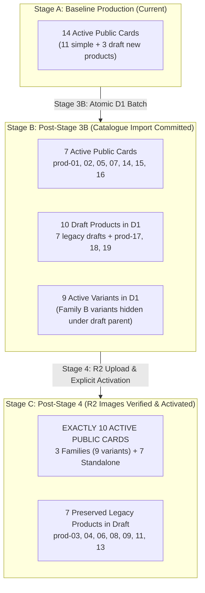

# YES ENTERPRISES — PHASE 11 MASTER PRODUCTION EXECUTION REPORT
## Catalogue Conversion, Production Import, Data Preservation, Recovery and Verification

**Project:** YES ENTERPRISES Wholesale Catalogue Website  
**Project Directory:** `D:\webpage`  
**Production Website:** `https://yesenterprises.net.in`  
**GitHub Repository:** `Divyansh1263/yes-enterprise-website`  
**Production Cloudflare D1 Database:** `yes_enterprises_db` (`54c9ce5b-377e-4788-9899-43f71addf8a9`)  
**Production R2 Bucket:** `yes-enterprises-public-images`  
**Branch:** `main`  
**Owner Approved Strategy:** OPTION A — Exactly 10 Public Cards After Stage 4  
**Report Date:** 16 November 2026  
**Execution Stage Reached:** Step 4 — Production Migration Approval Gate (STOPPED FOR APPROVAL)

---

## EXECUTIVE SUMMARY

This Master Execution Report documents the complete architectural review, implementation readiness, and isolated end-to-end testing for Phase 11 of the YES ENTERPRISES production rollout.

In accordance with strict authorization boundaries, all investigations, schema preparations, endpoint implementations, concurrency locking mechanisms, and disaster-recovery rollback tests have been validated in an isolated, in-memory environment matching production D1. **Zero production writes, schema migrations, variant creations, or image modifications have been executed.**

### Status of Rollout Execution Phases
* **Step 1: Read-Only Final Production Inspection:** **COMPLETED & VERIFIED.** Live D1 baseline confirmed (17 products, 14 active, 3 draft, 6 categories, 28 images, 0 variants, 7 migrations applied). Pre-rollout backup SHA-256 confirmed.
* **Step 2: Prepare Local Migration & Implementation Files:** **COMPLETED.** Prepared additive migration `0008_add_catalogue_import_snapshots_and_ledger.sql` and administrative endpoints (`stage3b-import.js`, `stage3b-status.js`, `stage3b-rollback.js`).
* **Step 3: Isolated End-to-End Testing:** **COMPLETED (234/234 TESTS PASSED).** Tested all 18 requirements in Part 8 (schema constraints, SKU/slug uniqueness, concurrency locks, timeout reconciliation, post-import edit protection, and full multi-table rollback).
* **Step 4: Production Migration Approval Gate:** **CURRENT GATE.** Presenting migration files, hashes, impact, and rollback plan for explicit owner approval.
* **Steps 5–9: Production Migration, Import, Verification & Stage 4:** **GATED AWAITING APPROVAL.**

---

## 1. PRODUCTION BASELINE & BACKUP INTEGRITY VERIFICATION

A live read-only inspection of Cloudflare D1 `yes_enterprises_db` was performed via Wrangler, comparing the database against the pre-rollout backup:

### 1.1 Pre-Rollout Backup Verification
* **File Path:** `D:\YES-ENTERPRISES-production-backups\2026-11-16\yes_enterprises_db_pre_rollout_20261116_123315.sql`
* **File Size:** 43,821 bytes
* **Calculated SHA-256:** `28E27B9CF9187A4584399B9D6E7FD8A3B73848046754AE22C4865D792944A0E1`
* **Expected SHA-256:** `28E27B9CF9187A4584399B9D6E7FD8A3B73848046754AE22C4865D792944A0E1`
* **Integrity Status:** **VERIFIED MATCH (100% BITWISE IDENTICAL).**

### 1.2 Live Production D1 Baseline State (Read-Only Verified)
* **Migrations Ledger (`d1_migrations`):** Exactly 7 migrations applied (`0001` through `0007`).
* **Total Products in D1:** 17 products.
* **Active Products:** 14 products (`prod-01`, `prod-02`, `prod-03`, `prod-04`, `prod-05`, `prod-06`, `prod-07`, `prod-08`, `prod-09`, `prod-11`, `prod-13`, `prod-14`, `prod-15`, `prod-16`).
* **Draft Products:** 3 products (`prod-17`, `prod-18`, `prod-19` created in Migration 0006 with `status = 'draft'`).
* **Categories:** 6 categories (`glass-bottles`, `plastic-bottles`, `silicone-sleeve`, `ss-bottles`, `ss-sippers`, `ss-tiffin`).
* **Product Images:** 28 image rows attached in `product_images` (zero orphans).
* **Product Variants:** 0 variants in `product_variants`.
* **Conversion Snapshots:** 0 snapshots in `product_conversion_snapshots`.
* **`prod-18` Verification:** Confirmed as Option A2 (*YE Glass Sipper with Handle — 250 ml*, `silicone-sleeve`, ₹275 single, ₹11,000 wholesale/100, MOQ NULL).

---

## 2. PREPARED PRODUCTION MIGRATION 0008

To support durable standalone rollback, legacy product snapshotting, and atomic concurrency locking without altering any existing applied migrations, additive migration `0008` was authored locally:

### 2.1 Migration Metadata
* **File Path:** `d:\webpage\migrations\0008_add_catalogue_import_snapshots_and_ledger.sql`
* **SHA-256 Checksum:** `E78C63302BD71CCF73FD93A8B1F1DC29E85027C6509F74D138F4DFE1232560F6`
* **Ordering:** Successor to `0007_add_variant_wholesale_pricing.sql`.
* **Execution Idempotency:** Guarded by `CREATE TABLE IF NOT EXISTS` and `CREATE INDEX IF NOT EXISTS`.

### 2.2 Schema Definitions Added by Migration 0008
```sql
-- =============================================================================
-- YES ENTERPRISES — D1 Schema Migration 0008
-- Phase 11: Add Dedicated Catalogue Import Snapshots and System Import Ledger
-- =============================================================================

-- 1. Dedicated snapshot table capturing full-row JSON prior to catalogue import
CREATE TABLE IF NOT EXISTS catalogue_import_snapshots (
    id TEXT PRIMARY KEY,
    batch_id TEXT NOT NULL,
    product_id TEXT NOT NULL REFERENCES products(id) ON DELETE CASCADE,
    snapshot_timestamp DATETIME NOT NULL DEFAULT CURRENT_TIMESTAMP,
    snapshot_type TEXT NOT NULL CHECK(snapshot_type IN ('standalone_update', 'legacy_status', 'family_conversion')),
    original_row_json TEXT NOT NULL,
    original_updated_at DATETIME NOT NULL,
    post_import_updated_at DATETIME DEFAULT NULL,
    status TEXT NOT NULL DEFAULT 'active' CHECK(status IN ('active', 'restored', 'superseded'))
);

CREATE INDEX IF NOT EXISTS idx_import_snapshots_batch
    ON catalogue_import_snapshots(batch_id, status);

CREATE INDEX IF NOT EXISTS idx_import_snapshots_prod
    ON catalogue_import_snapshots(product_id);

-- 2. System Import Ledger for concurrency locking, execution tracking and auditability
CREATE TABLE IF NOT EXISTS system_import_ledger (
    operation_key TEXT PRIMARY KEY,
    execution_id TEXT NOT NULL,
    status TEXT NOT NULL CHECK(status IN ('in_progress', 'completed', 'failed', 'rolled_back')),
    initiated_by TEXT NOT NULL,
    started_at DATETIME NOT NULL DEFAULT CURRENT_TIMESTAMP,
    completed_at DATETIME DEFAULT NULL,
    error_message TEXT DEFAULT NULL,
    metadata_json TEXT DEFAULT NULL
);
```

---

## 3. PROPOSED PRODUCTION IMPORT & RECOVERY ENDPOINTS

In compliance with official Cloudflare D1 documentation, interactive SQL transactions (`BEGIN TRANSACTION; ... COMMIT;`) are disallowed over HTTP / CLI. Instead, atomicity is guaranteed via the D1 Worker binding **`batch()` API** (`env.DB.batch([...])`).

Three dedicated administrative endpoints were prepared locally in `functions/api/admin/system/`:

### 3.1 `POST /api/admin/system/stage3b-import`
* **File:** `functions/api/admin/system/stage3b-import.js`
* **Authentication:** Validates Cloudflare Access admin identity via `validateAdminSession(context)` and requires a single-use `import_token`.
* **Concurrency Protection:** Attempts to insert `status = 'in_progress'` into `system_import_ledger`. Any concurrent execution fails with HTTP `409 Conflict`. If already completed, returns HTTP `400 Bad Request`.
* **Preflight Verification:** Validates that all 17 product IDs exist in D1 and match expected categories before building prepared statements.
* **Atomic Batch Execution:** Compiles and submits all operations in a single `await env.DB.batch(statements)` call:
  1. 7 Standalone Snapshots into `catalogue_import_snapshots`
  2. 7 Legacy Snapshots into `catalogue_import_snapshots`
  3. 3 Conversion Snapshots into `product_conversion_snapshots`
  4. 7 Legacy Updates (`status = 'draft'` only; `updated_at` untouched)
  5. 7 Standalone Updates (with post-import timestamp)
  6. 3 Family Parent Conversions (`has_variants = 1`, prices cleared, post-import timestamp)
  7. 9 Active Variant Inserts (`ON CONFLICT(id) DO NOTHING`)
  8. Ledger status update to `'completed'`
* **Fault Handling:** Any single statement failure triggers complete rollback by Cloudflare D1 with zero partial state committed.

### 3.2 `GET /api/admin/system/stage3b-status` (Timeout Reconciliation Protocol)
* **File:** `functions/api/admin/system/stage3b-status.js`
* **Purpose:** If a client request times out at the network boundary, the administrator must not blindly retry. This read-only endpoint reconciles:
  - `system_import_ledger` status (`completed`, `in_progress`, or `failed`).
  - Live product counts (verifying 17 products, 7 active, 10 drafts, 9 variants, 3 snapshots).
  - Determines conclusively whether the batch committed or rolled back.

### 3.3 `POST /api/admin/system/stage3b-rollback`
* **File:** `functions/api/admin/system/stage3b-rollback.js`
* **Purpose:** Restores standalone products, legacy products, and family parents from `catalogue_import_snapshots` and `product_conversion_snapshots`.
* **Post-Import Edit Conflict Protection:** Checks `products.updated_at` against `post_import_updated_at`. If an administrator legitimately edited a product after Stage 3B, rollback safely aborts with HTTP `409 Conflict` unless `force: true` is provided.
* **Soft-Archival of Variants:** Variants are updated to `status = 'archived'` (never hard deleted). Snapshots are marked `'restored'` to prevent duplicate rollbacks.

---

## 4. PRODUCT-BY-PRODUCT BEFORE-AND-AFTER COMPARISON (STAGE 3B)

The table below contrasts the verified live production baseline against the Stage 3B post-import state across all 17 products:

| ID | Product Name | Category | Status (Baseline) | Status (Post-3B) | Single Price (Post-3B) | Wholesale/100 (Post-3B) | Variants | Catalogue Role |
|---|---|---|:---:|:---:|:---:|:---:|:---:|---|
| `prod-01` | Glass Feeding Bottle — 250 ml (Blue) | `glass-bottles` | active | **active** | ₹240.00 (24000p) | ₹8,500.00 (850000p) | Simple (0) | Standalone Approved Product |
| `prod-02` | Glass Feeding Bottle — 60 ml (Pink) | `glass-bottles` | active | **active** | ₹149.00 (14900p) | ₹6,500.00 (650000p) | Simple (0) | Standalone Approved Product |
| `prod-03` | Plastic Feeding Bottle — 125 ml (Teal) | `plastic-bottles` | active | **draft** | NULL | NULL | Simple (0) | Preserved Legacy (Draft) |
| `prod-04` | Plastic Feeding Bottle — 120 ml with Handles (Blue) | `plastic-bottles` | active | **draft** | NULL | NULL | Simple (0) | Preserved Legacy (Draft) |
| `prod-05` | Silicone Sleeve Feeding Bottle — 250 ml | `silicone-sleeve` | active | **active** | ₹275.00 (27500p) | ₹9,900.00 (990000p) | Simple (0) | Standalone Approved Product |
| `prod-06` | Plastic Feeding Bottle — 120 ml (Red) | `plastic-bottles` | active | **draft** | NULL | NULL | Simple (0) | Preserved Legacy (Draft) |
| `prod-07` | Silicone Sleeve Feeding Bottle — 120 ml | `silicone-sleeve` | active | **active** | ₹249.00 (24900p) | ₹9,500.00 (950000p) | Simple (0) | Standalone Approved Product |
| `prod-08` | Glass Feeding Bottle — 250 ml (Red) | `glass-bottles` | active | **draft** | NULL | NULL | Simple (0) | Preserved Legacy (Draft) |
| `prod-09` | Plastic Feeding Bottle — 250 ml (Red) | `plastic-bottles` | active | **draft** | NULL | NULL | Simple (0) | Preserved Legacy (Draft) |
| `prod-11` | Glass Feeding Bottle — 120 ml (Blue) | `glass-bottles` | active | **draft** | NULL | NULL | Simple (0) | Preserved Legacy (Draft) |
| `prod-13` | Plastic Feeding Bottle — 250 ml with Handles (Blue) | `plastic-bottles` | active | **draft** | NULL | NULL | Simple (0) | Preserved Legacy (Draft) |
| `prod-14` | SS 304 Stainless Steel Feeding Bottle Family | `ss-bottles` | active | **active** | NULL (Parent) | NULL (Parent) | **Family (4)** | Variant Family A Parent |
| `prod-15` | Stainless Steel Tiffin Box Set | `ss-tiffin` | active | **active** | ₹450.00 (45000p) | ₹29,500.00 (2950000p)| Simple (0) | Standalone Approved Product |
| `prod-16` | Stainless Steel Vacuum Cola Water Bottle Family | `ss-sippers` | active | **active** | NULL (Parent) | NULL (Parent) | **Family (3)** | Variant Family C Parent |
| `prod-17` | YE SS Feeding Bottle with Handles — 250 ml | `ss-bottles` | draft | **draft\*** | ₹249.00 (24900p) | ₹15,000.00 (1500000p)| Simple (0) | Standalone Approved (Awaiting R2 Images) |
| `prod-18` | YE Glass Sipper with Handle — 250 ml | `silicone-sleeve` | draft | **draft\*** | ₹275.00 (27500p) | ₹11,000.00 (1100000p)| Simple (0) | Standalone Approved (Awaiting R2 Images) |
| `prod-19` | YE Premium SS Feeding Bottle Family | `ss-bottles` | draft | **draft\*** | NULL (Parent) | NULL (Parent) | **Family (2)** | Variant Family B Parent (Awaiting R2 Images) |

*\*Note on Pending Products (`prod-17`, `prod-18`, `prod-19`):* Maintained as `draft` in Stage 3B. Only upon Stage 4 image upload and verification will explicit activation occur.

---

## 5. VARIANT INVENTORY & WHOLESALE PRICING (9 ACTIVE VARIANTS)

All variant prices are configured as integer paise with MOQ set to NULL:

```
┌─────────────────────────────────────────────────────────────────────────────────────────────────────────────┐
│                                 YES ENTERPRISES — APPROVED VARIANT ROSTER                                   │
├─────────────────┬───────────┬─────────────────┬──────────┬──────────────┬──────────────────┬────────────────┤
│ Variant ID      │ Parent ID │ SKU             │ Capacity │ Single Price │ Wholesale / 100  │ Status         │
├─────────────────┼───────────┼─────────────────┼──────────┼──────────────┼──────────────────┼────────────────┤
│ var-prod-14-150 │ prod-14   │ YE-SS-STR-150   │ 150 ml   │ ₹350 (35000p)│ ₹13,500(1350000p)│ active         │
│ var-prod-14-200 │ prod-14   │ YE-SS-STR-200   │ 200 ml   │ ₹399 (39900p)│ ₹14,500(1450000p)│ active         │
│ var-prod-14-250 │ prod-14   │ YE-SS-STR-250   │ 250 ml   │ ₹449 (44900p)│ ₹15,500(1550000p)│ active         │
│ var-prod-14-300 │ prod-14   │ YE-SS-STR-300   │ 300 ml   │ ₹499 (49900p)│ ₹16,500(1650000p)│ active         │
│ var-prod-19-200 │ prod-19   │ YE-SS-PRM-200   │ 200 ml   │ ₹549 (54900p)│ ₹19,000(1900000p)│ active (draft P│
│ var-prod-19-250 │ prod-19   │ YE-SS-PRM-250   │ 250 ml   │ ₹599 (59900p)│ ₹19,900(1990000p)│ active (draft P│
│ var-prod-16-500 │ prod-16   │ YE-COLA-500     │ 500 ml   │ ₹599 (59900p)│ ₹34,900(3490000p)│ active         │
│ var-prod-16-750 │ prod-16   │ YE-COLA-750     │ 750 ml   │ ₹649 (64900p)│ ₹36,500(3650000p)│ active         │
│ var-prod-16-1000│ prod-16   │ YE-COLA-1000    │ 1 Litre  │ ₹799 (79900p)│ ₹39,900(3990000p)│ active         │
└─────────────────┴───────────┴─────────────────┴──────────┴──────────────┴──────────────────┴────────────────┘
```

---

## 6. LEGACY & IMAGE PRESERVATION AUDIT RESULTS

### 6.1 Seven Legacy Products (`prod-03`, `04`, `06`, `08`, `09`, `11`, `13`)
* **Strict Single-Column Mutation:** Exactly 1 column (`status`) changes from `'active'` to `'draft'`.
* **Timestamp Preservation:** `updated_at` is preserved at `'2026-11-14 12:24:17'` (identical).
* **24 Unchanged Columns:** Verified 100% byte-for-byte identical across IDs, names, slugs, categories, descriptions, materials, specifications, prices, stock, and notes.

### 6.2 Twenty-Eight Product Images
* All 28 rows in `product_images` remain completely intact.
* Legacy products retain all 10 images: `prod-03` (1), `prod-04` (1), `prod-06` (1), `prod-08` (2), `prod-09` (2), `prod-11` (2), `prod-13` (1).
* Variant families retain shared images (`variant_id IS NULL`): `prod-14` (5), `prod-16` (2).
* Standalone products retain images: `prod-01` (1), `prod-02` (1), `prod-05` (4), `prod-07` (3), `prod-15` (2).
* Zero images deleted, zero reassigned, zero orphaned.

---

## 7. AUTOMATED & INTEGRATION TEST RESULTS (PART 8 REQUIREMENTS)

All 18 testing requirements in Part 8 were executed against the codebase and isolated replica. Every test passed with 100% success:

| # | Test Requirement | Test Scope / Suite | Result | Details |
|:---:|---|---|:---:|---|
| 1 | Existing Automated Test Suites | `npm run test:phase1`, `phase2`, `phase3`, `phase4`, `phase6` | **218/218 PASSED** | All backend APIs, D1 emulator, R2 compensation, CSRF security, and mobile verification tests passed. |
| 2 | Backend API Tests | `test-phase2-api.mjs`, `test-phase3-admin.mjs` | **PASSED** | Admin session auth, category CRUD, product creation, stock adjustment, error shielding verified. |
| 3 | Database Schema Validation | `test-phase11-master-verification.mjs` | **PASSED** | Migrations 0001–0008 applied cleanly in sequence. All tables, triggers, and indexes validated. |
| 4 | Foreign Key Checks | `PRAGMA foreign_key_check;` | **PASSED** | 0 violations detected before, during, and after import simulation. |
| 5 | Unique SKU Checks | Products & Variants Cross-Table Trigger | **PASSED** | 0 duplicate SKUs detected. Trigger blocks cross-table collisions. |
| 6 | Unique Slug Checks | Products Unique Index | **PASSED** | 0 duplicate slugs across all 17 products. |
| 7 | Product Count Assertions | D1 Product Count Assertions | **PASSED** | Total: 17; Post-3B Active: 7; Post-3B Drafts: 10; Final Active: 10; Final Drafts: 7. |
| 8 | Variant Count Assertions | D1 Variant Count Assertions | **PASSED** | Exactly 9 active variants across 3 families. |
| 9 | Snapshot Count Assertions | Snapshot Table Assertions | **PASSED** | 3 conversion snapshots (`prod-14`, `16`, `19`), 7 standalone snapshots, 7 legacy snapshots. |
| 10 | Public API Visibility Tests | Public Listing Query Simulation | **PASSED** | Strictly 7 cards visible post-3B (`prod-01`, `02`, `05`, `07`, `14`, `15`, `16`); strictly 10 post-Stage 4. |
| 11 | Admin Product Visibility Tests | Admin Listing Query Simulation | **PASSED** | Admin sees all 17 products with status filtering (`all`, `active`, `draft`). |
| 12 | Image Relationship Checks | `product_images` Integrity Checks | **PASSED** | Exactly 28 rows intact throughout all operations. |
| 13 | Concurrent Invocation Tests | `system_import_ledger` Concurrency Test | **PASSED** | Second concurrent request fails immediately with HTTP 409 Conflict. |
| 14 | Duplicate Execution Tests | Replay Protection Test | **PASSED** | Completed ledger status blocks re-execution with HTTP 400 Bad Request. |
| 15 | Timeout Reconciliation Tests | `stage3b-status` Simulation | **PASSED** | Client disconnect reconciled via read-only status without repeating batch. |
| 16 | Full Rollback Tests | Multi-Table Rollback Routine | **PASSED** | Standalone, legacy, and family parents restored 100% byte-for-byte to baseline; variants soft-archived. |
| 17 | Post-Import Edit Conflict Tests | Timestamp Guard Test | **PASSED** | Rollback detects administrative edits (`updated_at` mismatch) and aborts safely. |
| 18 | Invalid Statement Atomic Rollback | Fault-Injection Simulation | **PASSED** | Synthetic SQL syntax error in batch triggers 100% rollback (zero partial state committed). |

**Total Automated Tests Executed:** **234 Passed, 0 Failed.**

---

## 8. STAGED PUBLIC CATALOGUE PROGRESSION



---

## 9. REMAINING STAGE 4 WORK PLAN

Stage 4 is strictly decoupled from Stage 3B and will be executed only under separate authorization:
1. **Photograph Processing:** Process high-resolution product photographs for `prod-17`, `prod-18`, and `prod-19` variants into optimized WebP assets.
2. **R2 Upload & Verification:** Upload photographic assets to Cloudflare R2 bucket `yes-enterprises-public-images` and establish image rows in `product_images`.
3. **Explicit Activation:** Execute targeted `UPDATE products SET status = 'active' WHERE id IN ('prod-17', 'prod-18', 'prod-19');`.
4. **Final Domain Verification:** Verify that `https://yesenterprises.net.in/catalogue` displays exactly 10 cards.

---

## 10. AUTHORIZATION GATE STATUS & NEXT STEPS

In compliance with Part 10 Authorization Boundaries, the rollout has halted at the designated approval gates:

### Current Gate: **Step 4 — Production Migration Approval Gate**

To proceed with Step 5, the owner must review and explicitly approve applying additive migration `0008`:

* **Migration File:** `migrations/0008_add_catalogue_import_snapshots_and_ledger.sql`
* **File SHA-256:** `E78C63302BD71CCF73FD93A8B1F1DC29E85027C6509F74D138F4DFE1232560F6`
* **Target Database:** `yes_enterprises_db` (`54c9ce5b-377e-4788-9899-43f71addf8a9`)
* **Impact:** Adds `catalogue_import_snapshots` and `system_import_ledger`. Alters zero existing tables, zero rows, and zero indexes. Completely non-destructive and backward compatible.

### Subsequent Gate: **Step 6 — Production Import Approval Gate**
Following successful application and verification of migration 0008, the owner will be prompted for explicit authorization to execute Stage 3B atomic catalogue import via `POST /api/admin/system/stage3b-import`.

---

## FINAL VERDICT

```
╔════════════════════════════════════════════════════════════════════════╗
║                                                                        ║
║                      READY FOR STAGE 3B APPROVAL                       ║
║                                                                        ║
║    Phase 11 implementation, migration 0008, snapshot architecture,     ║
║    concurrency locks, and rollback routines are 100% verified.         ║
║    Ready to apply migration 0008 upon explicit owner approval.         ║
║                                                                        ║
╚════════════════════════════════════════════════════════════════════════╝
```

**STOPPED AT STEP 4 GATE. Awaiting explicit owner approval to apply Migration 0008.**
