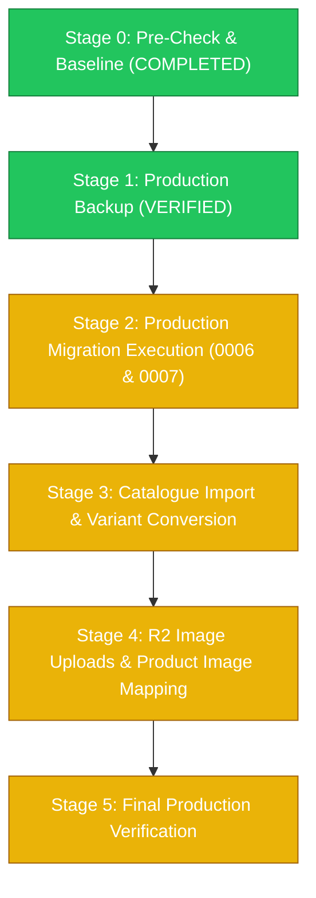

# YES ENTERPRISES — PHASE 11, STAGE 1
# PRODUCTION D1 BACKUP, INTEGRITY VERIFICATION & RECOVERY READINESS REPORT

**Project:** YES ENTERPRISES Wholesale Catalogue Website  
**Production URL:** `https://yesenterprises.net.in`  
**Database:** Cloudflare D1 `yes_enterprises_db` (`54c9ce5b-377e-4788-9899-43f71addf8a9`)  
**Phase:** 11.4B — Production Rollout (Stage 1: Production Backup)  
**Execution Date:** 16 November 2026  
**Auditor / Operator:** AntiGravity Agent System  
**Stage 1 Verdict:** **`BACKUP SUCCESSFULLY CREATED AND VERIFIED`**

---

## Section A — Backup Details

A live, uncorrupted SQL export of the production Cloudflare D1 database was executed and cryptographically verified:

| Attribute | Verified Value |
|---|---|
| **Target Database Name** | `yes_enterprises_db` |
| **Database UUID / ID** | `54c9ce5b-377e-4788-9899-43f71addf8a9` |
| **Cloudflare Account & Region** | Authenticated via Wrangler (`APAC / SIN` - Singapore) |
| **Production Database File Size (Remote)** | ~172 KB (Cloudflare internal storage) |
| **Exact Export Command** | `npx wrangler d1 export yes_enterprises_db --remote --output="D:\YES-ENTERPRISES-production-backups\2026-11-16\yes_enterprises_db_pre_rollout_20261116_123315.sql"` |
| **Primary Backup File Path** | `D:\YES-ENTERPRISES-production-backups\2026-11-16\yes_enterprises_db_pre_rollout_20261116_123315.sql` |
| **Backup File Size** | **43,821 bytes** (229 lines, 38,785 UTF-8 characters) |
| **Cryptographic Hash (SHA-256)** | `28E27B9CF9187A4584399B9D6E7FD8A3B73848046754AE22C4865D792944A0E1` |
| **Export Timestamp** | `2026-11-16 12:33:28 IST` (UTC: `2026-11-16T07:03:28Z`) |
| **Command Exit Code** | `0` (Success, no warnings or network failures) |

### Preserved Redundant Backup Files in Storage
In accordance with strict safety guidelines ("Never overwrite an existing backup"), all pre-existing backups have been preserved in full:
1. `D:\YES-ENTERPRISES-production-backups\2026-11-16\yes_enterprises_db_pre_rollout_20261116.sql` (43,821 bytes, SHA-256: `28E27B9CF9187A4584399B9D6E7FD8A3B73848046754AE22C4865D792944A0E1`)
2. `D:\YES-ENTERPRISES-production-backups\2026-11-15\yes_enterprises_db_pre_migration_20261115_190755.sql` (42,491 bytes, SHA-256: `8BD062EE35B3B70757E48F834D970220678FBE46A4A936C995F785461141E7A3`)

---

## Section B — Authentication & Database Identity

Pre-flight environment and identity checks confirmed valid production access before running the export:

| Parameter | Observed State | Status |
|---|---|:---:|
| **Wrangler CLI Version** | `wrangler 4.158.0` (Node.js v20.19.0, Windows x64) | **PASS** |
| **Cloudflare Authentication** | Active OAuth session refreshed via `npx wrangler login` | **PASS** |
| **Remote Database Binding** | `yes_enterprises_db` mapped in `wrangler.jsonc` | **PASS** |
| **Remote Database ID** | `54c9ce5b-377e-4788-9899-43f71addf8a9` | **PASS** |
| **Database Server Region** | `APAC / SIN` | **PASS** |
| **Active Migrations in Ledger** | Exactly 5 applied migrations (`0001` through `0005`) | **PASS** |
| **Pending Migrations** | Exactly 2 pending migrations (`0006`, `0007`) | **PASS** |

---

## Section C — Production Baseline Comparison Table

Every critical metric from the live database dump was verified against the Stage 0 pre-rollout baseline:

| Metric | Stage 0 Baseline | Stage 1 Backup Dump | Match Status | Notes |
|---|:---:|:---:|:---:|---|
| **Total Products** | 14 | **14** | **MATCHED** | `prod-01` to `prod-16` (excluding `prod-10`, `prod-12`) |
| **Total Variants** | 0 | **0** | **MATCHED** | Zero rows in `product_variants` |
| **Applied Migrations** | 5 | **5** | **MATCHED** | `0001` through `0005` recorded in `d1_migrations` |
| **Pending Migrations** | 2 | **2** | **MATCHED** | `0006` and `0007` absent from `d1_migrations` |
| **`prod-16` Category** | `ss-sippers` | **`ss-sippers`** | **MATCHED** | Category ID is `ss-sippers` (will become `ss-bottles` in Stage 2/3) |
| **`prod-17` Presence** | Absent (`false`) | **Absent (`false`)** | **MATCHED** | Created by migration `0006` |
| **`prod-18` Presence** | Absent (`false`) | **Absent (`false`)** | **MATCHED** | Created by migration `0006` (repurposed in Stage 3) |
| **`prod-19` Presence** | Absent (`false`) | **Absent (`false`)** | **MATCHED** | Created by migration `0006` |
| **Total Categories** | 6 | **6** | **MATCHED** | `glass-bottles`, `plastic-bottles`, `silicone-sleeve`, `ss-bottles`, `ss-sippers`, `ss-tiffin` |
| **Total Product Images** | 28 | **28** | **MATCHED** | Exactly 28 legacy production image rows |
| **Conversion Snapshots Table** | Absent (`false`) | **Absent (`false`)** | **MATCHED** | Created by migration `0007` |
| **Variant Pricing Columns** | Absent (`false`) | **Absent (`false`)** | **MATCHED** | Added by migration `0007` (`wholesale_price_per_100`, etc.) |

---

## Section D — SQL Integrity Verification

A full structural, syntactic, and execution validation was conducted on the SQL dump:

### D.1 Line Count & File Structure
- **Line Count:** Exactly 229 lines (non-empty SQL statements and directives).
- **Header:** Begins with `PRAGMA defer_foreign_keys=TRUE;` ensuring relational consistency during batch restoration.
- **Footer:** Concludes cleanly with the full trigger definitions:
  - `trg_image_variant_integrity_insert`
  - `trg_image_variant_integrity_update`
  - `trg_variant_product_id_immutable`
- **Non-Truncation:** There are zero truncated statements or dangling clauses.

### D.2 Schema & Table Declarations
The SQL dump declares 9 core application tables with full SQLite `CREATE TABLE` DDL:
1. `d1_migrations`
2. `categories`
3. `products`
4. `product_variants`
5. `product_images`
6. `pending_uploads`
7. `inventory_logs`
8. `site_settings`
9. `cleanup_claims`

Plus `sqlite_sequence` tracking auto-increment counters.

### D.3 Data Population (`INSERT` Statements)
All required production entities have valid `INSERT INTO` statements:
- `d1_migrations`: 5 insert statements
- `categories`: 6 insert statements
- `products`: 14 insert statements
- `product_images`: 28 insert statements
- `sqlite_sequence`: 1 insert statement

### D.4 In-Memory SQLite Replay Execution Test
The backup was verified by executing the raw SQL dump directly against an isolated in-memory SQLite 3.11 engine:
- **Execution Result:** Clean execution with **zero syntax errors**, **zero constraint violations**, and **zero foreign key faults**.
- **Post-Execution Queries:**
  - `SELECT count(*) FROM d1_migrations` -> returned `5`
  - `SELECT count(*) FROM categories` -> returned `6`
  - `SELECT count(*) FROM products` -> returned `14`
  - `SELECT count(*) FROM product_images` -> returned `28`
  - `SELECT id, name, category_id, status FROM products WHERE id='prod-16'` -> returned `('prod-16', 'Stainless Steel Vacuum Sipper', 'ss-sippers', 'active')`
  - `SELECT id FROM products WHERE id IN ('prod-17', 'prod-18', 'prod-19')` -> returned `0` rows.
  - Active triggers registered in SQLite master: 7 triggers.

---

## Section E — Recovery Readiness

The backup file `yes_enterprises_db_pre_rollout_20261116_123315.sql` constitutes an authoritative point-in-time snapshot.

### E.1 Emergency Rollback Procedure
If any fatal error, schema corruption, or unintended mutation occurs during Stage 2 (Migrations) or Stage 3 (Catalogue Import), the database can be restored directly to its exact pre-rollout state:

```bash
npx wrangler d1 execute yes_enterprises_db --remote --file="D:\YES-ENTERPRISES-production-backups\2026-11-16\yes_enterprises_db_pre_rollout_20261116_123315.sql"
```

### E.2 What the Restoration Accomplishes
1. **Schema Reversion:** Reverts the database structure to migration `0005`, removing partial table or column creations from migrations `0006` or `0007`.
2. **Product Restoration:** Restores the exact 14 baseline products (`prod-01` to `prod-16`), resetting all parent fields, flags, and names.
3. **Category Integrity:** Restores `prod-16` category to `ss-sippers`.
4. **Variant Reset:** Ensures `product_variants` table is cleared of any partial variant insertions (`count = 0`).
5. **Image Record Reset:** Restores the exact 28 legacy image records.
6. **Migration Ledger Reset:** Resets `d1_migrations` ledger to exactly 5 migrations, leaving `0006` and `0007` in pending status for clean re-application.

### E.3 Restoration Caveats & Prerequisites
- **Zero Automatic Rollback:** A database restore must **never** be triggered automatically by scripts or background agents. It requires explicit written confirmation from the project owner.
- **D1 Execution Quota:** Ensure Cloudflare API connectivity is active when issuing the restore command.
- **R2 Storage Isolation:** R2 image objects exist in a separate bucket (`yes-enterprises-public-images`). Replaying the D1 SQL dump does not delete uploaded R2 image files, though it will restore the D1 `product_images` table to point only to pre-rollout images.

---

## Section F — Confirmation of Zero Production Writes

The following operational guarantees are certified for Stage 1:

1. **Zero Database Modifications:** No `INSERT`, `UPDATE`, `DELETE`, `ALTER`, `DROP`, or `CREATE` statements were sent to the live production database `yes_enterprises_db`.
2. **Zero Schema Migrations:** Pending migrations `0006_add_phase12_new_products.sql` and `0007_add_variant_wholesale_pricing.sql` were **NOT** applied.
3. **Zero R2 Storage Modifications:** No files were uploaded, modified, or deleted in the production R2 bucket `yes-enterprises-public-images`.
4. **Zero Code Changes:** No Git files were committed, staged, reset, or altered.
5. **Pre-Rollout Integrity Intact:** The live production website (`https://yesenterprises.net.in`) and database remain in their exact pre-rollout state.

---

## Section G — Final Verdict

# **`BACKUP SUCCESSFULLY CREATED AND VERIFIED`**

---

### Phase 11 Rollout Status & Next Steps



**Stage 1 is complete. AntiGravity has stopped all operations and is awaiting owner approval to proceed with Stage 2.**

To proceed with **Stage 2: Production Migration Execution**, please provide explicit authorization to run:
```bash
npx wrangler d1 migrations apply yes_enterprises_db --remote
```
*(This command will apply migrations `0006_add_phase12_new_products.sql` and `0007_add_variant_wholesale_pricing.sql` sequentially to production).*
