# YES ENTERPRISES — PHASE 11, STAGE 2A
# PRODUCTION D1 MIGRATION SAFETY REVIEW & IMPLEMENTATION DESIGN REPORT

**Project:** YES ENTERPRISES Wholesale Catalogue Website  
**Production URL:** `https://yesenterprises.net.in`  
**Target Database:** Cloudflare D1 `yes_enterprises_db` (`54c9ce5b-377e-4788-9899-43f71addf8a9`)  
**Phase:** 11.4B — Production Rollout (Stage 2A: Migration Safety Review)  
**Execution Date:** 16 November 2026  
**Auditor / System:** AntiGravity Agent System  
**Mode:** STRICT READ-ONLY ANALYSIS (Zero production database writes, zero migrations applied)  

---

## 1. Executive Summary & Verification Objective

The objective of Stage 2A is to conduct an independent, read-only architectural safety review of pending Cloudflare D1 migrations:
- `migrations/0006_add_phase12_new_products.sql`
- `migrations/0007_add_variant_wholesale_pricing.sql`

This review resolves the core operational challenge regarding **`prod-18`**: ensuring that the obsolete preliminary 120 ml identity is never publicly exposed or cached at Cloudflare CDN edge nodes, and that the approved 250 ml product identity (Owner Decision Option A2) is safely established.

### Key Audit Findings:
1. **Production Backup Verified:** The fresh pre-rollout backup created in Stage 1 is fully intact, readable, and cryptographically verified at SHA-256 `28E27B9CF9187A4584399B9D6E7FD8A3B73848046754AE22C4865D792944A0E1`.
2. **Approved Catalogue Source Verified:** `data/phase_11_4A_catalogue_import_preview.json` matches its authorized cryptographic hash (`E6D4DAC029B4D6335C8B1A00064C6C8CAB4C236C1B533A1CE3BEC3D1214262F5`) with 100% precision.
3. **Migration 0006 Safety Hazard Identified:** The unrevised `0006` migration script inserts `prod-18` as `status = 'active'`, `category_id = 'glass-bottles'`, `name = 'YE Glass Sipper with Handle – 120 ml'`, and attaches an obsolete local image `img-prod-18-1`. Because public catalogue endpoints return `Cache-Control: s-maxage=300`, applying `0006` as-is creates an immediate **5-minute edge cache poisoning risk**, exposing the unapproved product on `https://yesenterprises.net.in`.
4. **Zero Risk to Migration History:** Cloudflare D1 tracks migrations solely by filename (`name`) in `d1_migrations` without content hashing. Because `0006` has never been applied to production, revising `0006` in place prior to execution guarantees that the 120 ml identity is never written to production D1, never returned by public APIs, and never cached.

---

## 2. Backup Integrity Verification (Stage 1 Handoff)

Before proceeding with migration analysis, the primary production backup was re-audited against `docs/PHASE_11_STAGE_1_PRODUCTION_BACKUP_REPORT.md`:

| Attribute | Expected in Stage 1 Report | Verified On-Disk Value | Status |
|---|---|---|:---:|
| **Full File Path** | `D:\YES-ENTERPRISES-production-backups\2026-11-16\yes_enterprises_db_pre_rollout_20261116_123315.sql` | `D:\YES-ENTERPRISES-production-backups\2026-11-16\yes_enterprises_db_pre_rollout_20261116_123315.sql` | **MATCH** |
| **Exact File Size** | 43,821 bytes | 43,821 bytes | **MATCH** |
| **Line Count** | 229 lines | 229 lines | **MATCH** |
| **SHA-256 Hash** | `28E27B9CF9187A4584399B9D6E7FD8A3B73848046754AE22C4865D792944A0E1` | `28E27B9CF9187A4584399B9D6E7FD8A3B73848046754AE22C4865D792944A0E1` | **MATCH** |
| **Redundant Backup Preserved** | `..._20261116.sql` (43,821 bytes) | Present, unmodified | **MATCH** |
| **Historical Backup Preserved** | `..._20261115_190755.sql` (42,491 bytes) | Present, unmodified | **MATCH** |

---

## 3. Migration Files Content & Cryptographic Hashes

The local migration files intended for deployment were audited:

### 3.1 `migrations/0006_add_phase12_new_products.sql`
- **File Size:** 7,495 bytes (221 lines)
- **SHA-256 Hash:** `5A9AF23836CA211FDC557E3D69E94B1DC7C88CECA4D217A3255B68C8394654F6`
- **Current File Contents & Declarations:**
  - `prod-17`: *YE Stainless Steel Feeding Bottle with Handles* (`ss-bottles`, `has_variants = 0`, `base_price_paise = NULL`, `status = 'active'`). 1 image record `img-prod-17-1` (`/assets/seller-new-products/product-a-handled-ss-bottle.jpeg`).
  - `prod-18`: *YE Glass Sipper with Handle – 120 ml* (`glass-bottles`, `has_variants = 0`, `base_price_paise = NULL`, `status = 'active'`). 1 image record `img-prod-18-1` (`/assets/seller-new-products/product-b-glass-sipper-120ml.jpeg`).
  - `prod-19`: *YE Premium Stainless Steel Feeding Bottle – 200 ml* (`ss-bottles`, `has_variants = 0`, `base_price_paise = NULL`, `status = 'active'`). 4 image records `img-prod-19-1` to `img-prod-19-4` (`/assets/seller-new-products/...`).
  - Idempotency: Uses `ON CONFLICT(id) DO NOTHING` across all `INSERT` statements.

### 3.2 `migrations/0007_add_variant_wholesale_pricing.sql`
- **File Size:** 1,699 bytes (34 lines)
- **SHA-256 Hash:** `5E505C75E720C7063606CA2E2638278C29CBDCC6CC14631F3DF7F907B7F9B930`
- **Current File Contents & Declarations:**
  - Adds `expected_price_per_100_paise INTEGER DEFAULT NULL` to `product_variants`.
  - Adds `min_order_quantity INTEGER DEFAULT NULL` to `product_variants`.
  - Creates composite index: `idx_product_variants_pricing ON product_variants(product_id, status, price_paise, expected_price_per_100_paise)`.
  - Creates dedicated table: `product_conversion_snapshots` with foreign key `REFERENCES products(id) ON DELETE CASCADE`.
  - Creates index: `idx_snapshots_product ON product_conversion_snapshots(product_id)`.

---

## 4. Migration Ledger State (Local vs Remote Production)

Inspection of Cloudflare D1 migration state using Wrangler 4.158.0:

| Migration File | Local D1 State | Remote Production D1 State | Pending on Remote? |
|---|:---:|:---:|:---:|
| `0001_initial_schema.sql` | APPLIED (2026-11-14) | APPLIED (2026-11-14 07:59:43) | No |
| `0002_r2_deletion_safety.sql` | APPLIED (2026-11-14) | APPLIED (2026-11-14 07:59:44) | No |
| `0003_seed_initial_catalogue.sql` | APPLIED (2026-11-15) | APPLIED (2026-11-15 13:40:05) | No |
| `0004_add_expected_price_per_100.sql` | APPLIED (2026-11-15) | APPLIED (2026-11-15 13:40:05) | No |
| `0005_add_min_order_quantity.sql` | APPLIED (2026-11-15) | APPLIED (2026-11-15 13:40:06) | No |
| `0006_add_phase12_new_products.sql` | APPLIED (dev test) | **NOT APPLIED (PENDING)** | **YES** |
| `0007_add_variant_wholesale_pricing.sql` | APPLIED (dev test) | **NOT APPLIED (PENDING)** | **YES** |

> **Key Takeaway:** Remote production D1 has **zero records** of migrations `0006` or `0007`. In Cloudflare D1, migration tracking table `d1_migrations` contains only:
> ```sql
> CREATE TABLE "d1_migrations" (
>   id INTEGER PRIMARY KEY AUTOINCREMENT,
>   name TEXT UNIQUE,
>   applied_at TIMESTAMP DEFAULT CURRENT_TIMESTAMP NOT NULL
> );
> ```
> Cloudflare D1 does **not** store cryptographic checksums of SQL files in the migration ledger. Wrangler inspects only the string filename `name`. Therefore, any non-destructive correction applied to `0006` prior to remote execution is completely safe, transparent, and creates zero migration divergence.

---

## 5. Schema Impact & Compatibility Analysis

### 5.1 Analysis of Migration 0007 Statements
1. **`ALTER TABLE product_variants ADD COLUMN expected_price_per_100_paise INTEGER DEFAULT NULL;`**
   - **Type:** Non-destructive column addition.
   - **Default:** `NULL` (fully backward compatible).
   - **Integrity Impact:** Zero existing variants exist in production (`count = 0`). The operation completes instantly without table rewrite.
2. **`ALTER TABLE product_variants ADD COLUMN min_order_quantity INTEGER DEFAULT NULL;`**
   - **Type:** Non-destructive column addition.
   - **Default:** `NULL` (supports optional MOQs).
   - **Integrity Impact:** Fully compatible with existing table structure.
3. **`CREATE INDEX IF NOT EXISTS idx_product_variants_pricing...`**
   - **Columns Indexed:** `(product_id, status, price_paise, expected_price_per_100_paise)`.
   - **Performance:** Speeds up public catalogue aggregation queries (`MIN(price_paise)` and `MIN(expected_price_per_100_paise)` in `functions/api/products/index.js#L97-L110`).
4. **`CREATE TABLE IF NOT EXISTS product_conversion_snapshots...`**
   - **Purpose:** Dedicated rollback table capturing simple product baseline state before conversion to a variable family.
   - **Compatibility with Phase 11.3 Implementation:**
     - Inspected `functions/api/admin/products/[id].js#L141-L153`: The admin API conversion handler inserts into this exact table schema.
     - Inspected `functions/api/admin/products/[id]/rollback.js#L39-L87`: The rollback endpoint selects from and updates this exact table.
     - Without Migration 0007, any product conversion in Phase 11.4B / Stage 3 will throw runtime SQL error: `no such table: product_conversion_snapshots`.
   - **Verdict on Migration 0007:** **100% Valid, safe, and mandatory.**

---

## 6. The `prod-18` Implementation Problem & Risk Audit

### 6.1 The Discrepancy
- **In Migration `0006`:**
  - Name: `YE Glass Sipper with Handle – 120 ml`
  - Slug: `ye-glass-sipper-with-handle-120ml`
  - Category: `glass-bottles`
  - Status: `'active'`
  - Is Featured: `1`
  - Single Price: `NULL`
  - Expected Wholesale Price: `NULL`
  - Image: `img-prod-18-1` pointing to `/assets/seller-new-products/product-b-glass-sipper-120ml.jpeg`
- **Approved Owner Decision (Option A2):**
  - ID: `prod-18`
  - Name: `YE Glass Sipper with Handle — 250 ml`
  - Slug: `ye-glass-sipper-handle-250ml`
  - Category: `silicone-sleeve`
  - Single Price: ₹275 (27,500 paise, printed box MRP override)
  - Expected Wholesale Price: ₹11,000 per 100 (1,100,000 paise)
  - MOQ: `NULL`
  - Status: `active` (upon import and image attachment)
  - Images: 4 approved Group 3 photographs (primary: `...9.28.28 AM (1).jpeg`) uploaded to R2 in Stage 4.

### 6.2 Why "Apply 0006 As-Is and Immediately Run UPDATE" is UNSAFE
Applying `0006` in its current state with the assumption of updating `prod-18` a few seconds later introduces fatal risks:

1. **Edge Cache Poisoning (`s-maxage=300`):**
   - The public products endpoint [functions/api/products/index.js](file:///d:/webpage/functions/api/products/index.js#L189) specifies:
     `publicCacheHeaders(60, 300)` -> `Cache-Control: public, max-age=60, s-maxage=300`.
   - Cloudflare CDN edge servers cache this JSON response for **5 minutes (300 seconds)**.
   - If `0006` executes with `status = 'active'`, any incoming web request or crawler (Googlebot, WhatsApp link preview, site visitor) that hits `/api/products`, `/api/categories`, or `/api/products/ye-glass-sipper-with-handle-120ml` during the window between migration application and subsequent update will trigger edge cache population.
   - For the subsequent 5 minutes, visitors in that Cloudflare edge region will see the unapproved 120 ml card, wrong category, and broken local image path.
2. **Category Count Contamination:**
   - [functions/api/categories/index.js](file:///d:/webpage/functions/api/categories/index.js#L33-L35) queries `COUNT(p.id) WHERE p.status = 'active'`.
   - `glass-bottles` category would temporarily report 4 products instead of the verified 3 products.
3. **Ghost Image Record Creation:**
   - `0006` inserts `img-prod-18-1` into `product_images`. This image points to a local static assets folder (`/assets/seller-new-products/...`), NOT an R2 object key. It would linger as an orphaned or invalid database record.
4. **Premature Exposure of `prod-17` and `prod-19`:**
   - Similarly, `prod-17` and `prod-19` in `0006` currently have `status = 'active'` and `base_price_paise = NULL`.
   - If `0006` runs as-is, `prod-17` and `prod-19` would appear on the live website with unpriced cards and placeholder images before Stage 3 (catalogue import) and Stage 4 (R2 upload) take place!

---

## 7. Recommended Safe Migration Design

To completely eliminate public exposure risks, cache poisoning, and orphaned image records, we evaluated three implementation alternatives:

### 7.1 Alternative Evaluation

```mermaid
flowchart TD
    subgraph ALT1 ["Alternative 1: Apply 0006 As-Is then UPDATE"]
        A1["Apply 0006 as-is"] --> A2["Window: 120ml is ACTIVE in DB"]
        A2 --> A3["Cloudflare Edge Caches 120ml (s-maxage=300)"]
        A3 --> A4["UPDATE prod-18 to 250ml in Stage 3"]
        A4 --> A5["POISONED CACHE: Users still see 120ml for 5 min!"]
    end

    subgraph ALT2 ["Alternative 2: Revise 0006 In-Place (RECOMMENDED)"]
        B1["Revise 0006 on disk before execution"]
        B2["Insert prod-18 with approved 250ml identity & status='draft'"]
        B3["Set prod-17 & prod-19 to status='draft'"]
        B4["Omit obsolete static image records"]
        B5["Apply migrations 0006 & 0007 via Wrangler"]
        B6["ZERO Public Exposure, ZERO Cache Poisoning"]
        B7["Stage 3 & 4 import approved data & activate safely"]
        B1 --> B2 --> B3 --> B4 --> B5 --> B6 --> B7
    end
```



### 7.2 The Recommended Solution (In-Place Revision of 0006 to Draft Status)
Prior to executing Stage 2B, revise `migrations/0006_add_phase12_new_products.sql` on disk as follows:

1. **Repurpose `prod-18` Directly:**
   - `name`: `'YE Glass Sipper with Handle — 250 ml'`
   - `name_hi`: `'YE हैंडल वाला ग्लास सिपर — 250 ml'`
   - `slug`: `'ye-glass-sipper-handle-250ml'`
   - `category_id`: `'silicone-sleeve'`
   - `material`: `'Glass with Protective Silicone Star Sleeve'`
   - `brand`: `'YE'`
   - `base_price_paise`: `27500` (₹275)
   - `expected_price_per_100_paise`: `1100000` (₹11,000)
   - `min_order_quantity`: `NULL`
   - **`status`:** `'draft'`
   - **`is_featured`:** `0`
2. **Prevent Premature Exposure of `prod-17` and `prod-19`:**
   - Set `status = 'draft'` and `is_featured = 0` for `prod-17` and `prod-19` as well.
   - This ensures that while schema migration 0006 creates the IDs, none of them leak onto the public website before Stage 3 imports full pricing and Stage 4 uploads approved R2 images.
3. **Omit Preliminary Image Records:**
   - Omit the `INSERT INTO product_images` for `img-prod-17-1`, `img-prod-18-1`, and `img-prod-19-*` from migration `0006`.
   - The verified 36 camera photographs will be cleanly attached in Stage 4 directly to their permanent Cloudflare R2 URLs.
4. **Guaranteed Public Safety:**
   - Public endpoint filter `WHERE p.status = 'active'` prevents draft products from appearing in `/api/products`.
   - Detail endpoint `WHERE p.slug = ? AND p.status = 'active'` returns 404 for draft products.
   - Category counts in `/api/categories` ignore draft products.
   - Cloudflare edge caches only valid active products.

---

## 8. Approved Catalogue Source Pre-Check

In accordance with Section 5 of the Master Roadmap, the approved source file was audited:

- **Source File:** `data/phase_11_4A_catalogue_import_preview.json`
- **Expected Cryptographic Hash:** `E6D4DAC029B4D6335C8B1A00064C6C8CAB4C236C1B533A1CE3BEC3D1214262F5`
- **Observed File Hash:** `E6D4DAC029B4D6335C8B1A00064C6C8CAB4C236C1B533A1CE3BEC3D1214262F5`
- **Verification Result:** **EXACT 100% HASH MATCH**.
- **Historical Preview File (`data/catalogue_import_preview.json`):** Untouched and preserved.

---

## 9. Rollback & Disaster Recovery Procedures

If an unexpected failure occurs during Stage 2B execution:

### 9.1 Emergency Rollback Command
```bash
npx wrangler d1 execute yes_enterprises_db --remote --file="D:\YES-ENTERPRISES-production-backups\2026-11-16\yes_enterprises_db_pre_rollout_20261116_123315.sql"
```

### 9.2 Scope of Reversion
- Restores all 9 production tables to their exact pre-migration baseline.
- Reverts `d1_migrations` ledger to exactly 5 migrations (0001–0005).
- Removes any partially created tables (`product_conversion_snapshots`) or added columns (`expected_price_per_100_paise`, `min_order_quantity`).
- Preserves all original 14 products, 6 categories, and 28 legacy image records.
- Note: Emergency restore requires explicit written owner confirmation.

---

## 10. Stage 2B Execution Commands & Step-by-Step Procedure

When owner approval is granted for Stage 2B, execution will proceed strictly following these steps:

### Step 1: Pre-Flight Production State Re-Verification
Run read-only verification queries to re-confirm zero drift:
```bash
npx wrangler d1 execute yes_enterprises_db --remote --command="SELECT COUNT(*) as prod_count FROM products; SELECT COUNT(*) as var_count FROM product_variants; SELECT COUNT(*) as mig_count FROM d1_migrations;"
```
*(Must confirm exactly 14 products, 0 variants, 5 applied migrations).*

### Step 2: Apply Safe Migration 0006 Revision to Disk
Update `migrations/0006_add_phase12_new_products.sql` with the safe `status = 'draft'` design and approved `prod-18` 250 ml metadata.

### Step 3: Execute Remote Production Migrations
```bash
npx wrangler d1 migrations apply yes_enterprises_db --remote
```
*(Applies migration `0006` followed by migration `0007`).*

### Step 4: Post-Migration Ledger & Schema Verification
```bash
npx wrangler d1 execute yes_enterprises_db --remote --command="SELECT name, applied_at FROM d1_migrations ORDER BY id; PRAGMA table_info(product_variants); SELECT COUNT(*) FROM product_conversion_snapshots; SELECT id, name, category_id, status FROM products WHERE id IN ('prod-17', 'prod-18', 'prod-19');"
```

### Step 5: Verify Zero Public Leakage
Perform read-only query against the public active catalogue query logic:
```bash
npx wrangler d1 execute yes_enterprises_db --remote --command="SELECT id, name FROM products WHERE status = 'active';"
```
*(Must confirm exactly the original 14 active products; `prod-17`, `prod-18`, and `prod-19` must NOT appear in the active public catalogue).*

---

## 11. Risks, Constraints & Unresolved Questions

| Risk Item | Likelihood | Impact | Mitigation Strategy |
|---|:---:|:---:|---|
| **Old 120 ml identity leaks to public** | Zero (with recommended plan) | High | Revised 0006 inserts `prod-18` as 250 ml in `draft` status; never exposed to public APIs. |
| **Edge Cache Poisoning** | Zero (with recommended plan) | High | All new products set to `status = 'draft'`, excluding them from cached `/api/products` responses. |
| **Migration 0007 execution failure** | Extremely Low | Medium | Replayed cleanly in SQLite in-memory engine during Stage 1 audit. Non-destructive ALTER TABLE. |
| **Local vs Remote Migration conflict** | Zero | Low | D1 migration ledger tracks only filenames. 0006 and 0007 are pending on remote. |

### Unresolved Questions:
- None. All data models, prices, categories, and image associations have been finalized and verified against physical product packaging.

---

## 12. Final Stop Condition & Handoff

Stage 2A analysis is **COMPLETE**.
- Zero write operations were executed against the production database.
- No migrations have been applied.
- No files have been uploaded to R2.
- AntiGravity is paused and awaiting owner instructions.

---

### Request for Owner Action:
To proceed to **Phase 11 — Stage 2B: Production D1 Migration Execution**, please review this report and grant explicit authorization to:
1. Apply the recommended safe in-place revision to `migrations/0006_add_phase12_new_products.sql` (inserting `prod-18` with approved 250 ml identity and `status = 'draft'`).
2. Execute `npx wrangler d1 migrations apply yes_enterprises_db --remote`.
