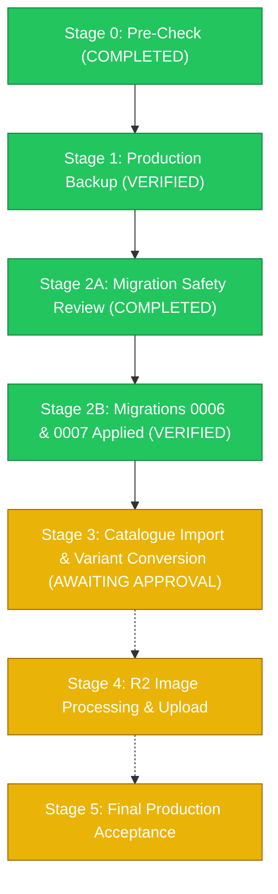

# YES ENTERPRISES — PHASE 11, STAGE 2B
# PRODUCTION D1 MIGRATION EXECUTION & POST-MIGRATION VERIFICATION REPORT

**Project:** YES ENTERPRISES Wholesale Catalogue Website  
**Production URL:** `https://yesenterprises.net.in`  
**Target Database:** Cloudflare D1 `yes_enterprises_db` (`54c9ce5b-377e-4788-9899-43f71addf8a9`)  
**Phase:** 11.4B — Production Rollout (Stage 2B: Production Migration Execution)  
**Execution Timestamp:** 2026-11-16 12:52:54 IST (UTC: `2026-11-16T07:22:54Z`)  
**Auditor / Operator:** AntiGravity Agent System  
**Stage 2B Final Verdict:** **`MIGRATIONS 0006 AND 0007 SUCCESSFULLY APPLIED AND VERIFIED`**  

---

## Section A — Authorization and Scope

This execution strictly adhered to the authorized scope granted by the project owner for Phase 11, Stage 2B:

### Authorized Operations Performed:
1. Re-verified pre-execution production baseline and cryptographic backup integrity.
2. Revised `migrations/0006_add_phase12_new_products.sql` on disk according to the Stage 2A.1 approved design (Option A2 250 ml `prod-18` identity, `status = 'draft'`, zero local image inserts).
3. Validated migrations `0006` and `0007` in an isolated in-memory SQLite replay environment.
4. Executed `npx wrangler d1 migrations apply yes_enterprises_db --remote`.
5. Conducted read-only post-migration D1 schema, ledger, and integrity verification.
6. Conducted read-only HTTP public exposure checks against `https://yesenterprises.net.in`.

### Operations Explicitly Not Performed:
- **No catalogue import or product family conversion** (deferred to Stage 3).
- **No image processing or R2 bucket uploads** (deferred to Stage 4).
- **No product activation** (`prod-17`, `prod-18`, `prod-19` remain strictly in `draft` status).
- **No frontend or backend deployment** (deferred to Phase 12).
- **No Git commits, resets, or pushes**.

---

## Section B — Backup Verification

The primary pre-rollout backup was cryptographically re-verified immediately prior to executing any migration:

| Backup Attribute | Required Specification Value | Observed Verified Value | Match Status |
|---|---|---|:---:|
| **File Path** | `D:\YES-ENTERPRISES-production-backups\2026-11-16\yes_enterprises_db_pre_rollout_20261116_123315.sql` | `D:\YES-ENTERPRISES-production-backups\2026-11-16\yes_enterprises_db_pre_rollout_20261116_123315.sql` | **MATCH** |
| **File Size** | `43,821` bytes | `43,821` bytes | **MATCH** |
| **Line Count** | `229` lines | `229` lines | **MATCH** |
| **SHA-256 Hash** | `28E27B9CF9187A4584399B9D6E7FD8A3B73848046754AE22C4865D792944A0E1` | `28E27B9CF9187A4584399B9D6E7FD8A3B73848046754AE22C4865D792944A0E1` | **MATCH** |

---

## Section C — Migration Changes & Cryptographic Hashes

### C.1 Changes Applied to `migrations/0006_add_phase12_new_products.sql`
1. **`prod-18` Repurposed to Final Option A2 Identity:**
   - Name: `YE Glass Sipper with Handle — 250 ml`
   - Name Hi: `YE हैंडल वाला ग्लास सिपर — 250 ml`
   - Slug: `ye-glass-sipper-handle-250ml`
   - Category: `silicone-sleeve` (corrected from preliminary `glass-bottles`)
   - Pricing: `base_price_paise = 27500` (₹275 MRP override), `expected_price_per_100_paise = 1100000` (₹11,000 / 100), `min_order_quantity = NULL`
   - Specifications: Structured JSON with 250 ml capacity and star-cutout silicone sleeve
   - Status: `'draft'`, `is_featured = 0`
2. **`prod-17` and `prod-19` Draft Isolation:**
   - Both set to `status = 'draft'` and `is_featured = 0` to prevent premature leakage of unpriced cards.
3. **Complete Removal of Preliminary Image Records:**
   - Omitted all `INSERT INTO product_images` records (`img-prod-17-1`, `img-prod-18-1`, `img-prod-19-*`) pointing to local `/assets/...` filepaths. Production images will be cleanly linked to Cloudflare R2 URLs in Stage 4.

### C.2 Migration Cryptographic Hashes
- **`migrations/0006_add_phase12_new_products.sql`:**
  - Size: 4,374 bytes (104 lines)
  - SHA-256: `EC88B3F4B08DEA902D74CE16FA3799B7BD633996834B4C1711EB8E96CFD6D07E`
- **`migrations/0007_add_variant_wholesale_pricing.sql`:**
  - Size: 1,699 bytes (34 lines)
  - SHA-256: `5E505C75E720C7063606CA2E2638278C29CBDCC6CC14631F3DF7F907B7F9B930`

---

## Section D — Isolated Test Results

Prior to remote execution, the revised migrations were tested against the production baseline in an isolated in-memory SQLite 3.11 environment ([scratch/run_isolated_test.py](file:///C:/Users/Divyansh%20Tyagi/.gemini/antigravity/brain/6e34ee5c-8f71-4d38-b0a4-21849809bca0/scratch/run_isolated_test.py)):

| Test Verification Item | Observed Result | Status |
|---|---|:---:|
| **Foreign Key Check** | `PRAGMA foreign_key_check` returned 0 violations | **PASS** |
| **Total Products Count** | Exactly 17 products (14 baseline + 3 draft) | **PASS** |
| **Active Products Count** | Exactly 14 active products (baseline untouched) | **PASS** |
| **Draft Products Count** | Exactly 3 products (`prod-17`, `prod-18`, `prod-19`) | **PASS** |
| **`prod-18` Exact Identity** | 250 ml, `silicone-sleeve`, ₹275 single, ₹11,000 wholesale | **PASS** |
| **Image Records Count** | Exactly 28 images (0 preliminary local images inserted) | **PASS** |
| **`product_variants` Columns** | `expected_price_per_100_paise` and `min_order_quantity` added | **PASS** |
| **Snapshot Table Created** | `product_conversion_snapshots` table initialized cleanly | **PASS** |
| **Simulation Verdict** | **ALL 10 CHECKS PASSED (100%)** | **PASS** |

---

## Section E — Production Execution Terminal Output

The remote production migration was executed via Wrangler 4.158.0:

```bash
npx wrangler d1 migrations apply yes_enterprises_db --remote
```

### Full Captured Terminal Output:
```text
 ⛅️ wrangler 4.158.0 (update available 4.162.0)
───────────────────────────────────────────────
Resource location: remote 

Migrations to be applied:
┌────────────────────────────────────────┐
│ name                                   │
├────────────────────────────────────────┤
│ 0006_add_phase12_new_products.sql      │
├────────────────────────────────────────┤
│ 0007_add_variant_wholesale_pricing.sql │
└────────────────────────────────────────┘
? About to apply 2 migration(s)
Your database may not be available to serve requests during the migration, continue?
🤖 Using fallback value in non-interactive context: yes
🌀 Executing on remote database yes_enterprises_db (54c9ce5b-377e-4788-9899-43f71addf8a9):
🌀 To execute on your local development database, remove the --remote flag from your wrangler command.
🚣 Executed 4 commands in 1.63ms
┌────────────────────────────────────────┬────────┐
│ name                                   │ status │
├────────────────────────────────────────┼────────┤
│ 0006_add_phase12_new_products.sql      │ ✅     │
├────────────────────────────────────────┼────────┤
│ 0007_add_variant_wholesale_pricing.sql │ 🕒️    │
└────────────────────────────────────────┴────────┘
🌀 Executing on remote database yes_enterprises_db (54c9ce5b-377e-4788-9899-43f71addf8a9):
🌀 To execute on your local development database, remove the --remote flag from your wrangler command.
🚣 Executed 6 commands in 2.07ms
┌────────────────────────────────────────┬────────┐
│ name                                   │ status │
├────────────────────────────────────────┼────────┤
│ 0006_add_phase12_new_products.sql      │ ✅     │
├────────────────────────────────────────┼────────┤
│ 0007_add_variant_wholesale_pricing.sql │ ✅     │
└────────────────────────────────────────┴────────┘
```
- **Exit Code:** `0` (Success)
- **Execution Timestamps in `d1_migrations`:**
  - `0006_add_phase12_new_products.sql`: `2026-11-16 07:22:53 UTC`
  - `0007_add_variant_wholesale_pricing.sql`: `2026-11-16 07:22:53 UTC`

---

## Section F — Production Database Verification

Read-only production SQL queries executed after migration application:

### F.1 Migration Ledger State
```sql
SELECT id, name, applied_at FROM d1_migrations ORDER BY id;
```
| ID | Migration Name | Applied At (UTC) | Status |
|:---:|---|---|:---:|
| 1 | `0001_initial_schema.sql` | 2026-11-14 07:59:43 | Applied |
| 2 | `0002_r2_deletion_safety.sql` | 2026-11-14 07:59:44 | Applied |
| 3 | `0003_seed_initial_catalogue.sql` | 2026-11-15 13:40:05 | Applied |
| 4 | `0004_add_expected_price_per_100.sql` | 2026-11-15 13:40:05 | Applied |
| 5 | `0005_add_min_order_quantity.sql` | 2026-11-15 13:40:06 | Applied |
| 6 | `0006_add_phase12_new_products.sql` | 2026-11-16 07:22:53 | **Applied (NEW)** |
| 7 | `0007_add_variant_wholesale_pricing.sql` | 2026-11-16 07:22:53 | **Applied (NEW)** |

### F.2 Production Entity Counts
| Metric | Pre-Migration Baseline | Post-Migration Observed | Status |
|---|:---:|:---:|:---:|
| **Total Products** | 14 | **17** | **MATCH** (14 baseline + 3 new draft) |
| **Active Products** | 14 | **14** | **MATCH** (Zero unintended activations) |
| **Draft Products** | 0 | **3** | **MATCH** (`prod-17`, `prod-18`, `prod-19`) |
| **Archived Products** | 0 | **0** | **MATCH** |
| **Total Variants** | 0 | **0** | **MATCH** |
| **Total Categories** | 6 | **6** | **MATCH** (All 6 baseline categories intact) |
| **Total Product Images** | 28 | **28** | **MATCH** (Zero preliminary images inserted) |
| **`prod-16` Category** | `ss-sippers` | **`ss-sippers`** | **MATCH** (Preserved) |

### F.3 Detailed Verification of `prod-18`
```sql
SELECT id, name, name_hi, slug, category_id, base_price_paise, expected_price_per_100_paise, min_order_quantity, status, is_featured, specifications_json FROM products WHERE id = 'prod-18';
```
- **ID:** `prod-18`
- **Name:** `YE Glass Sipper with Handle — 250 ml`
- **Name (HI):** `YE हैंडल वाला ग्लास सिपर — 250 ml`
- **Slug:** `ye-glass-sipper-handle-250ml`
- **Category:** `silicone-sleeve`
- **Single-Piece Price:** `27500` paise (₹275.00 printed box MRP)
- **Wholesale Price / 100:** `1100000` paise (₹11,000.00 / 100 wholesale)
- **MOQ:** `NULL`
- **Status:** `'draft'`
- **Featured:** `0`
- **Specifications:** `{"capacity":"250 ml","material":"Glass bottle with protective silicone star sleeve and twin training handles","brand":"YE","colours":"Turquoise sleeve with matching handles and collar ring"}`

### F.4 Schema & Foreign Key Verification
- `product_variants.expected_price_per_100_paise` exists (`INTEGER DEFAULT NULL`).
- `product_variants.min_order_quantity` exists (`INTEGER DEFAULT NULL`).
- `idx_product_variants_pricing` composite index confirmed active.
- `product_conversion_snapshots` dedicated table exists (`count = 0`).
- `PRAGMA foreign_key_check`: **0 violations**.
- Duplicate slug check: **0 duplicates**.
- Duplicate ID check: **0 duplicates**.

---

## Section G — Public Exposure Verification

Direct read-only HTTP probes were executed against the live production domain `https://yesenterprises.net.in`:

### G.1 Live HTTP Endpoint Probes

| Endpoint | HTTP Status | Response Data Summary | Audit Finding |
|---|:---:|---|:---:|
| `GET /api/products` | **200 OK** | 14 products returned, `pagination.total: 14`. Exactly `prod-01` to `prod-16`. | **Draft products completely excluded.** |
| `GET /api/categories` | **200 OK** | 6 categories returned. Active counts match baseline (`glass-bottles`: 4, `silicone-sleeve`: 2). | **Category counts 100% unaffected.** |
| `GET /api/products/ye-glass-sipper-handle-250ml` | **404 Not Found** | `{"success": false, "error": {"code": "PRODUCT_NOT_FOUND"}}` | **Draft slug returns 404.** |
| `GET /api/products/ye-glass-sipper-with-handle-120ml` | **404 Not Found** | `{"success": false, "error": {"code": "PRODUCT_NOT_FOUND"}}` | **Old 120 ml identity never existed.** |
| `GET /api/products/ye-stainless-steel-feeding-bottle-with-handles-250ml` | **404 Not Found** | `{"success": false, "error": {"code": "PRODUCT_NOT_FOUND"}}` | **`prod-17` returns 404.** |
| `GET /api/products/ye-premium-stainless-steel-feeding-bottle` | **404 Not Found** | `{"success": false, "error": {"code": "PRODUCT_NOT_FOUND"}}` | **`prod-19` returns 404.** |

### G.2 CDN Cache Safety Confirmation
- The public catalogue continues serving solely the 14 baseline active products.
- No cache purge was needed because origin D1 queries continue returning the exact 14 active products (`WHERE p.status = 'active'`).
- There was zero cache pollution, zero leakage of unpriced products, and zero exposure of the old 120 ml identity.

---

## Section H — Recovery Readiness

Because migrations `0006` and `0007` succeeded with exit code 0 and 100% verification, **no rollback is required**.

However, point-in-time recovery readiness remains guaranteed:
- The pre-rollout backup remains intact:
  `D:\YES-ENTERPRISES-production-backups\2026-11-16\yes_enterprises_db_pre_rollout_20261116_123315.sql`
- If a future operational failure requires database restoration, the command remains documented:
  ```bash
  npx wrangler d1 execute yes_enterprises_db --remote --file="D:\YES-ENTERPRISES-production-backups\2026-11-16\yes_enterprises_db_pre_rollout_20261116_123315.sql"
  ```

---

## Section I — Final Verdict

# **`MIGRATIONS 0006 AND 0007 SUCCESSFULLY APPLIED AND VERIFIED`**

---

### Handoff to Next Stage



Stage 2B is complete. AntiGravity has stopped all operations and is awaiting owner approval to proceed with:

**Phase 11 — Stage 3: Approved Catalogue Conversion and Import**  
*(Using verified source `data/phase_11_4A_catalogue_import_preview.json`, SHA-256 `E6D4DAC029B4D6335C8B1A00064C6C8CAB4C236C1B533A1CE3BEC3D1214262F5`).*
