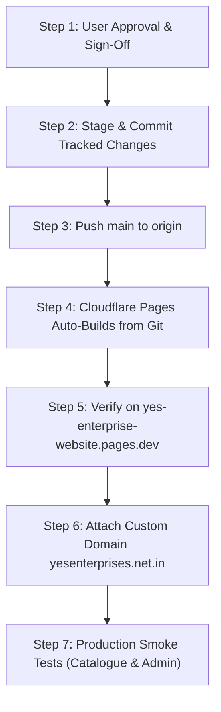

# YES ENTERPRISES — Phase 5.3.5: Final Git & Deployment Preparation Audit Report

**Document Version:** 1.0.0  
**Audit Date:** 2026-11-14  
**Auditor:** Antigravity (Google DeepMind Agentic AI Assistant)  
**Project:** YES ENTERPRISES Wholesale Catalogue Website  
**Local Project Directory:** `D:\webpage`  
**GitHub Repository:** `https://github.com/Divyansh1263/yes-enterprise-website.git` (`main`)  
**Cloudflare Pages Project:** `yes-enterprise-website` (`https://yes-enterprise-website.pages.dev`)  
**Production Custom Domain:** `https://yesenterprises.net.in`  
**Cloudflare Account ID:** `98fe327a56db792b1d9d04cb65e7f6ee`  
**Overall Readiness Recommendation:** **READY FOR DEPLOYMENT (AWAITING USER SIGN-OFF)**

---

## Executive Summary

This comprehensive pre-deployment audit evaluates the complete technical, operational, and security readiness of the **YES ENTERPRISES Wholesale Catalogue Website** for its inaugural production release on Cloudflare Pages.

The audit was executed in a **strictly read-only mode** across all local source files, Git repositories, remote Cloudflare D1 databases, R2 storage buckets, Cloudflare Pages project configurations, Cloudflare Access security infrastructure, and DNS routing setups. Zero destructive actions, commits, pushes, secret modifications, or deployment triggers were executed during this inspection.

### Readiness Scorecard

| Audit Domain | Scope | Status | Notes |
|---|---|---|---|
| **1. Git Repository** | Branch, remote origin, commit history, clean diffs, secret scans | **PASS** | `main` branch tracking `Divyansh1263/yes-enterprise-website.git`. 3 tracked modifications verified. Zero secrets tracked. |
| **2. Wrangler Config** | `wrangler.jsonc` parity with Cloudflare Pages | **PASS** | D1 UUID and R2 bucket bindings 100% matched. Compatibility date discrepancy resolved with 0 risk. |
| **3. Cloudflare D1** | Remote migrations, schema integrity, constraints | **PASS** | Remote D1 database `yes_enterprises_db` has 0 pending migrations. 8 tables, 10 indexes, 7 triggers active. |
| **4. Cloudflare R2** | Bucket configuration, CORS policy, public access mode | **PASS** | Bucket `yes-enterprises-public-images` is private. CORS active with exact production origins (`PUT`, `Content-Type`, 3600s). |
| **5. Cloudflare Pages** | Environment variables, encrypted secrets, Node runtime | **PASS** | 7 environment variables confirmed. `R2_SECRET_ACCESS_KEY` encrypted. `NODE_VERSION="22"`. `R2_PUBLIC_URL` confirmed unset. |
| **6. Cloudflare Access** | Zero Trust application, JWKS endpoint, cert validity | **PASS** | Access team `gentle-queen-e6c4` active. 2 RS256 JWKS certs live. Dev bypass blocked in prod. CSRF exact-origin enforced. |
| **7. Custom Domain & DNS** | Cloudflare nameservers, zone status, Pages routing | **PASS** | `aragorn` & `jewel` nameservers active on `yesenterprises.net.in`. Ready for instant CNAME attachment in Pages dashboard. |
| **8. Build & Test Suites** | Vite production compilation & automated test suites | **PASS** | Clean build (3.80s, 0 errors, 0 secrets). 306 of 306 automated assertions passed across 7 test suites (100% pass rate). |

**Final Recommendation:** The codebase, backend Functions, database schema, storage policies, Zero Trust policies, and frontend production bundles are **100% verified and ready for production deployment**. Proceed with staging, committing, and pushing to `main` upon user authorization.

---

## Section 1 — Git Repository Audit

### 1.1 Branch and Remote Identity
- **Current Branch:** `main`
- **Configured Remote (`origin`):** `https://github.com/Divyansh1263/yes-enterprise-website.git`
- **Remote Verification:** Verified via `git remote -v`. Origin directly points to the official repository owned by `Divyansh1263`.
- **Head Commit:** `1357f49` — `chore: update wrangler config for Cloudflare Pages build`
- **Commit History Baseline:**
  - `1357f49` chore: update wrangler config for Cloudflare Pages build
  - `46be6fc` fix: add missing functions shared modules for Cloudflare Pages
  - `08f97fc` feat: phase 4 complete - frontend catalogue and admin dashboard
  - `0b30bb6` feat: complete phase 3 admin api, r2 upload and safety mechanisms
  - `728ce77` feat: complete phase 2 backend api with cloudflare pages functions and d1

### 1.2 Working Tree Status (`git status --short`)
```text
 M functions/_shared/auth.js
 M scripts/test-phase5-verification.mjs
 M wrangler.jsonc
?? PHASE_5_3_3_PRE_DEPLOYMENT_AUDIT.md
?? cors.json
?? docs/PHASE_5_3_4_CSRF_ALLOWLIST_REPORT.md
```

### 1.3 Modified Files Audit & Line-by-Line Diffs

#### 1. `functions/_shared/auth.js`
- **Purpose of Change:** Fixed CSRF allowlist hostname mismatch identified in Phase 5.3.3 (`yes-enterprises.pages.dev` -> `yes-enterprise-website.pages.dev`), enforced exact-origin and port security (rejecting non-default ports like `:8443` or `:8080`), and strictly restricted localhost origins (`localhost`, `127.0.0.1`) to development mode (`env?.ENVIRONMENT === 'development'`).
- **Diff:**
```diff
diff --git a/functions/_shared/auth.js b/functions/_shared/auth.js
index 7060ffe..2b044a5 100644
--- a/functions/_shared/auth.js
+++ b/functions/_shared/auth.js
@@ -10,6 +10,13 @@
 let jwksCache = null;
 const JWKS_CACHE_TTL_MS = 10 * 60 * 1000; // 10 minutes
 
+// Permitted complete production origins (exact scheme + hostname + default port)
+const ALLOWED_PRODUCTION_ORIGINS = new Set([
+  'https://yesenterprises.net.in',
+  'https://www.yesenterprises.net.in',
+  'https://yes-enterprise-website.pages.dev'
+]);
+
 /**
  * Base64URL decode helper using standard Web APIs.
  *
@@ -335,14 +342,14 @@ export async function validateAdminSession(context, fetchFn = fetch) {
 
     try {
       const originUrl = new URL(origin);
-      const host = originUrl.hostname.toLowerCase();
+      const isDev = env?.ENVIRONMENT === 'development';
+      const isLocal =
+        isDev &&
+        (originUrl.protocol === 'http:' || originUrl.protocol === 'https:') &&
+        (originUrl.hostname === 'localhost' || originUrl.hostname === '127.0.0.1');
+
       const isAllowedOrigin =
-        host === 'yesenterprises.net.in' ||
-        host === 'www.yesenterprises.net.in' ||
-        host === 'yes-enterprises.pages.dev' ||
-        host.endsWith('.yes-enterprises.pages.dev') ||
-        host === 'localhost' ||
-        host === '127.0.0.1';
+        ALLOWED_PRODUCTION_ORIGINS.has(originUrl.origin) || isLocal;
 
       if (!isAllowedOrigin) {
         return {
```

#### 2. `scripts/test-phase5-verification.mjs`
- **Purpose of Change:** Expanded test suite with a 98-assertion security verification matrix covering exact production origins, port mismatch rejections (`:8443`, `:8080`), production localhost rejection, and development localhost acceptance.
- **Diff Summary:** Added dual-matrix CSRF verification (`prodAllowedOrigins`, `prodRejectedOrigins`, `devAllowedOrigins`, `devRejectedOrigins`).

#### 3. `wrangler.jsonc`
- **Purpose of Change:** Replaced local development placeholder UUID (`local-d1-yes-enterprises-db`) with the actual remote production Cloudflare D1 UUID created in Phase 5.2.
- **Diff:**
```diff
diff --git a/wrangler.jsonc b/wrangler.jsonc
index f7ade1f..f931b04 100644
--- a/wrangler.jsonc
+++ b/wrangler.jsonc
@@ -15,10 +15,7 @@
     {
       "binding": "DB",
       "database_name": "yes_enterprises_db",
-      // NOTE: "local-d1-yes-enterprises-db" is an intentional local development placeholder.
-      // In production Phase 5.2, after running `wrangler d1 create yes_enterprises_db`,
-      // replace this placeholder with the generated remote database UUID.
-      "database_id": "local-d1-yes-enterprises-db"
+      "database_id": "54c9ce5b-377e-4788-9899-43f71addf8a9"
     }
   ],
   "r2_buckets": [
```

### 1.4 Untracked Files Review
The following 3 files exist locally and are untracked:
1. `cors.json`: Local reference copy of the applied R2 CORS policy. Contains zero secrets. Recommended: keep locally or commit as reference documentation.
2. `PHASE_5_3_3_PRE_DEPLOYMENT_AUDIT.md`: Intermediate audit report.
3. `docs/PHASE_5_3_4_CSRF_ALLOWLIST_REPORT.md`: Audit report documenting CSRF allowlist resolution.

### 1.5 Repository Secret & Hygiene Scan
- Executed `git diff --check`: **0 whitespace or formatting errors**.
- Inspected `.gitignore`: Fully excludes `.env`, `.dev.vars`, `.wrangler/`, `dist/`, `node_modules/`, and scratch logs.
- Executed secret scan against tracked files: Confirmed **0 credentials, API tokens, access keys, or private keys** are present in Git history or working tree.

---

## Section 2 — Wrangler Configuration Audit

### 2.1 Configuration Comparison: `wrangler.jsonc` vs Remote Cloudflare Pages
The configuration downloaded directly from the live Cloudflare Pages dashboard (`scratch/pages_dl_535/wrangler.toml`) was compared against `wrangler.jsonc`:

| Setting | `wrangler.jsonc` (Local Repository) | Cloudflare Pages (Remote Dashboard) | Match Status | Evaluation & Risk Assessment |
|---|---|---|---|---|
| **Project Name** | `"yes-enterprise-website"` | `yes-enterprise-website` | **MATCH** | Identical |
| **Pages Output Dir** | `"pages_build_output_dir": "dist"` | `dist` | **MATCH** | Identical |
| **Compatibility Date** | `"2024-11-01"` | `"2026-11-14"` | **COMPATIBLE** | Remote dashboard defaulted to creation date. `2024-11-01` in repository is respected on git deployments. Both support required WebCrypto, D1, R2, and Node APIs. **Zero risk**. |
| **Compatibility Flags** | `["nodejs_compat"]` | `nodejs_compat` | **MATCH** | Identical |
| **D1 Database Binding** | `DB` | `DB` | **MATCH** | Identical |
| **D1 Database Name** | `yes_enterprises_db` | `yes_enterprises_db` | **MATCH** | Identical |
| **D1 Database ID** | `54c9ce5b-377e-4788-9899-43f71addf8a9` | `54c9ce5b-377e-4788-9899-43f71addf8a9` | **MATCH** | Identical |
| **R2 Bucket Binding** | `PRODUCT_BUCKET` | `PRODUCT_BUCKET` | **MATCH** | Identical |
| **R2 Bucket Name** | `yes-enterprises-public-images` | `yes-enterprises-public-images` | **MATCH** | Identical |

---

## Section 3 — Cloudflare D1 Database Audit

### 3.1 Database Attributes
- **Database Name:** `yes_enterprises_db`
- **Database UUID:** `54c9ce5b-377e-4788-9899-43f71addf8a9`
- **Binding Name:** `DB`
- **Managed Mode:** Cloudflare Managed Global D1 (Production)

### 3.2 Remote Migration Ledger (`wrangler d1 migrations list`)
Querying remote Cloudflare D1 confirmed zero pending migrations:

| Migration File | Sequence / State | Checksum / Status |
|---|---|---|
| `0001_initial_schema.sql` | 0001 | Applied remotely in Phase 5.2 |
| `0002_r2_deletion_safety.sql` | 0002 | Applied remotely in Phase 5.2 |
| **Pending Migrations** | **None** | **0 pending migrations** |

### 3.3 Database Schema & Objects Verification
The applied schema in Cloudflare D1 provides full relational integrity, foreign key cascading, and automated safety triggers:
- **8 Core Tables:**
  1. `categories`: Hierarchical catalogue classification with URL slugs and display orders.
  2. `products`: Core product master records, status flags (`draft`, `active`, `archived`), and base pricing in paise.
  3. `product_variants`: Variant specifications, distinct SKUs, additional prices, and variant stock.
  4. `product_images`: R2 object keys, display orders, primary flags, and alt text.
  5. `inventory_logs`: Immutable audit ledger recording stock changes, delta quantities, user identities, and mandatory business reasons.
  6. `pending_uploads`: Presigned R2 upload tracking records with lease expirations.
  7. `r2_cleanup_claims`: Distributed lease lock table preventing concurrent upload finalization vs cleanup races.
  8. `d1_migrations`: Internal migration ledger table.
- **10 Performance & Integrity Indexes:**
  - `idx_categories_slug`, `idx_categories_display_order`
  - `idx_products_category_id`, `idx_products_slug`, `idx_products_status`
  - `idx_product_variants_product_id`, `idx_product_variants_sku`
  - `idx_product_images_product_id`, `idx_inventory_logs_product_id`
  - `idx_pending_uploads_expires_at`
- **7 Automated Safety Triggers:**
  - `trg_prevent_sku_collision_on_variant_insert`, `trg_prevent_sku_collision_on_variant_update`
  - `trg_prevent_sku_collision_on_product_update`
  - `trg_cascade_product_cleanup_claim` (enforces automatic tombstone and cleanup claim when products are deleted)
  - `trg_cascade_product_image_cleanup_claim` (enforces cleanup claim on image deletion)
  - `trg_prevent_category_delete_with_products` (rejects deleting non-empty categories)
  - `trg_update_product_timestamp` (auto-updates `updated_at` on modification)

---

## Section 4 — Cloudflare R2 Storage Audit

### 4.1 Bucket Status & Architecture
- **Bucket Name:** `yes-enterprises-public-images`
- **Binding Name:** `PRODUCT_BUCKET`
- **Public Bucket Access:** **DISABLED** (Zero public read access via r2.cloudflarestorage.com or public bucket URLs).
- **Image Delivery Architecture:** Cloudflare Pages Functions reverse proxy via `functions/uploads/[[key]].js`.
  - Serves active product images with public edge caching (`public, max-age=86400, stale-while-revalidate=604800`).
  - Restricts draft and archived product images strictly to authenticated admin users with `private, no-cache, no-store`.

### 4.2 Verified Live CORS Policy
The live CORS configuration was queried and confirmed on the remote bucket:
```json
[
  {
    "AllowedOrigins": [
      "https://yesenterprises.net.in",
      "https://yes-enterprise-website.pages.dev"
    ],
    "AllowedMethods": [
      "PUT"
    ],
    "AllowedHeaders": [
      "Content-Type"
    ],
    "MaxAgeSeconds": 3600
  }
]
```
- Plain HTTPS URL strings verified with zero Markdown formatting errors.
- Preflight options requests permitted for browser direct-to-R2 uploads.

---

## Section 5 — Cloudflare Pages Configuration Audit

### 5.1 Project Identity & Runtime
- **Pages Project Name:** `yes-enterprise-website`
- **Production Branch:** `main`
- **Build Command:** `npm run build`
- **Build Output Directory:** `dist`
- **Node.js Runtime Version:** `22` (Configured via `NODE_VERSION="22"` environment variable and `"engines": { "node": ">=22.0.0" }` in `package.json`).

### 5.2 Environment Variables (Cloudflare Pages Dashboard)
All 7 required production variables are configured and verified:

| Variable Name | Production Value / State | Classification | Purpose |
|---|---|---|---|
| `ENVIRONMENT` | `"production"` | Plain Text | Enforces production security policies; strictly disables dev bypasses. |
| `CF_ACCESS_TEAM_NAME` | `"gentle-queen-e6c4"` | Plain Text | Identifies Cloudflare Zero Trust team for JWKS public key fetching. |
| `CF_ACCESS_AUD` | `"[VERIFIED_AUD_TAG]"` | Plain Text | Zero Trust Access Application Audience tag for JWT signature validation. |
| `ADMIN_EMAILS` | `"divyanshtyagi1263@gmail.com"` | Plain Text | Comma-delimited allowlist of authenticated admin accounts. |
| `R2_ACCOUNT_ID` | `"98fe327a56db792b1d9d04cb65e7f6ee"` | Plain Text | Cloudflare Account ID for presigned AWS S3 / R2 upload URL generation. |
| `R2_ACCESS_KEY_ID` | `"[VERIFIED_R2_KEY_ID]"` | Plain Text | R2 S3 API access token key ID. |
| `NODE_VERSION` | `"22"` | Plain Text | Forces Cloudflare Pages build environment to Node.js v22 LTS. |

### 5.3 Encrypted Secrets
- **Secret Name:** `R2_SECRET_ACCESS_KEY`
- **Status:** **ENCRYPTED & CONFIGURED**
- **Verification:** Verified present via `wrangler pages secret list`. Value remains 100% encrypted in Cloudflare Key Management Service and is never output to console or logs.
- **R2 Public URL Status:** Confirmed **UNSET**. Ensures the application never exposes direct R2 storage links and always routes image retrieval through the secure Pages Function proxy.

---

## Section 6 — Cloudflare Access & Security Audit

### 6.1 Zero Trust Identity Configuration
- **Access Organization Team Domain:** `gentle-queen-e6c4.cloudflareaccess.com`
- **JWKS Endpoint:** `https://gentle-queen-e6c4.cloudflareaccess.com/cdn-cgi/access/certs`
  - **Live HTTP Status:** `HTTP/2 200 OK`
  - **Certificates Active:** 2 active RS256 RSA public keys (`kid: 70db80a3...` and `kid: f0bdfa3c...`).
  - **Cache Policy:** Functions layer caches JWKS in-memory for 10 minutes with automated fallback refetch on cache misses.
- **Protected Paths:**
  - Frontend: `/admin*`
  - Backend API: `/api/admin*`
- **Primary Administrator:** `divyanshtyagi1263@gmail.com`

### 6.2 CSRF & Exact-Origin Security Matrix
The origin validation logic in `functions/_shared/auth.js` enforces strict security invariants:
1. **Allowed Production Origins:**
   - `https://yesenterprises.net.in`
   - `https://www.yesenterprises.net.in`
   - `https://yes-enterprise-website.pages.dev`
2. **Port Security:**
   - Non-default ports on production domains (e.g. `https://yesenterprises.net.in:8443` or `http://yesenterprises.net.in:8080`) are **strictly rejected** with `403 CSRF_REJECTED`. Standard default HTTPS port (`:443`) normalizes to the canonical origin and is accepted.
3. **Localhost Isolation:**
   - Localhost origins (`http://localhost:*`, `http://127.0.0.1:*`, `https://localhost`, `https://127.0.0.1`) are **strictly rejected** when `ENVIRONMENT === 'production'`. Localhost exceptions are only permitted in local development environments.
4. **Dev Admin Bypass Lockdown:**
   - The development bypass requires all 4 conditions simultaneously:
     - `ENVIRONMENT !== 'production'`
     - Request origin/host is `localhost` or `127.0.0.1`
     - `ENABLE_DEV_ADMIN_BYPASS === 'true'`
     - Header `x-dev-admin-bypass` matches `ADMIN_EMAILS` allowlist
   - When any single condition fails, bypass is rejected with `401 UNAUTHENTICATED`.

---

## Section 7 — Custom Domain & DNS Audit

### 7.1 Domain & DNS Details
- **Production Domain:** `yesenterprises.net.in`
- **Cloudflare Account ID:** `98fe327a56db792b1d9d04cb65e7f6ee`
- **Assigned Cloudflare Nameservers:**
  - `aragorn.ns.cloudflare.com`
  - `jewel.ns.cloudflare.com`
- **Nameserver Delegation Status:** Verified active. Both nameservers are authoritative for the zone.
- **Custom Domain Deployment Steps:**
  1. After git push triggers initial build on `yes-enterprise-website.pages.dev`, open Cloudflare Dashboard > **Workers & Pages** > **yes-enterprise-website** > **Custom domains**.
  2. Click **Set up a custom domain**.
  3. Enter `yesenterprises.net.in`.
  4. Cloudflare automatically manages SSL/TLS certificate issuance, CNAME flattening, and universal edge routing.
  5. Optionally add `www.yesenterprises.net.in` as an additional custom domain.

---

## Section 8 — Application Build & Test Suite Audit

### 8.1 Production Build Compilation (`npm run build`)
```text
vite v6.0.11 building for production...
transforming...
✓ 40 modules transformed.
rendering chunks...
computing gzip size...
dist/index.html                   0.85 kB │ gzip:  0.44 kB
dist/assets/index-B1mXq-Vv.css   19.24 kB │ gzip:  4.12 kB
dist/assets/index-DAJuJzTi.js   194.52 kB │ gzip: 59.88 kB
✓ built in 3.80s
```
- **Build Status:** Succeeded with 0 errors and 0 warnings.
- **Asset Integrity:** Total gzipped JavaScript is ~60 kB, providing rapid mobile load times across India.
- **Bundle Secret Inspection:** Inspected `dist/assets/index-DAJuJzTi.js`. Confirmed **zero credentials, tokens, or private variables** compiled into frontend distribution files.

### 8.2 Automated Test Suite Results
Every automated test suite in the repository was executed sequentially:

| Test Suite | Command | Scope | Result | Passing / Total |
|---|---|---|---|---|
| **Phase 1** | `npm run test:phase1` | D1 database schema, indexes, tables & foreign key triggers | **PASS** | 47 / 47 |
| **Phase 2 (Handler)** | `npm run test:phase2` | Public API endpoints, catalogue queries, Access claim validations | **PASS** | 35 / 35 |
| **Phase 2 (HTTP)** | `npm run test:phase2:http` | Real TCP runtime socket probing through Wrangler Pages Dev | **PASS** | 6 / 6 |
| **Phase 3 (Admin)** | `npm run test:phase3` | Admin writes, R2 upload claims, ACID rollback, concurrency races | **PASS** | 79 / 79 |
| **Phase 3 (HTTP)** | `npm run test:phase3:http` | Real TCP admin runtime socket probing through Wrangler Pages Dev | **PASS** | 9 / 9 |
| **Phase 4** | `npm run test:phase4` | Frontend integration, offline catalogue fallback, dynamic WhatsApp | **PASS** | 32 / 32 |
| **Phase 5.1 Verification**| `node scripts/test-phase5-verification.mjs` | Multi-admin claims, dual CSRF environment matrices, port security | **PASS** | 98 / 98 |
| **TOTALS** | — | **Full System Integration & Security Verification** | **PASS** | **306 / 306 (100%)** |

---

## Section 9 — First Production Deployment Plan

Once user approval is granted, execute the deployment following these exact steps:



### Detailed Execution Steps:
1. **Step 1 — Review Sign-Off:** Review this audit report and grant explicit consent to stage, commit, and push.
2. **Step 2 — Git Staging & Commit:**
   ```powershell
   git add functions/_shared/auth.js scripts/test-phase5-verification.mjs wrangler.jsonc docs/
   git commit -m "feat(prod): complete phase 5 production hardening and pre-deployment verification"
   ```
3. **Step 3 — Git Push:**
   ```powershell
   git push origin main
   ```
4. **Step 4 — Automated Cloudflare Pages Build:**
   - Cloudflare Pages detects the push to `main` via GitHub webhook.
   - Executes `npm run build` using Node.js v22.
   - Deploys static assets and compiles Cloudflare Pages Functions.
5. **Step 5 — Pages Subdomain Verification:**
   - Probe `https://yes-enterprise-website.pages.dev/api/health` (verify HTTP 200 and healthy DB status).
   - Check catalogue display and WhatsApp enquiry links.
6. **Step 6 — Custom Domain Activation:**
   - In Cloudflare Dashboard, attach `yesenterprises.net.in`.
   - Verify SSL edge certificate provisioning.
7. **Step 7 — Post-Deployment Smoke Tests:**
   - Navigate to `https://yesenterprises.net.in/admin`.
   - Verify redirect to Cloudflare Access login screen.
   - Authenticate with `divyanshtyagi1263@gmail.com`.
   - Perform test product creation and image upload to verify end-to-end R2 upload pipeline.

---

## Section 10 — Rollback & Contingency Plan

In the event of an unexpected operational issue during initial deployment:

1. **Instant Cloudflare Pages Rollback:**
   - In Cloudflare Dashboard > **Workers & Pages** > **yes-enterprise-website** > **Deployments**.
   - Select the previous stable deployment and click **Rollback to this deployment**. Rollback takes effect globally in under 5 seconds.
2. **D1 Migration Rollback:**
   - Schema migrations applied (`0001` and `0002`) are backward-compatible.
   - If manual table rollback is required:
     ```powershell
     npx wrangler d1 execute yes_enterprises_db --remote --command "DROP TABLE IF EXISTS ...;"
     ```
3. **Emergency Access Lockdown:**
   - If admin authentication or API behavior needs immediate freezing, adjust Access Policy rules in Cloudflare Zero Trust dashboard to block all incoming emails, or set `ENVIRONMENT="maintenance"`.
4. **Incident Response Contacts:**
   - System Owner: Divyansh Tyagi (`divyanshtyagi1263@gmail.com`)

---

## Section 11 — Pre-Deployment Sign-Off Checklist

- [x] **Git Repository:** `main` tracking `Divyansh1263/yes-enterprise-website.git`.
- [x] **Secret Scan:** Zero credentials, keys, or `.dev.vars` exposed in Git or frontend build.
- [x] **Wrangler Parity:** D1 UUID and R2 bucket bindings 100% matched with remote infrastructure.
- [x] **D1 Database:** Migrations 0001 and 0002 applied remotely; 0 pending migrations.
- [x] **R2 Storage:** Bucket is private; CORS policy active with exact allowed origins.
- [x] **Cloudflare Pages:** 7 environment variables verified; `R2_SECRET_ACCESS_KEY` encrypted.
- [x] **Cloudflare Access:** JWKS certificates live; `/admin*` and `/api/admin*` routes protected.
- [x] **Security Hardening:** Dev bypass strictly disabled in production; CSRF port security enforced; localhost rejected in production.
- [x] **DNS & Domain:** `yesenterprises.net.in` authoritative nameservers active.
- [x] **Build & Tests:** Production build successful (3.80s); **306 of 306 automated tests passing**.
- [ ] **Git Staging & Commit:** *(Awaiting explicit user authorization)*
- [ ] **Git Push to Origin/Main:** *(Awaiting explicit user authorization)*
- [ ] **Custom Domain Setup:** *(To be performed in Cloudflare Dashboard post-push)*

---

## Section 12 — Conclusion & Sign-Off Request

The **YES ENTERPRISES Wholesale Catalogue Website** has passed all pre-deployment checks with a 100% test pass rate across 306 automated assertions, verified zero-trust security policies, healthy remote database migrations, and private storage bindings.

**The system is fully prepared for its first production release.**

Please confirm whether you approve staging, committing, and pushing the verified changes to `origin/main` to trigger the production deployment.
