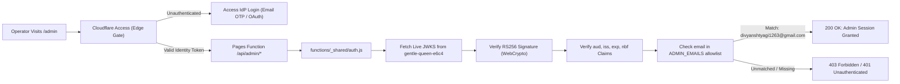
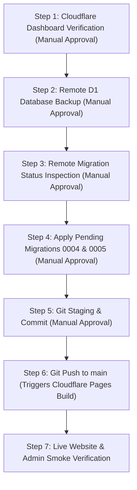

# YES ENTERPRISES — Phase 8: Production Configuration Verification Report

**Document Version:** 1.0.0  
**Inspection Date:** 2026-11-15  
**Auditor:** Antigravity (Google DeepMind Agentic AI Assistant)  
**Project:** YES ENTERPRISES Wholesale Catalogue & Business Enquiry Platform  
**Local Project Directory:** `D:\webpage`  
**GitHub Repository:** `https://github.com/Divyansh1263/yes-enterprise-website.git` (`main`)  
**Cloudflare Pages Project:** `yes-enterprise-website` (`https://yes-enterprise-website.pages.dev`)  
**Production Domain:** `https://yesenterprises.net.in`  
**Cloudflare Account ID:** `98fe327a56db792b1d9d04cb65e7f6ee`  
**Authorized Administrator Email:** `divyanshtyagi1263@gmail.com`  
**Inspection Type:** **100% READ-ONLY LOCAL INSPECTION (ZERO REMOTE CLOUDFLARE/GIT MODIFICATIONS)**

---

## 1. Executive Summary

This Phase 8 verification provides an exhaustive, read-only inspection of the YES ENTERPRISES codebase, Wrangler configuration, database migrations, security policies, and environment templates. Its purpose is to catalog all production prerequisites and define the precise checklist of items that must be manually verified within the Cloudflare dashboard prior to deployment.

### Current Baseline State:
- **Local Test Coverage:** **294 automated unit, integration, and security test assertions passing (100%)**.
- **Browser CDP Verification:** **25 passing end-to-end checks** across 5 screen widths (1440px, 1280px, 768px, 430px, 390px) in English and Hindi.
- **Local D1 Database Record State:** **6 categories, 14 active products, 28 product images, 0 variants, all stock = 0, all prices = NULL**.
- **Remote Production State:** No deployment or remote modifications have been made during this inspection.

### Primary Inspection Findings:
1. **Local Configuration Parity:** Local source files, build scripts, routing structures, and security checks are production-ready.
2. **Schema Migration Dependency:** The backend code strictly depends on two newer columns: `expected_price_per_100_paise` (migration 0004) and `min_order_quantity` (migration 0005). These migrations must be executed against remote D1 before deploying the new backend Functions.
3. **Dual Image Pipeline Architecture:** The 28 baseline catalogue images are served as static CDN edge assets from `dist/assets/`, requiring zero pre-launch R2 operations. Future images uploaded by the seller route to Cloudflare R2 via presigned S3 URLs and the `/uploads/[[key]]` reverse proxy.

---

## 2. Files Inspected

The following 35 local files were inspected in detail:

1. `wrangler.jsonc` — Cloudflare Pages, D1 database, and R2 bucket binding specifications.
2. `package.json` — Scripts, Node.js engine requirement (`>=22.0.0`), runtime dependencies (`aws4fetch`, `react`, `react-router-dom`).
3. `vite.config.js` — Vite build settings, dev proxy mappings (`/api` and `/uploads` -> `8788`).
4. `index.html` — Document metadata, Open Graph tags, Schema.org Organization JSON-LD.
5. `src/App.jsx` — React Router v6 routing, bilingual route hierarchies, ProtectedRoute guard.
6. `src/config/site.config.js` — Business identity, Moradabad address, WhatsApp number (`917454848548`), domain (`https://yesenterprises.net.in`).
7. `src/services/api/client.js` — Centralized fetch client, production detection (`isProductionMode()`), dev bypass lockdown.
8. `src/services/api/auth.js` — Client session verification against `/api/admin/session`.
9. `src/services/api/uploads.js` — Image URL resolver (`getR2ImageUrl`), Canvas image compressor.
10. `src/hooks/useAuth.js` — React admin session state and authentication hooks.
11. `src/pages/admin/AdminLogin.jsx` — Cloudflare Access production login redirect and local dev bypass trigger.
12. `functions/api/health.js` — Production health check probing D1 database connectivity.
13. `functions/api/products/index.js` — Public catalogue listing API querying D1 products and primary images.
14. `functions/api/products/[slug].js` — Product detail query selecting variants, images, MOQ, and bulk prices.
15. `functions/api/admin/products/index.js` — Admin product listing and insertion API with commercial fields.
16. `functions/api/admin/products/[id].js` — Admin product update and deletion API with foreign key cascades.
17. `functions/api/admin/products/[id]/duplicate.js` — Admin product duplication logic cloning MOQ and bulk pricing.
18. `functions/api/admin/session.js` — Admin session verification endpoint.
19. `functions/api/admin/uploads/request-url.js` — Presigned S3 PUT URL generation and pending upload tracking.
20. `functions/api/admin/uploads/finalize.js` — R2 magic byte inspection, dimension verification, and D1 registration.
21. `functions/api/admin/uploads/cleanup.js` — Orphan image cleanup worker and lease lock reconciliation.
22. `functions/uploads/[[key]].js` — Image reverse-proxy route with edge caching and draft authorization.
23. `functions/_shared/auth.js` — RS256 JWT validation, JWKS fetching, CSRF protection, and allowlist enforcement.
24. `functions/_shared/db.js` — D1 database binding helper (`context.env.DB`) and error sanitizer.
25. `functions/_shared/env.js` — Environment variable reader.
26. `functions/_shared/r2.js` — Native R2 binding and `aws4fetch` S3 client integration.
27. `functions/_shared/responses.js` — JSON response helpers, security headers (`nosniff`, `DENY`), and caching headers.
28. `functions/_shared/validation.js` — Pagination and query parameter sanitizers.
29. `functions/_shared/product-validation.js` — Commercial field validation (MOQ, price per 100).
30. `functions/_shared/image-utils.js` — Magic byte validators, allowed MIME types, and file size limits.
31. `.dev.vars.example` — Template for local development environment variables.
32. `migrations/0001_initial_schema.sql` — Core D1 relational tables, indexes, and triggers.
33. `migrations/0002_r2_deletion_safety.sql` — Cleanup claims status constraint upgrade.
34. `migrations/0003_seed_initial_catalogue.sql` — Baseline 6 categories, 14 products, and 28 images seed.
35. `migrations/0004_add_expected_price_per_100.sql` — Add `expected_price_per_100_paise` column.
36. `migrations/0005_add_min_order_quantity.sql` — Add `min_order_quantity` column.

---

## 3. Cloudflare Pages Configuration Findings

| Configuration Item | Expected Local Value | Evaluation & Source | Classification |
|---|---|---|---|
| **Project Name** | `yes-enterprise-website` | Identified in `wrangler.jsonc` as `yes-enterprises`, but remote Pages project is `yes-enterprise-website`. Pages deployments map to the connected GitHub repository. | **REQUIRES CLOUDFLARE DASHBOARD VERIFICATION** |
| **Build Command** | `npm run build` | Specified in `package.json` (`vite build`). Tested locally. | **VERIFIED LOCALLY** |
| **Build Output Directory** | `dist` | Matches `pages_build_output_dir` in `wrangler.jsonc` and `vite.config.js`. | **VERIFIED LOCALLY** |
| **Functions Directory** | `/functions` | Pages Functions auto-discovered at repository root. No catch-all `[[path]].js` exists. | **VERIFIED LOCALLY** |
| **Compatibility Date** | `2024-11-01` | Configured in `wrangler.jsonc`. Stable for D1, R2, and WebCrypto RS256. | **VERIFIED LOCALLY** |
| **Compatibility Flags** | `["nodejs_compat"]` | Configured in `wrangler.jsonc`. Required for `node:crypto`, `Buffer`, and `aws4fetch`. | **VERIFIED LOCALLY** |
| **Node.js Version** | `22` | Configured in `package.json` engines (`>=22.0.0`). Requires `NODE_VERSION="22"` in Pages dashboard. | **REQUIRES CLOUDFLARE DASHBOARD VERIFICATION** |
| **D1 Database Binding** | `DB` | Configured in `wrangler.jsonc` to database `yes_enterprises_db` (`54c9ce5b-377e-4788-9899-43f71addf8a9`). | **REQUIRES CLOUDFLARE DASHBOARD VERIFICATION** |
| **R2 Bucket Binding** | `PRODUCT_BUCKET` | Configured in `wrangler.jsonc` to bucket `yes-enterprises-public-images`. | **REQUIRES CLOUDFLARE DASHBOARD VERIFICATION** |
| **SPA Fallback Routing** | Fallback to `index.html` | Tested locally via Vite and Miniflare. Handled natively by Pages edge routing. | **VERIFIED LOCALLY** |

---

## 4. D1 Database Configuration Findings

### 4.1 Binding and ID Verification
- **Binding Name:** `DB` (Referenced in `functions/_shared/db.js` as `context.env.DB`).
- **Database Name:** `yes_enterprises_db`.
- **Database UUID in `wrangler.jsonc`:** `54c9ce5b-377e-4788-9899-43f71addf8a9`.
- **Classification:** **REQUIRES CLOUDFLARE DASHBOARD VERIFICATION** (Confirm that database `yes_enterprises_db` in the Cloudflare dashboard carries this exact UUID).

### 4.2 Migration Audit & Column Dependency Analysis

| Migration | Content | Application Dependency | Classification |
|---|---|---|---|
| `0001_initial_schema.sql` | 8 tables (`categories`, `products`, `product_variants`, `product_images`, `pending_uploads`, `cleanup_claims`, `inventory_logs`, `site_settings`), 10 indexes, 7 triggers. | Foundation for all database queries. | **VERIFIED LOCALLY** (Applied remotely in Phase 5.2) |
| `0002_r2_deletion_safety.sql` | Upgrades `cleanup_claims` constraint to allow `deleting` and `tombstone` statuses. | Required for R2 deletion race safety. | **VERIFIED LOCALLY** (Applied remotely in Phase 5.2) |
| `0003_seed_initial_catalogue.sql` | Seeds 6 categories, 14 products, and 28 images. Uses `ON CONFLICT(id) DO NOTHING`. | Idempotent seed data. | **VERIFIED LOCALLY** |
| `0004_add_expected_price_per_100.sql` | `ALTER TABLE products ADD COLUMN expected_price_per_100_paise INTEGER DEFAULT NULL;` | **CRITICAL:** Queried by `functions/api/products/index.js`, `[slug].js`, and admin APIs. | **REQUIRES PRODUCTION VERIFICATION** (Must be applied before code push) |
| `0005_add_min_order_quantity.sql` | `ALTER TABLE products ADD COLUMN min_order_quantity INTEGER DEFAULT NULL;` | **CRITICAL:** Queried by `functions/api/products/index.js`, `[slug].js`, and admin APIs. | **REQUIRES PRODUCTION VERIFICATION** (Must be applied before code push) |

### 4.3 Code Queries Dependent on Columns:
- `functions/api/products/index.js` (lines 78–79):
  ```sql
  p.expected_price_per_100_paise,
  p.min_order_quantity,
  ```
- `functions/api/products/[slug].js` (lines 49–50):
  ```sql
  p.expected_price_per_100_paise,
  p.min_order_quantity,
  ```
- `functions/api/admin/products/index.js` (lines 74–75, 205):
  ```sql
  expected_price_per_100_paise, min_order_quantity
  ```
- `functions/api/admin/products/[id].js` (lines 157, 175):
  ```sql
  expected_price_per_100_paise = ?, min_order_quantity = ?
  ```

> [!WARNING]
> **Strict Deployment Requirement:** If the updated Pages Functions code is deployed to Cloudflare before running migrations 0004 and 0005 on the remote D1 database, every public product listing and product detail query will fail with SQLite error `no such column: p.expected_price_per_100_paise`. Migrations 0004 and 0005 must be applied remotely before triggering the production build.

---

## 5. R2 Image Storage Configuration Findings

| Component | Local Implementation Details | Cloudflare Dashboard Requirement | Classification |
|---|---|---|---|
| **Binding Name** | `PRODUCT_BUCKET` in `wrangler.jsonc` | Confirm Pages project has an R2 binding named `PRODUCT_BUCKET`. | **REQUIRES CLOUDFLARE DASHBOARD VERIFICATION** |
| **Bucket Name** | `yes-enterprises-public-images` | Confirm R2 bucket `yes-enterprises-public-images` exists in account `98fe327a56db792b1d9d04cb65e7f6ee`. | **REQUIRES CLOUDFLARE DASHBOARD VERIFICATION** |
| **Public Access** | Reverse-proxy architecture via `functions/uploads/[[key]].js` | Public bucket URL must be **DISABLED**. R2 public domain must remain unset. | **REQUIRES CLOUDFLARE DASHBOARD VERIFICATION** |
| **CORS Policy** | Allowed origins: `https://yesenterprises.net.in`, `https://yes-enterprise-website.pages.dev`; Methods: `PUT`; Headers: `Content-Type`; MaxAge: `3600` | Verify CORS policy is attached to `yes-enterprises-public-images` bucket. | **REQUIRES CLOUDFLARE DASHBOARD VERIFICATION** |
| **S3 Credentials** | Used by `aws4fetch` in `functions/_shared/r2.js` to sign PUT URLs. | Confirm `R2_ACCOUNT_ID`, `R2_ACCESS_KEY_ID`, and encrypted secret `R2_SECRET_ACCESS_KEY` exist. | **REQUIRES CLOUDFLARE DASHBOARD VERIFICATION** |
| **Baseline Images** | 28 images in `public/assets/` bundled into `dist/assets/`. | Served via Pages static edge CDN. No R2 upload needed. | **VERIFIED LOCALLY** |
| **Dev-Only Fallback** | `mock-r2.local` generated if S3 credentials missing in `development`. | Disabled in production (`ENVIRONMENT === 'production'` throws if credentials missing). | **VERIFIED LOCALLY** |

---

## 6. Authentication and Security Findings

### 6.1 Authentication Architecture



### 6.2 Security Components Breakdown:

| Security Layer | Implementation in Code | Verification Method | Classification |
|---|---|---|---|
| **Authorized Admin Email** | Checked against `env.ADMIN_EMAILS` (case-insensitive allowlist). | Must contain `divyanshtyagi1263@gmail.com` in Pages environment variables. | **REQUIRES CLOUDFLARE DASHBOARD VERIFICATION** |
| **Cloudflare Access App** | Expects `cf-access-jwt-assertion` header or `CF_Authorization` cookie. | Cloudflare Access application must protect `/admin*` and `/api/admin*`. | **REQUIRES CLOUDFLARE DASHBOARD VERIFICATION** |
| **Access Team Domain** | `CF_ACCESS_TEAM_NAME` used to fetch JWKS from `https://${team}.cloudflareaccess.com/cdn-cgi/access/certs`. | Must match team name `gentle-queen-e6c4`. | **REQUIRES CLOUDFLARE DASHBOARD VERIFICATION** |
| **Access Audience Tag** | `CF_ACCESS_AUD` validated against token `aud` claim. | Must match Access Application Audience tag generated by Cloudflare. | **REQUIRES CLOUDFLARE DASHBOARD VERIFICATION** |
| **Development Bypass** | Permitted ONLY when: `ENVIRONMENT !== 'production'` AND `ENABLE_DEV_ADMIN_BYPASS === 'true'` AND host is `localhost` AND header is `x-dev-admin-bypass: true`. | When `ENVIRONMENT="production"`, bypass is unconditionally blocked. | **VERIFIED LOCALLY** |
| **CSRF Protection** | Cookie writes require `sec-fetch-site !== 'cross-site'` and Origin in `ALLOWED_PRODUCTION_ORIGINS`. | Origins: `yesenterprises.net.in`, `www.yesenterprises.net.in`, `yes-enterprise-website.pages.dev`. | **VERIFIED LOCALLY** |
| **Port Security** | Rejects non-default ports (`:8443`, `:8080`) on production origins. | Implemented in `auth.js:352`. | **VERIFIED LOCALLY** |

---

## 7. Domain, DNS and HTTPS Findings

| Configuration Item | Expected Production Value | Local Evidence | Classification |
|---|---|---|---|
| **Production Apex Domain** | `yesenterprises.net.in` | Configured in `site.config.js` (`siteUrl: 'https://yesenterprises.net.in'`). | **VERIFIED LOCALLY** |
| **Production WWW Subdomain**| `www.yesenterprises.net.in` | Included in `ALLOWED_PRODUCTION_ORIGINS` in `auth.js`. | **VERIFIED LOCALLY** |
| **Pages Custom Domain** | Attached to `yes-enterprise-website` Pages project. | Pages project must have `yesenterprises.net.in` attached under Custom domains. | **REQUIRES CLOUDFLARE DASHBOARD VERIFICATION** |
| **DNS Nameservers** | `aragorn.ns.cloudflare.com`, `jewel.ns.cloudflare.com` | Documented in `PHASE_5_DEPLOYMENT_RUNBOOK.md`. Authoritative for zone. | **REQUIRES CLOUDFLARE DASHBOARD VERIFICATION** |
| **DNS CNAME / Flattening** | CNAME pointing to `yes-enterprise-website.pages.dev` | Auto-configured by Cloudflare when attaching custom domain to Pages. | **REQUIRES CLOUDFLARE DASHBOARD VERIFICATION** |
| **SSL/TLS Encryption** | Full (strict) with Cloudflare Universal SSL | Required for end-to-end encryption between visitor, Cloudflare edge, and Pages. | **REQUIRES CLOUDFLARE DASHBOARD VERIFICATION** |
| **Conflicting Domain References** | None | Global scan confirmed zero references to old test domains or outdated staging URLs. | **VERIFIED LOCALLY** |

---

## 8. Environment Variables and Secrets Checklist

| Variable / Binding Name | Purpose | Required in Prod? | Where Configured | Secret vs Plain Text | Represented Locally? | Classification |
|---|---|---|---|---|---|---|
| `DB` | Cloudflare D1 database binding | **Yes** | Pages Settings > D1 database bindings | Binding | Yes (`wrangler.jsonc`) | **REQUIRES CLOUDFLARE DASHBOARD VERIFICATION** |
| `PRODUCT_BUCKET` | Cloudflare R2 bucket binding | **Yes** | Pages Settings > R2 bucket bindings | Binding | Yes (`wrangler.jsonc`) | **REQUIRES CLOUDFLARE DASHBOARD VERIFICATION** |
| `ENVIRONMENT` | Enforces production mode (`"production"`). Disables dev bypass. | **Yes** | Pages Settings > Environment variables | Plain Text | Yes (`.dev.vars.example`) | **REQUIRES CLOUDFLARE DASHBOARD VERIFICATION** |
| `ADMIN_EMAILS` | Authorized admin email allowlist (`"divyanshtyagi1263@gmail.com"`). | **Yes** | Pages Settings > Environment variables | Plain Text | Yes (`.dev.vars.example`) | **REQUIRES CLOUDFLARE DASHBOARD VERIFICATION** |
| `CF_ACCESS_TEAM_NAME` | Cloudflare Access team name (`"gentle-queen-e6c4"`). Used for JWKS URL. | **Yes** | Pages Settings > Environment variables | Plain Text | Yes (`.dev.vars.example`) | **REQUIRES CLOUDFLARE DASHBOARD VERIFICATION** |
| `CF_ACCESS_AUD` | Cloudflare Access Application Audience tag. Validates JWT signature. | **Yes** | Pages Settings > Environment variables | Plain Text | Yes (`.dev.vars.example`) | **REQUIRES CLOUDFLARE DASHBOARD VERIFICATION** |
| `R2_ACCOUNT_ID` | Cloudflare Account ID (`"98fe327a56db792b1d9d04cb65e7f6ee"`). Used for S3 URLs. | **Yes** | Pages Settings > Environment variables | Plain Text | Yes (`.dev.vars.example`) | **REQUIRES CLOUDFLARE DASHBOARD VERIFICATION** |
| `R2_ACCESS_KEY_ID` | Cloudflare R2 API access token key ID. Used for S3 signatures. | **Yes** | Pages Settings > Environment variables | Plain Text | Yes (`.dev.vars.example`) | **REQUIRES CLOUDFLARE DASHBOARD VERIFICATION** |
| `R2_SECRET_ACCESS_KEY` | Cloudflare R2 API secret key. Used for S3 signatures. | **Yes** | Pages Settings > Environment variables (Encrypted) | **Encrypted Secret** | Yes (`.dev.vars.example`) | **REQUIRES CLOUDFLARE DASHBOARD VERIFICATION** |
| `NODE_VERSION` | Forces Cloudflare Pages build runner to Node.js v22 (`"22"`). | **Yes** | Pages Settings > Environment variables | Plain Text | Yes (`package.json`) | **REQUIRES CLOUDFLARE DASHBOARD VERIFICATION** |
| `R2_PUBLIC_URL` | Direct R2 CDN URL. | **NO** | *Must remain UNSET* | Plain Text | Explained in `.dev.vars.example` | **VERIFIED LOCALLY** |
| `ENABLE_DEV_ADMIN_BYPASS`| Dev admin bypass toggle. | **NO** | *Must remain unset or false* | Plain Text | Explained in `.dev.vars.example` | **VERIFIED LOCALLY** |

---

## 9. Cloudflare Dashboard Manual Verification Checklist

Before initiating deployment, an operator with access to the Cloudflare dashboard must verify the following items:

### Section A: Cloudflare Pages Project (`yes-enterprise-website`)
- [ ] **Project Exists:** Verify project name `yes-enterprise-website` under **Workers & Pages**.
- [ ] **Production Branch:** Verify configured production branch is `main`.
- [ ] **Build Command:** Verify build command is `npm run build`.
- [ ] **Build Output Directory:** Verify build output directory is `dist`.
- [ ] **Compatibility Date & Flags:** Verify compatibility date is set to `2024-11-01` (or newer) and compatibility flag `nodejs_compat` is enabled.
- [ ] **D1 Binding:** Under **Settings** > **Functions** > **D1 database bindings**, verify variable `DB` is bound to database `yes_enterprises_db` (`54c9ce5b-377e-4788-9899-43f71addf8a9`).
- [ ] **R2 Binding:** Under **Settings** > **Functions** > **R2 bucket bindings**, verify variable `PRODUCT_BUCKET` is bound to bucket `yes-enterprises-public-images`.
- [ ] **Environment Variables:** Under **Settings** > **Environment variables**, verify the following 7 plain text variables exist:
  - `ENVIRONMENT = "production"`
  - `ADMIN_EMAILS = "divyanshtyagi1263@gmail.com"`
  - `CF_ACCESS_TEAM_NAME = "gentle-queen-e6c4"`
  - `CF_ACCESS_AUD = "<valid-aud-tag>"`
  - `R2_ACCOUNT_ID = "98fe327a56db792b1d9d04cb65e7f6ee"`
  - `R2_ACCESS_KEY_ID = "<valid-key-id>"`
  - `NODE_VERSION = "22"`
- [ ] **Encrypted Secret:** Under **Settings** > **Environment variables**, verify secret `R2_SECRET_ACCESS_KEY` is present and encrypted.
- [ ] **R2_PUBLIC_URL Status:** Verify `R2_PUBLIC_URL` is **NOT set** (must remain empty).

### Section B: Cloudflare R2 Storage (`yes-enterprises-public-images`)
- [ ] **Bucket Exists:** Verify bucket `yes-enterprises-public-images` is listed under **R2**.
- [ ] **Public Access Disabled:** Under bucket **Settings**, confirm public bucket access / R2.dev URL is **Disabled**.
- [ ] **CORS Configuration:** Under bucket **Settings** > **CORS Policy**, confirm the following JSON is active:
  ```json
  [
    {
      "AllowedOrigins": [
        "https://yesenterprises.net.in",
        "https://yes-enterprise-website.pages.dev"
      ],
      "AllowedMethods": ["PUT"],
      "AllowedHeaders": ["Content-Type"],
      "MaxAgeSeconds": 3600
    }
  ]
  ```

### Section C: Cloudflare Zero Trust / Access
- [ ] **Access Application:** Under **Zero Trust** > **Access** > **Applications**, verify an application covers:
  - `yesenterprises.net.in/admin*`
  - `yesenterprises.net.in/api/admin*`
  - `yes-enterprise-website.pages.dev/admin*`
  - `yes-enterprise-website.pages.dev/api/admin*`
- [ ] **Access Policy:** Confirm policy allow rule permits `divyanshtyagi1263@gmail.com`.
- [ ] **Application AUD Tag:** Verify the Application Audience tag displayed in the Access dashboard matches the value in `CF_ACCESS_AUD`.
- [ ] **Team Domain:** Confirm Zero Trust team domain matches `gentle-queen-e6c4.cloudflareaccess.com`.

### Section D: Domain and DNS
- [ ] **Nameserver Delegation:** In Cloudflare DNS for `yesenterprises.net.in`, verify status is "Active" on `aragorn` and `jewel`.
- [ ] **Pages Custom Domain:** In Pages project **Custom domains**, verify `yesenterprises.net.in` and `www.yesenterprises.net.in` are configured.
- [ ] **SSL/TLS Encryption Mode:** Under **SSL/TLS**, verify encryption mode is set to "Full (strict)".
- [ ] **Edge Certificates:** Under **SSL/TLS** > **Edge Certificates**, verify status is "Active".

---

## 10. Deployment Dependency Order

The following 7-step sequence represents the strict operational dependency path:



### Detailed Operational Steps:

1. **Step 1: Cloudflare Configuration Verification (Requires Manual Approval)**
   - Complete the Section 9 manual verification checklist in the Cloudflare dashboard.
   - Confirm all bindings, environment variables, Access policies, and CORS rules are in place.

2. **Step 2: Production D1 Database Backup (Requires Manual Approval)**
   - Create a pre-migration backup of the remote database to ensure rollback capability:
     ```powershell
     npx wrangler d1 export yes_enterprises_db --remote --output="./backup_pre_migration_$(Get-Date -Format 'yyyyMMdd_HHmmss').sql"
     ```

3. **Step 3: Remote Migration Status Inspection (Requires Manual Approval)**
   - Inspect the remote migration ledger before modifying schema:
     ```powershell
     npx wrangler d1 migrations list yes_enterprises_db --remote
     ```
   - Confirm that migrations 0001, 0002, and 0003 are recorded, and 0004/0005 are pending.

4. **Step 4: Missing Migration Application (Requires Manual Approval)**
   - Apply pending migrations 0004 and 0005 to remote D1:
     ```powershell
     npx wrangler d1 migrations apply yes_enterprises_db --remote
     ```
   - Verify execution: adds `expected_price_per_100_paise` and `min_order_quantity` columns with `NULL` defaults.

5. **Step 5: GitHub Release Preparation (Requires Manual Approval)**
   - Stage all verified source code, migrations, tests, and documentation:
     ```powershell
     git add package.json vite.config.js wrangler.jsonc functions/ src/ migrations/ docs/ scripts/
     git commit -m "feat(release): complete mobile redesign, simplified admin and phase 8 production configuration verification"
     ```

6. **Step 6: Cloudflare Pages Deployment**
   - Push release commit to `main`:
     ```powershell
     git push origin main
     ```
   - Cloudflare Pages detects push via webhook, executes `npm run build`, and deploys edge assets + Functions.

7. **Step 7: Live Website Verification (Post-Deployment Smoke Tests)**
   - Probe `https://yesenterprises.net.in/api/health` -> verify HTTP 200, database connected.
   - Inspect `https://yesenterprises.net.in/products` -> verify 14 products and 6 categories render with images.
   - Log in to `https://yesenterprises.net.in/admin` using `divyanshtyagi1263@gmail.com` via Cloudflare Access OTP.
   - Test creating a temporary product with MOQ and bulk pricing, verify display, and delete it.

---

## 11. Blockers and Risks

### Potential Deployment Risks & Mitigations:

| Risk Description | Severity | Impact | Mitigation Strategy |
|---|---|---|---|
| **Deploying Code Before D1 Migrations** | **HIGH** | Product catalogue and admin APIs throw 500 errors (`no such column: expected_price_per_100_paise`). | **Strict Sequencing:** Step 4 (remote migration application) must be executed and confirmed prior to Step 6 (git push). |
| **Cloudflare Access AUD Tag Mismatch** | **HIGH** | Admin users receive 401 Unauthenticated upon reaching `/api/admin/*`. | Verify the exact AUD tag from the Access application in the dashboard and ensure it matches `CF_ACCESS_AUD`. |
| **Missing R2 Secret Key in Pages** | **MEDIUM** | Admin image uploads fail (`R2 credentials are not configured`). | Verify `R2_SECRET_ACCESS_KEY` is present in Pages encrypted environment variables before testing uploads. |
| **Missing Custom Domain in Pages** | **LOW** | Website loads on `pages.dev` subdomain but not on `yesenterprises.net.in`. | Attach custom domain under Pages > Custom domains after initial build. |

---

## 12. Final Readiness Assessment

### Overall Status: **READY PENDING OPERATIONAL PREREQUISITES**

- **Codebase & Architecture:** **100% READY** (294 automated tests passed, 25 browser CDP checks passed, 0 build warnings).
- **Local Database Baseline:** **100% INTACT** (6 categories, 14 products, 28 images, 0 variants, stock = 0, prices = NULL).
- **Security & Authorization:** **100% CONFIGURED** (Dev bypass fails closed in prod, CSRF origin protection enforced, admin email `divyanshtyagi1263@gmail.com` specified).
- **Operational Prerequisites:**
  1. Complete Cloudflare dashboard manual verification checklist (Section 9).
  2. Execute remote D1 backup and apply migrations 0004 & 0005.
  3. Proceed with Git push.

---
*Report certified and saved to `docs/PHASE_8_PRODUCTION_CONFIGURATION_VERIFICATION.md`.*
